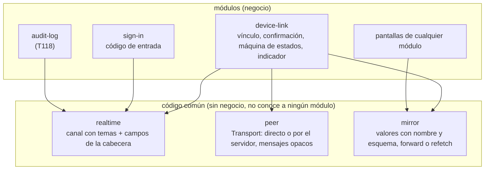

# ADR-017: Un canal con temas para lo que llega del servidor, y un espejo de valores con nombre

**Estado:** propuesto; lo aprueba Carlos con el diseño de 03 (paso 5). Precisa cómo se construyen las
formas `piggyback`, `temporary` y `peer` del [ADR-003](ADR-003-realtime-connections.md). El diseño
completo está en [device-link.md](../modules/device-link.md).

## Contexto

El capítulo 03 pide tres cosas que van juntas:

- **Un solo mecanismo** para todo lo que llega del servidor sin pedirlo (03 · R7.1): el vínculo, la
  espera del código de entrada y lo que venga (la auditoría que se actualiza sola, T118), con a lo sumo
  un canal por pestaña a la vista y lo no urgente en las respuestas que ya existen (R7.2).
- **Que el celular y la computadora se hablen directo por el Wi-Fi**, con el servidor solo para
  presentarlos y de respaldo, sin reintentar solos y sin nada de fondo (R3).
- **Que muestren lo mismo**: la pantalla, lo abierto encima y lo escrito, sin repetir por la conexión
  directa los pedidos al servidor (R6).

Carlos pidió además que sea reutilizable, que gaste lo mínimo de datos, que sea robusto ante cambios
y siga el principio abierto/cerrado, y que se pueda diagnosticar, porque los errores de esta parte no
se reproducen a voluntad.

Lo que pesa en la decisión: cada espera con su propio canal repite la reconexión, los topes y el
latido, y dos a la vez son dos canales; la cabecera `X-Ferrebress` ya viaja en cada respuesta y puede
llevar unos bytes más; lo que muestra una pantalla de Preact es su estado (lo abierto, lo escrito, lo
elegido, lo que trajo el servidor), no una lista de acciones; y el servidor no ve la conexión directa,
así que no puede cortarla cuando un vínculo termina.

## Decisión

### 1. El canal: temas sobre un solo SSE por pestaña

- Cada módulo **declara temas** (`realtime.topic`): nombre, parámetro, forma del evento, quién puede
  escuchar y con qué clave (`authorize`), y qué mandar al empezar a escuchar (`onSubscribe`). La pantalla
  pide un tema con `useTopic`; la aplicación abre **un** SSE por pestaña con todos los temas pedidos, solo
  a la vista y con red, y lo cierra cuando no queda ninguno. Sumar o sacar temas es un `POST` sobre el
  canal abierto. Un tema rechazado no impide los otros.
- **Cada tema manda su estado de ahora al suscribirse.** Reconectarse es seguro y el canal no guarda lo
  perdido ni usa `Last-Event-ID`.
- **Latido de 40 s** con un solo temporizador; la aplicación da el canal por cortado a los 55 s sin nada.
  Tener el canal abierto no cuenta como uso de la sesión, y el hub cierra los canales de las sesiones
  que terminan o vencen.
- **Lo no urgente va como un campo de la cabecera** que contribuye cada módulo (`header.contribute`). El
  del vínculo es una huella de 8 caracteres (`l=`): no guarda nada, sobrevive a un reinicio y la
  aplicación la lee antes de devolver la respuesta.
- La espera del código de entrada pasa a ser el tema `sign-in.codes`, con un emisor de códigos de 60 s
  común (`rotating-codes`) que usa también el código de vincular.

### 2. La conexión entre los dos: un transporte con dos variantes

- **La interfaz `Transport`** lleva mensajes `Json` que no conoce, con un tope de 64 KB; valida quien la
  usa. **Directo:** WebRTC con un solo canal de datos ordenado y confiable, **sin STUN ni TURN**, con los
  candidatos filtrados a los del Wi-Fi (también con permiso de cámara, que hace que Chrome muestre las
  direcciones reales). La computadora ofrece y decide cuándo falló. **Por el servidor:** quien lo crea le
  da cómo mandar y cómo recibir; el servidor mira el vínculo y la sesión del otro en cada lote.
- Cuál usar lo decide la máquina de estados del vínculo («directo, y si no se logra, por el servidor»),
  no una lista de transportes: las reglas nombran cada uno.

### 3. El espejo replica el estado a la vista, no acciones

- Lo que se ve vive en **valores con nombre**, cada uno con su esquema (`useMirrored(clave, inicial,
  esquema)`). Sin vínculo son valores comunes. Lo que la pantalla elige sola por su forma (`auto`) no
  viaja.
- Cada cambio viaja como un **parche** con un reloj de Lamport, y gana el último (registro LWW, con la
  computadora en el empate). La **foto** que manda la computadora al conectarse es un parche más, con un
  reloj por encima del más alto que dijo el celular: no hay una segunda regla.
- **Lo que trae el servidor** va en `useMirroredQuery` con un modo: `forward` (por el directo lo pide el que
  manda y el otro recibe por el Wi-Fi) o `refetch` (cada uno pide el suyo, porque el pedido depende del
  dispositivo o del permiso). Por el servidor, todo es `refetch`. Quién manda se lo dice el módulo que
  usa el espejo.

### 4. La confirmación del vínculo

El servidor no puede cortar una conexión entre dos navegadores. Por eso **cada dispositivo exige, antes de
mandar o aplicar cualquier cosa por el directo, una confirmación del servidor de menos de 4 minutos**: que
el vínculo existe y que la sesión del otro lado, la que registró la huella DTLS de **esta** conexión al
presentarse, sigue abierta. Antes de una foto, de menos de 30 s. Solo confirma quien está en uso, sin
temporizador. Sin internet, sigue con la última buena hasta que vuelva (R3.4). Las escrituras llevan su
vínculo y el servidor las rechaza si terminó. El que sigue en regla no depende de enterarse por
casualidad: la exigencia está en su propio código, y el dispositivo cortado no puede producir la
confirmación.

### 5. La máquina de estados, pura, con un diario

`step(estado, evento) → { estado, comandos }`, con estados que guardan solo datos (los transportes vivos
los guarda quien ejecuta), que el tipo no deja combinar mal, y comandos que ejecuta otra pieza. Cada evento
queda con sus datos en un diario de 300 entradas sin datos personales, que se puede volver a correr para
reproducir un error.

### 6. Dos patrones fuera de la lista de la constitución

- **Registro** (de temas, de campos de la cabecera, de lo que suma cada módulo a `/api/start`): cada módulo
  suma el suyo sin tocar la pieza común. Es lo que hace abierto/cerrado al canal.
- **Registro LWW por clave:** el mínimo de sincronización que deja a dos dispositivos que escriben a la
  vez con el mismo valor, sin coordinarse ni bloquear.

## Opciones descartadas

| Opción | A favor | En contra |
|---|---|---|
| **Un canal SSE por funcionalidad** (como el de entrada) | Cada uno simple y aislado | Dos esperas a la vez son dos canales y dos latidos (R7.2); cada una repite reconexión, topes y latido |
| **WebSocket** en lugar de SSE más POST | Un canal que va y vuelve | Más piezas en Caddy y en el servidor; para lo que llega del servidor alcanza SSE, y lo que sube es poco (ADR-003) |
| **Consultas a ritmo fijo** para enterarse de algo | Lo más simple | Gastan datos aunque no pase nada (00 · R4.3) |
| **Guardar lo perdido y reenviarlo** (`Last-Event-ID`) | Nada se pierde en un corte | Una lista por canal en memoria; que cada tema mande su estado al suscribirse da lo mismo sin guardar nada |
| **Un buzón de señales por dispositivo** | Sirve para cualquier tema | Guarda estado que se pierde al reiniciar y hay que borrar; para el vínculo alcanza una huella calculada. Si un tema lo necesita, se suma con la misma forma de campo |
| **STUN público** (el de Google) para el directo | Algunas redes más logran el directo | Un servicio externo que ve las direcciones del local; el directo es solo por el Wi-Fi (R3.1) |
| **TURN propio** | El respaldo también sería WebRTC | Un servicio más que operar, con su puerto UDP; el respaldo por HTTPS ya existe y pasa por Caddy |
| **Un permiso firmado por el servidor que los dos se pasan** (en vez de la confirmación) | El otro lo verifica sin preguntar | Una llave más que crear, rotar y publicar, con los mismos pedidos para renovarlo; la confirmación con la huella DTLS da lo mismo sin criptografía nueva |
| **Confiar en que el que sigue en regla se entere** | Ningún pedido de más | Por el directo no se entera hasta su próximo pedido, que puede no llegar: un celular cortado seguiría viendo y manejando la pantalla |
| **Replicar acciones con nombre** | Pocos bytes por toque | Habría que llevar cada toque de cada pantalla a un punto único; una acción que pide al servidor no da lo mismo en los dos; lo escrito letra por letra no es una acción |
| **Mandar la pantalla** (el HTML o una captura) | Nada que cambiar en las pantallas | Mucho más pesado; la otra forma (celular o computadora) no sale de la misma pantalla |
| **CRDT completos** (Yjs, Automerge) | Edición simultánea de textos sin perder letras | Decenas de KB y una biblioteca de peso para un caso que no pasa: una sola persona usa los dos |
| **Que cada dispositivo pida siempre lo suyo** | Sin reenviar respuestas | Por el directo, el celular pagaría con datos lo que puede recibir gratis por el Wi-Fi |
| **Reenviar las respuestas también por el servidor** | Los dos ven exactamente lo mismo | El celular baja sin comprimir lo que pedido le llegaba comprimido |
| **Una pestaña que reparte el canal a las otras** (`BroadcastChannel` y un candado) | Un solo canal por dispositivo aunque haya dos ventanas a la vista | Unas 150 líneas y casos nuevos para ahorrar un latido en un caso raro |

## Consecuencias

- **Sumar algo que llega del servidor** es declarar un tema y pedirlo desde la pantalla; T118 queda en
  eso. Sumar un campo de la cabecera es una contribución más.
- **Las pantallas guardan lo que se ve en valores con nombre** con su esquema y piden al servidor con
  `useMirroredQuery`; `pnpm check` exige el esquema y que cada `useState` de una pantalla diga por qué es
  local. Es un cambio en las pantallas que ya existen (frame, users, audit-log, manual), sin cambiar lo que
  hacen.
- **El espejo cuenta como uso de las sesiones** de los dos mientras se usa, porque cada uno confirma con
  su sesión (lo decide Carlos, diseño § 22).
- **El directo depende del Wi-Fi del local:** si aísla los equipos o bloquea mDNS, van por el servidor,
  que gasta datos; la tira del día lo muestra (R4.4) y el registro del servidor dice por qué.
- **Con varias copias del servidor,** el hub, los códigos, la memoria de los vínculos y sus sesiones pasan
  a PostgreSQL (`LISTEN/NOTIFY` y una tabla chica). `NOTIFY` lleva como mucho 8.000 bytes: el reenvío
  necesita entonces que los dos lados de un vínculo caigan en la misma copia, o una tabla de paso.
- `peer/rtc.ts` (lo que habla con `RTCPeerConnection`) y el candado de pestañas quedan fuera de la
  cobertura y se prueban de punta a punta (ADR-005); la lógica del directo tiene pruebas unitarias.
