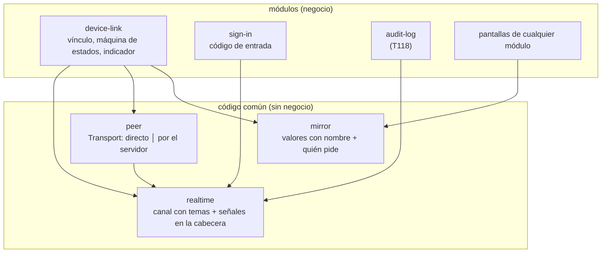

# ADR-017: Un canal con temas para lo que llega del servidor, y un espejo de valores con nombre

**Estado:** propuesto; lo aprueba Carlos con el diseño de 03 (paso 5). Precisa cómo se construyen las formas `piggyback`, `temporary` y `peer` del
[ADR-003](ADR-003-realtime-connections.md). El diseño completo está en
[device-link.md](../modules/device-link.md).

## Contexto

El capítulo 03 pide tres cosas que van juntas:

- **Un solo mecanismo** para todo lo que llega del servidor sin pedirlo (03 · R7.1): el vínculo, la
  espera del código de entrada y lo que venga (la auditoría que se actualiza sola, T118), con a lo sumo
  un canal abierto, solo mientras una pantalla a la vista lo necesita, y lo no urgente en las
  respuestas que ya existen (R7.2).
- **Que el celular y la computadora se hablen directo por el Wi-Fi**, con el servidor solo para
  presentarlos y de respaldo, sin reintentar solos y sin nada de fondo (R3).
- **Que muestren lo mismo**: la pantalla, lo abierto encima y lo escrito, sin repetir los pedidos al
  servidor (R6).

Carlos pidió además que sea reutilizable, que gaste lo mínimo de datos, que sea robusto ante cambios
y siga el principio abierto/cerrado, y que se pueda diagnosticar, porque los errores de esta parte no
se reproducen a voluntad.

Lo que pesa en la decisión: cada espera con su propio canal repite la reconexión, los topes y el
latido, y dos a la vez son dos canales; la cabecera `X-Ferrebress` ya viaja en cada respuesta y puede
llevar unos bytes más; y lo que muestra una pantalla de Preact es su estado (lo abierto, lo escrito, lo
elegido, lo que trajo el servidor), no una lista de acciones.

## Decisión

### 1. El canal: temas sobre un solo SSE por pestaña

- Cada módulo **declara temas** (`realtime.topic`): nombre, parámetro, quién puede escuchar
  (`authorize`) y qué mandar al empezar a escuchar (`onSubscribe`). La pantalla pide un tema con
  `useTopic`; la aplicación abre **un** SSE por pestaña con todos los temas pedidos, solo con la pestaña
  a la vista y con red, y lo cierra cuando no queda ninguno. Sumar o sacar temas es un `POST` sobre el
  canal abierto.
- **Cada tema manda su estado de ahora al suscribirse.** Así reconectarse es seguro y el canal no
  guarda lo perdido ni usa `Last-Event-ID`.
- **Latido de 40 s** con un solo temporizador en el servidor; la aplicación da el canal por cortado a
  los 55 s sin nada (R7.2: menos de un minuto). Tener el canal abierto no cuenta como uso de la sesión.
- **Lo no urgente va como señal en la cabecera:** `s=<tema>:<versión>` en `X-Ferrebress`, solo con una
  señal sin leer; el tema decide si pide algo.
- La espera del código de entrada pasa a ser el tema `sign-in.codes`, con un emisor de códigos de 60 s
  común (`rotating-codes`) que usa también el código de vincular.

### 2. La conexión entre los dos: un transporte con dos variantes (estrategia)

- **Directo:** WebRTC con un solo canal de datos ordenado y confiable, **sin STUN ni TURN**
  (`iceServers: []`): solo candidatos del Wi-Fi, escondidos con mDNS. Roles fijos (la computadora
  ofrece), oferta y respuesta con todos los candidatos en un mensaje cada una, 5 s de plazo. La
  presentación va por el tema del vínculo y el canal se cierra apenas se encuentran.
- **Por el servidor:** `POST` de ida, con los mensajes de 50 ms juntos, y el tema del vínculo de vuelta;
  el servidor no guarda nada.
- La máquina de estados del vínculo pide «un transporte» y no sabe cuál le tocó.

### 3. El espejo replica el estado a la vista, no acciones

- Lo que se ve vive en **valores con nombre** (`mirroredStore`, `useMirrored`): la dirección, lo
  abierto encima, lo escrito, lo elegido. Sin vínculo son valores comunes.
- Cada cambio viaja como un **parche** con un reloj de Lamport, y gana el último (registro LWW, con la
  computadora en el empate). Al conectarse, la computadora manda una **foto** de todo (R6.3).
- **Lo que trae el servidor** va en `useMirroredQuery`: por el directo lo pide la computadora y el
  celular recibe la respuesta por el Wi-Fi; por el servidor (si Carlos lo aprueba, diseño § 19 punto 2)
  cada uno pide lo suyo y viajan solo los parches. Lo que cambia algo (un POST) lo hace solo quien lo
  tocó.

### 4. La máquina de estados, pura, con un diario

`step(estado, evento) → { estado, efectos }`, con estados que el tipo no deja combinar mal y efectos
como comandos que ejecuta otra pieza. Cada evento queda en un diario de 300 entradas, sin datos
personales, que se puede volver a correr para reproducir un error.

### 5. Dos patrones fuera de la lista de la constitución

- **Registro de temas:** cada módulo suma el suyo al hub sin tocarlo. Es lo que hace abierto/cerrado
  al canal; sin él, el hub conocería cada tema.
- **Registro LWW por clave:** el mínimo de sincronización que deja a dos dispositivos que escriben a la
  vez con el mismo valor, sin coordinarse ni bloquear.

## Opciones descartadas

| Opción | A favor | En contra |
|---|---|---|
| **Un canal SSE por funcionalidad** (como el de entrada) | Cada uno simple y aislado | Dos esperas a la vez son dos canales y dos latidos (R7.2); cada una repite reconexión, topes y latido |
| **WebSocket** en lugar de SSE más POST | Un canal que va y vuelve | Más piezas en Caddy y en el servidor; para lo que llega del servidor alcanza SSE, y lo que sube es poco (ADR-003) |
| **Consultas a ritmo fijo** para enterarse de algo | Lo más simple | Gastan datos aunque no pase nada (00 · R4.3) |
| **Guardar lo perdido y reenviarlo** (`Last-Event-ID`) | Nada se pierde en un corte | Una lista por canal en memoria; que cada tema mande su estado al suscribirse da lo mismo sin guardar nada |
| **STUN público** (el de Google) para el directo | Algunas redes más logran el directo | Un servicio externo que ve las direcciones del local; el directo es solo por el Wi-Fi (R3.1). Queda a decisión de Carlos con la prueba de campo |
| **TURN propio** (servidor de reenvío de WebRTC) | El respaldo también sería WebRTC | Un servicio más que operar, con su puerto UDP; el respaldo por HTTPS ya existe y pasa por Caddy |
| **Replicar acciones con nombre** | Pocos bytes por toque | Habría que llevar cada toque de cada pantalla a un punto único; una acción que pide al servidor no da lo mismo en los dos; lo escrito letra por letra no es una acción |
| **Mandar la pantalla** (el HTML o una captura) | Nada que cambiar en las pantallas | Mucho más pesado; la otra forma (celular o computadora) no sale de la misma pantalla |
| **CRDT completos** (Yjs, Automerge) | Edición simultánea de textos sin perder letras | Decenas de KB y una biblioteca de peso para un caso que no pasa: una sola persona usa los dos |
| **Que cada dispositivo pida siempre lo suyo** | Sin reenviar respuestas | Por el directo, el celular pagaría con datos lo que puede recibir gratis por el Wi-Fi |
| **Reenviar siempre las respuestas, también por el servidor** (la letra de R6.2) | Los dos ven exactamente lo mismo | Por el servidor el celular baja sin comprimir lo que pedido le llegaba comprimido; queda como alternativa en el diseño |
| **Una pestaña que reparte el canal a las otras** (`BroadcastChannel` y un candado) | Un solo canal por dispositivo aunque haya dos ventanas a la vista | Unas 150 líneas y casos nuevos (la que reparte se oculta o se cierra) para ahorrar un latido en un caso raro; queda como alternativa |

## Consecuencias

- **Sumar algo que llega del servidor** es declarar un tema y pedirlo desde la pantalla; T118 queda en
  eso (diseño, § 13.1). Sumar una forma de conectar los dos es una fábrica de transporte más.
- **Las pantallas guardan lo que se ve en valores con nombre** y piden al servidor con
  `useMirroredQuery`; un control de `pnpm check` lo vigila. Es un cambio en las pantallas que ya
  existen (frame, users, audit-log, manual), sin cambiar lo que hacen.
- **El directo depende del Wi-Fi del local:** si aísla los equipos o bloquea mDNS, van por el servidor,
  que gasta datos; la tira del día lo muestra (R4.4) y el registro del servidor dice por qué (diseño,
  § 14).
- **Con varias copias del servidor,** el hub y el buzón pasan a `LISTEN/NOTIFY` de PostgreSQL; los temas
  y la aplicación no cambian. La presentación y el reenvío funcionan igual, porque pasan por el hub.
- `peer/direct.ts` y el candado de pestañas hablan solo con el navegador: quedan fuera de la cobertura y
  se prueban de punta a punta (ADR-005).
