# Diseño técnico · 03 · Celular y computadora (`device-link`), etapa a: vínculo y espejo

Implementa la etapa a del [capítulo 03](../../chapters/03-device-link/rules.md) y, con ella, **el
mecanismo único de lo que llega del servidor sin pedirlo** (R7), que después usan la espera del código
de entrada (01 · R2.5), la auditoría que se actualiza sola (roadmap T118) y lo que venga. El porqué de
las decisiones de fondo está en [ADR-017](../adr/ADR-017-realtime-channel-and-mirror.md); las cuatro
formas de conectarse, en [ADR-003](../adr/ADR-003-realtime-connections.md). Lo que hace falta que
decida Carlos está al final (§ 19).

**Cómo leerlo.** § 2 es el mapa: qué piezas hay, de qué depende cada una y qué datos pasan. § 3 a § 6
son las tres capas, de abajo hacia arriba: el canal con el servidor (común a todo el sistema), la
conexión entre los dos dispositivos y el espejo. § 7 es la máquina de estados del vínculo, que junta
todo. § 8 a § 12 son lo de cada diseño (datos, API, eventos, pantallas). § 13 dice cómo se suma algo
nuevo sin tocar lo que existe y qué lo hace robusto; § 14, cómo se diagnostica un error que no se puede
reproducir.

## 1. Qué resuelve

- Las reglas R1 a R8 del capítulo 03 y sus escenarios E01 a E42.
- De 01: que la espera del código QR de entrada pase al mecanismo común (R7.1), sin cambiar lo que ve
  la persona.
- De 00 · R4.3 y de la constitución (III): nada corre de fondo, y cada pedido automático nuevo queda en
  [mobile-data.md](../mobile-data.md) (§ 19, punto 6).
- Deja preparado, sin programarlo, el tema de la auditoría que se actualiza sola (T118, § 13.1).

**La idea técnica en tres capas:**

1. **El canal** (`realtime`, código común): por cada pestaña a la vista que lo necesita, **un solo**
   canal SSE con el servidor, que comparten todos los **temas** que esa pestaña escucha. Lo que no es
   urgente no abre nada: viaja como una **señal de tema** en la cabecera de respuestas que ya existen
   (el buzón, `piggyback`).
2. **La conexión entre los dos** (`peer`, código común): un **transporte** con dos variantes que
   cumplen la misma interfaz (estrategia): **directo** (WebRTC, un canal de datos por el Wi-Fi, sin
   servidores externos) y **por el servidor** (POST de ida y el tema del vínculo de vuelta). El
   servidor solo los presenta por el canal y lo cierra apenas se encuentran.
3. **El espejo** (`mirror`, código común): lo que se ve vive en **valores con nombre** (la dirección,
   lo abierto encima, lo escrito, lo elegido y lo que trajo el servidor). Cada cambio viaja como un
   parche de pocos bytes, y lo que pide el servidor lo pide uno solo y el otro recibe la respuesta.

`device-link` (el módulo) es la regla: quién se vincula, cuánto dura, qué lo termina, la máquina de
estados del vínculo, el indicador y la tira. Las tres capas no saben que existe; si se lo quita, el
canal sigue sirviendo a los otros temas y los valores con nombre se comportan como valores comunes.

## 2. El mapa de las piezas

### 2.1. El servidor

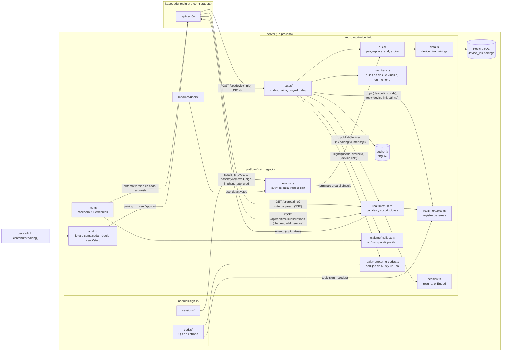

| Pieza | Responsabilidad, en una frase | Depende de | Recibe | Manda |
|---|---|---|---|---|
| `platform/realtime/hub.ts` | Tener abiertos los canales SSE, uno por pestaña, y entregarle a cada uno lo publicado en los temas que escucha | `topics`, `session`, `clock` | Abrir el canal, cambiar suscripciones, `publish(clave, datos)` | `hello {channel}`, `{topic, data}` por tema, latido `:` cada 40 s, `closed {reason}` |
| `platform/realtime/topics.ts` | Saber qué temas existen, quién puede escuchar cada uno y qué hacer al empezar y al dejar de escuchar | — | `topic(definición)` de cada módulo al registrarse | Para el hub: la clave de la suscripción o el rechazo |
| `platform/realtime/mailbox.ts` | Guardar, para quien no tiene canal, la señal de que un tema cambió, y ponerla en la cabecera de su próxima respuesta | `clock` | `signal(userId, deviceId, tema)`, `seen(…, tema, versión)` | `s=tema:versión` en `X-Ferrebress` |
| `platform/realtime/rotating-codes.ts` | Dar a quien escucha un código de 128 bits al azar que se renueva cada 60 s y sirve una vez | `clock`, `limits/` | `start(dueño)`, `take(código)`, `stop(dueño)` | El código nuevo a quien lo pidió, por su tema |
| `platform/start.ts` | Juntar lo que cada módulo suma a `/api/start`, sin que `sign-in` los conozca | — | `contribute(nombre, (sesión) => datos)` | El objeto que `sign-in` agrega a su respuesta |
| `platform/session.ts` (cambia) | Además de resolver la sesión, avisar cuándo termina una | `sign-in` le da cómo | `onEnded(escucha)` | `(sessionId, motivo)` |
| `modules/device-link/routes/` | La entrada HTTP del vínculo: valida, mira que quien pide sea del vínculo, llama a la regla y responde | `rules`, `members`, `hub`, `mailbox` | § 9 | § 9 |
| `modules/device-link/rules/` | Qué se puede: vincular, reemplazar, terminar, vencer; sin tecnología | — | Filas y la hora | Decisiones |
| `modules/device-link/data.ts` | Leer y escribir `device_link.pairings`, en lote | Kysely | | |
| `modules/device-link/members.ts` | Contestar sin consultar la base «¿esta persona en este dispositivo es de este vínculo?», para presentar y reenviar | `data` | Altas y bajas de vínculos | Sí o no |

### 2.2. La aplicación

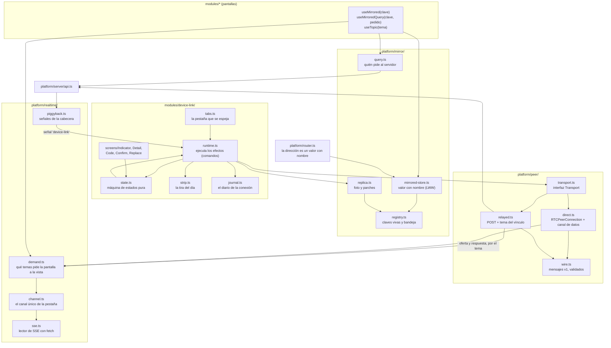

| Pieza | Responsabilidad, en una frase | Depende de | Recibe | Manda |
|---|---|---|---|---|
| `platform/realtime/channel.ts` | Tener abierto a lo sumo un canal por pestaña, solo mientras haya temas pedidos, la pestaña esté a la vista y haya red | `sse`, `reach` | Los temas pedidos (`demand`) | `GET /api/realtime`, `POST /api/realtime/subscriptions`; reparte cada evento al tema |
| `platform/realtime/demand.ts` | Contar quién pide cada tema (`useTopic`), para abrir o cerrar el canal | — | `useTopic(tema, param, alRecibir)` | Altas y bajas de temas al canal |
| `platform/realtime/piggyback.ts` | Leer las señales de la cabecera y avisarle al tema que cambió | `api.ts` | `s=tema:versión` | `onSignal(tema, versión)` |
| `platform/peer/transport.ts` | La interfaz común de los transportes (estrategia) | — | | `send(mensaje)`, `onMessage`, `onClose`, `kind`, `close()` |
| `platform/peer/direct.ts` | Armar la conexión directa: oferta, respuesta, canal de datos, latido de ICE | `RTCPeerConnection` del navegador | La oferta o respuesta del otro | La propia; mensajes por el canal de datos |
| `platform/peer/relayed.ts` | Mandar por el servidor lo que el directo no pudo | `api.ts`, `demand.ts` | Eventos del tema del vínculo | `POST /api/device-link/relay` con los mensajes juntos |
| `platform/peer/wire.ts` | Convertir mensajes a texto y de vuelta, con su versión, validándolos | contrato `device-link` | Texto | Mensaje tipado, o «desconocido» |
| `platform/mirror/mirrored-store.ts` | Un valor con nombre que se comporta como `createStore` y, si hay espejo, avisa cada cambio | `registry` | `set(valor)` | Parche `{key, value, clock}` |
| `platform/mirror/query.ts` | Decidir quién de los dos le pide al servidor y guardar la respuesta en un valor con nombre | `api.ts`, `mirrored-store` | `useMirroredQuery(clave, pedido)` | El pedido, o la espera de lo que trajo el otro |
| `platform/mirror/replica.ts` | Armar la foto de todo lo vivo y aplicar fotos y parches que llegan | `registry` | Foto, parches | Foto, parches |
| `modules/device-link/state.ts` | La máquina de estados del vínculo, pura: estado más evento da estado nuevo y efectos | — | Eventos (§ 7) | Estado y comandos |
| `modules/device-link/runtime.ts` | Ejecutar los comandos (abrir un transporte, mandar la foto, suscribirse) y convertir lo que pasa en eventos | `peer`, `mirror`, `realtime`, `api` | Comandos | Eventos |
| `modules/device-link/journal.ts` | Anotar cada evento y cada transición, sin datos personales, para diagnosticar (§ 14) | `device/storage` | Evento, estado | Las últimas 300 entradas |
| `modules/device-link/strip.ts` | La tira del día: tramos por estado, desde la primera conexión del día | `server/clock` | Cada cambio de estado | Tramos y totales (R4.4) |
| `modules/device-link/tabs.ts` | Elegir, entre las pestañas de la computadora, la que se espeja: la última que se usó (R6.4) | `BroadcastChannel`, Web Locks | Toques y teclas | «Esta pestaña espeja» o «ya no» |

## 3. El canal con el servidor (`realtime`, código común)

### 3.1. Qué es un tema

Un **tema** es algo que una pantalla espera del servidor. Cada módulo declara los suyos al
registrarse; el hub no sabe qué significan:

```ts
// src/server/platform/realtime/topics.ts
export type TopicDefinition<P, E> = {
  name: string;                          // 'device-link.pairing', 'sign-in.codes', 'audit-log.new'
  param: Schema<P>;                      // qué parámetro lleva la suscripción (zod/mini), o ninguno
  // Quién puede escuchar y con qué clave: la clave separa a los oyentes (un vínculo, una pantalla).
  authorize(c: Context, param: P): Promise<{ key: string } | { refused: ErrorCode }>;
  // Al empezar a escuchar, el estado de ahora: así reconectarse nunca pierde nada (§ 3.4).
  onSubscribe?(key: string, send: (event: E) => void, param: P): void | Promise<void>;
  onUnsubscribe?(key: string): void;
  anonymous?: true;                      // se puede escuchar sin sesión (la entrada)
};
```

**Sumar un tema** es escribir esa definición en el módulo y llamar a `realtime.topic(def)`. El hub, el
canal de la aplicación y los demás temas no cambian.

| Tema | Módulo | Parámetro | Clave | Quién | Al suscribirse manda |
|---|---|---|---|---|---|
| `sign-in.codes` | sign-in | la pestaña | la pantalla (cookie `__Host-sign-in-screen`) | sin sesión | el código vigente |
| `device-link.code` | device-link | — | la sesión | con sesión, solo una computadora | el código vigente |
| `device-link.pairing` | device-link | el vínculo | el vínculo | con sesión, de ese vínculo (E38) | si el otro está escuchando |
| `audit-log.new` (T118, no se programa) | audit-log | el último id visto | el permiso | con `audit.view` | cuántas hay nuevas desde ese id |

### 3.2. El canal de la aplicación

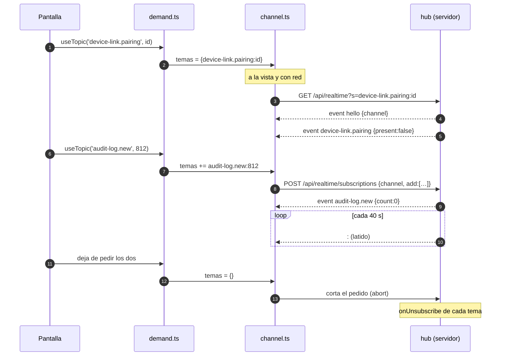

- **Uno por pestaña, nunca de fondo.** `channel.ts` es uno solo por pestaña. Se abre cuando hay al
  menos un tema pedido, la pestaña está a la vista y el navegador dice que hay red; se cierra cuando
  falta cualquiera de las tres. Al ocultarse la pestaña se corta en el acto (no espera al latido).
- **Sumar o sacar temas no rehace el canal:** va un `POST /api/realtime/subscriptions` con el
  identificador del canal (128 bits al azar, que llega en `hello` y solo sirve con la misma sesión o
  la misma cookie de pantalla). Juntar los cambios de un mismo dibujo en un solo pedido es tarea de
  `demand.ts` (los junta en una microtarea).
- **No usa `EventSource`**: es el lector con `fetch` de hoy (`server/realtime.ts`), que pasa a
  `realtime/sse.ts` sin cambiar cómo reintenta (tres veces con espera creciente, y después espera a que
  vuelva la red o la vista; `429` espera lo que dice el servidor).
- **Un corte se nota en menos de un minuto (R7.2):** el servidor manda un latido (`:\n\n`, un
  comentario de SSE) cada 40 s, con **un solo temporizador** para todos los canales; la aplicación
  da el canal por cortado si no llegó nada en 55 s y reintenta como arriba. Del lado del servidor, una
  escritura que falla cierra el canal.
- **HTTP/2:** el canal va por la misma conexión que los pedidos normales. Mientras el canal está
  abierto, el latido la mantiene viva y los pedidos no vuelven a abrir la conexión segura (unos 4 a 5 KB
  cada vez, ver mobile-data.md): con el canal abierto, el latido se paga solo.

### 3.3. El servidor: el hub

- **Abrir:** `GET /api/realtime?s=<tema>[:<param>]&s=…` (como mucho 16). Cada tema contesta
  `authorize`; si alguno rechaza, no se abre nada y se responde el rechazo (`403 not-paired`,
  `401 session-closed`). Sin sesión, solo si todos los temas son `anonymous`.
- **Quién lo tiene abierto:** `channels: Map<channelId, Channel>` y `byKey: Map<clave, Set<Channel>>`.
  `publish(clave, evento)` es una búsqueda en un mapa y una escritura por oyente: sin consultas.
- **Topes**, en la configuración: 4 canales por sesión (pestañas), 3 sin sesión por dirección (como las
  pantallas de entrada de hoy), 2.000 en total, 16 temas por canal, 10 aperturas por minuto por
  dirección y 60 cambios de suscripción por minuto por canal. Al llegar a un tope, `too-many-attempts`.
- **La sesión manda:** la plataforma de sesiones avisa cuando una termina (`sessions.onEnded`, que da
  `sign-in`), y el hub cierra sus canales con `closed {reason: 'session'}`. En cada latido mira además,
  en memoria, que la sesión de cada canal siga abierta (60 minutos sin pedidos, 8 horas de tope,
  ADR-015): **tener el canal abierto no cuenta como uso**, así no alarga ninguna sesión.
- **Con varias copias del servidor** (constitución IX), `publish` pasa por `LISTEN/NOTIFY` de
  PostgreSQL: cambia solo el hub; los temas y la aplicación no se enteran.

### 3.4. Reconectarse sin perder nada

Cada tema **manda su estado de ahora al suscribirse** (`onSubscribe`). Así, un corte, una pestaña
que vuelve a la vista o un servidor que se reinicia nunca dejan a una pantalla con algo viejo: el
canal no guarda una lista de lo que se perdió ni necesita `Last-Event-ID`. Lo que se manda por un
tema es siempre **idempotente**: recibirlo dos veces da lo mismo que una.

### 3.5. Lo que no es urgente: señales en la cabecera (el buzón)

`X-Ferrebress` suma un campo opcional, `s=`, con las **señales** de ese dispositivo y esa persona:
`s=device-link:3`. Solo nombre del tema y una versión, nunca el contenido (unos 20 bytes, y solo
mientras hay una señal sin leer; sin señales, nada). La aplicación (`piggyback.ts`) compara la versión
con la última que vio y, si cambió, avisa al tema; el tema pide lo que le haga falta, si le hace falta,
y ese pedido lleva la versión leída, con lo que el buzón la borra.

- Se usa para lo que puede esperar al próximo pedido: «tu vínculo cambió» para el dispositivo que no
  tiene el canal abierto (lo terminaron desde Usuarios, se reemplazó, el otro tocó «Reconectar»).
- Vive en memoria, por `(persona, dispositivo)`, con un tope de 16 temas por dispositivo y 10.000
  dispositivos. Si se reinicia el servidor se pierde, y no importa: `/api/start` trae el vínculo de
  ahora (§ 9.1).
- Es la forma `piggyback` del ADR-003, de uso general: la versión nueva y los permisos siguen como
  están (campos `v` y `p`).

## 4. La conexión entre los dos (`peer`, código común)

### 4.1. El transporte (estrategia)

```ts
// src/app/platform/peer/transport.ts
export type TransportKind = 'direct' | 'relayed';
export interface Transport {
  readonly kind: TransportKind;
  send(message: WireMessage): void;          // nunca tira: si está cerrado, no hace nada
  onMessage(listener: (message: WireMessage) => void): () => void;
  onClose(listener: (why: CloseReason) => void): () => void;
  close(why: CloseReason): void;             // idempotente
}
export type TransportFactory = {
  kind: TransportKind;
  available(): boolean;                      // el navegador lo permite (RTCPeerConnection existe)
  open(meeting: Meeting): Promise<Transport | Failure>;
};
// El orden es la preferencia: primero directo, después por el servidor.
export const transports: readonly TransportFactory[] = [direct, relayed];
```

La máquina de estados no conoce las variantes: pide «un transporte» y recibe uno de los dos con su
`kind`. Sumar una forma (un día, otra cosa que WebRTC) es una fábrica más en la lista.

### 4.2. Directo: WebRTC sin servidores externos

- **Solo un canal de datos**, sin audio ni video: `RTCPeerConnection({ iceServers: [] })` y
  `createDataChannel('mirror', { ordered: true })`. Ordenado y confiable (SCTP): los parches llegan en
  orden y sin perderse.
- **Sin STUN ni TURN:** la conexión directa es solo por el Wi-Fi del local (R3.1); dos dispositivos en
  redes distintas van por el servidor (E09). Así no hay ningún servicio de afuera, y WebRTC no expone
  la dirección pública de nadie. Chrome esconde la dirección local con un nombre `.local` (mDNS) y la
  resuelve en la misma red. Si el Wi-Fi bloquea mDNS o aísla los equipos, la conexión directa no se
  logra y pasan al servidor: lo que la regla ya prevé (E18). La tarea 1 lo prueba en el local (§ 18).
- **Roles fijos, sin choques:** la computadora siempre ofrece y el celular siempre responde. No hacen
  falta las reglas de «negociación perfecta» porque nunca ofrecen los dos a la vez.
- **Sin goteo de candidatos:** como solo hay candidatos locales, juntarlos tarda menos de 100 ms; la
  oferta va con todos adentro, en **un** mensaje, y la respuesta igual. Presentarse son dos mensajes.
- **Plazo:** si el canal de datos no se abre en 5 s desde la oferta, falla (`ice-timeout`) y pasan al
  servidor sin reintentar (R3.3).
- **Seguir vivo:** ICE comprueba la conexión cada pocos segundos por su cuenta (paquetes STUN de unos
  100 bytes por el Wi-Fi, que no son internet). Si deja de contestar (`iceConnectionState`
  `disconnected` más de 5 s, o `failed`), el transporte se cierra con `lost`. Así se nota el corte del
  otro aunque se haya quedado sin batería.
- **La latencia de la ruta** (la maqueta muestra «12 ms»): con el detalle abierto, un `ping` por el
  canal de datos cada 2 s, que no gasta internet. Con el detalle cerrado, ninguno.

### 4.3. Por el servidor

- **De ida:** `POST /api/device-link/relay` con una lista de mensajes. Los que salen en los mismos
  50 ms van juntos, y dos parches de la misma clave se quedan con el último: escribir «tornillo» no
  manda ocho pedidos. Por la conexión directa no se espera nada: cada mensaje sale en el acto (R6.5).
- **De vuelta:** el servidor los publica en el tema `device-link.pairing:<id>`, solo para el otro, que
  los recibe por su canal. No guarda nada: si el otro no está escuchando, se descartan y quien mandó se
  entera por el estado de presencia.
- **La latencia:** la del último ida y vuelta de un mensaje de verdad; no hay `ping` por el servidor.

### 4.4. Presentarse

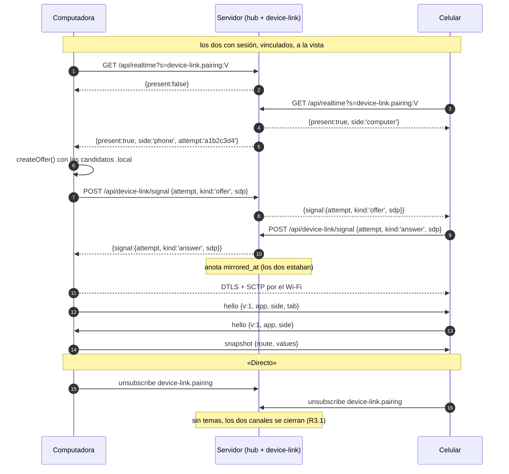

- `attempt` es un número al azar de 32 bits, el mismo en los dos y en el registro del servidor: junta
  lo que anotó cada uno de un mismo intento (§ 14).
- El servidor reenvía la señal solo entre los dos del vínculo, solo si los dos están escuchando y solo
  si el vínculo no terminó (E38, E39). Valida el tamaño (8 KB) y que la descripción tenga solo un
  `m=application` (ni audio ni video).
- **El primer `hello`** dice la versión del protocolo (`v`) y del código (`app`). Con otra `v` mayor,
  no espejan (§ 19, punto 4). El `hello` de la computadora lleva su pestaña (R6.4).

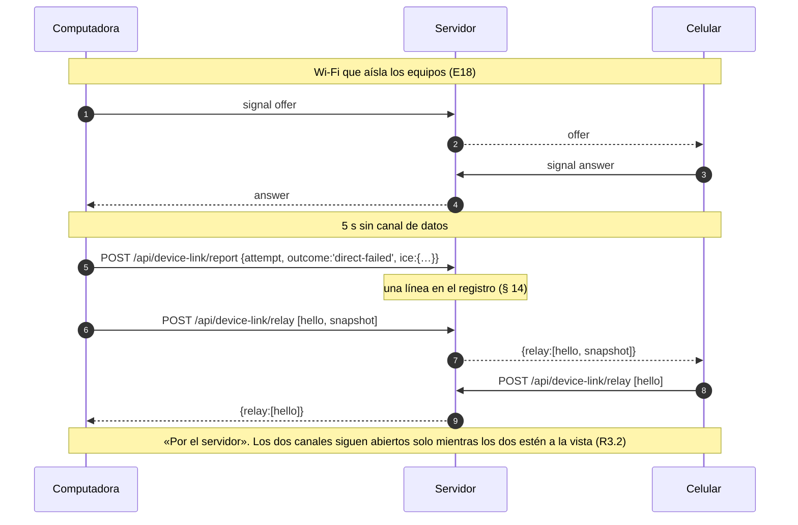

- **El respaldo no reintenta el directo por su cuenta (R3.3).** Lo vuelve a probar al tocar «Probar
  conexión directa» (un mensaje `probe` por el servidor, y la computadora ofrece de nuevo mientras sigue
  el respaldo; si el canal de datos abre, se cambia sin cortar y el respaldo se cierra; si no, «No se
  pudo», E19) o al volver a encontrarse (R3.5).

## 5. El espejo (`mirror`, código común)

### 5.1. Qué se espeja: valores con nombre

Las pantallas guardan lo abierto, lo escrito y lo elegido en estado local de Preact (`useState`, unos
33 en `src/app/modules/`): no hay un punto único por donde pasen las acciones. Repetir acciones en los
dos, además, obligaría a que cada acción diera lo mismo en los dos (no lo da si una pide al servidor) y
no alcanza para lo escrito letra por letra. El espejo replica **el estado a la vista**, que es lo que dice R6.2, con dos piezas:

```ts
// src/app/platform/mirror/mirrored-store.ts
// Como createStore, con un nombre único y un valor que se puede pasar a JSON.
export function mirroredStore<T extends Json>(key: MirrorKey, initial: T): Store<T>;
// Como useState, para el estado de una pantalla: la clave se arma con la pantalla abierta.
export function useMirrored<T extends Json>(key: string, initial: T): [T, (next: T) => void];

// src/app/platform/mirror/query.ts
// Lo que trae el servidor para mostrar: lo pide uno solo y el otro recibe la respuesta.
export function useMirroredQuery<T extends Json>(
  key: string, request: () => Promise<ApiResult<T>>, deps: unknown[],
): { data?: T; failed: boolean; update(change: (now: T) => T): void; invalidate(): void };
```

- **Qué va en un valor con nombre** (R6.2): la dirección (`router.route` pasa a ser
  `mirroredStore('route', …)`), lo abierto encima (hojas, detalles, confirmaciones), lo escrito en
  buscadores y campos, lo elegido (filtros, la fila elegida) y lo que trajo el servidor
  (`useMirroredQuery`).
- **Qué no:** lo que es del dispositivo y no «se ve igual en los dos»: el menú minimizado (00 · R1.6,
  solo en la computadora), Alt apretado, dónde está el cursor, cuánto se bajó en una lista, la cámara
  abierta, la entrada y todo lo de `sign-in`, la sesión, la llave de prueba y los avisos del marco
  (versión nueva, «Algo salió mal»).
- **Las claves** son `<módulo>.<cosa>` y, si son de una pantalla, `<módulo>.<pantalla>.<cosa>`. Un
  control de `pnpm check` comprueba que no haya dos iguales y que ningún `useState` de una pantalla
  guarde algo de la lista de «qué va» (por nombre: los que quedan locales llevan un comentario
  `// local:` con el porqué).
- **Sin espejo, son valores comunes:** si no hay vínculo, o si se quita `device-link`, `useMirrored`
  es `useState` con nombre y `useMirroredQuery` es pedir y guardar. Ningún módulo sabe del vínculo.

### 5.2. Cómo viaja un cambio

- **Parche:** `{t:'set', k:'users.list.search', v:'torn', c:42}`. `c` es un reloj de Lamport por
  dispositivo (el mayor que vio más uno). Quien recibe aplica si `(c, lado)` es mayor que lo que tiene,
  con la computadora ganando el empate: **el último que escribe gana**, y repetir o desordenar un
  parche no cambia el resultado. Es un registro LWW por clave (ADR-017).
- **Foto (R6.3):** al conectarse, al reconectar y cuando el celular vuelve, la computadora manda
  `{t:'snap', route, values:[[clave, valor, c]…]}` con todo lo vivo; el celular reemplaza lo suyo,
  vuelve al valor inicial lo que la computadora no tiene, y va a su dirección. El celular nunca manda
  foto.
- **Llega antes que su pantalla:** si llega un valor de una clave que todavía no existe (el celular
  está bajando el módulo que la computadora abrió), queda en una bandeja hasta que la pantalla la
  registra, como mucho 10 s. Así no importa el orden en que se dibujan las cosas.
- **Tope:** un valor de más de 256 KB no se espeja (queda en el diario como `too-large`): una lista así
  se pide en páginas.

### 5.3. Quién le pide al servidor (R6.2)

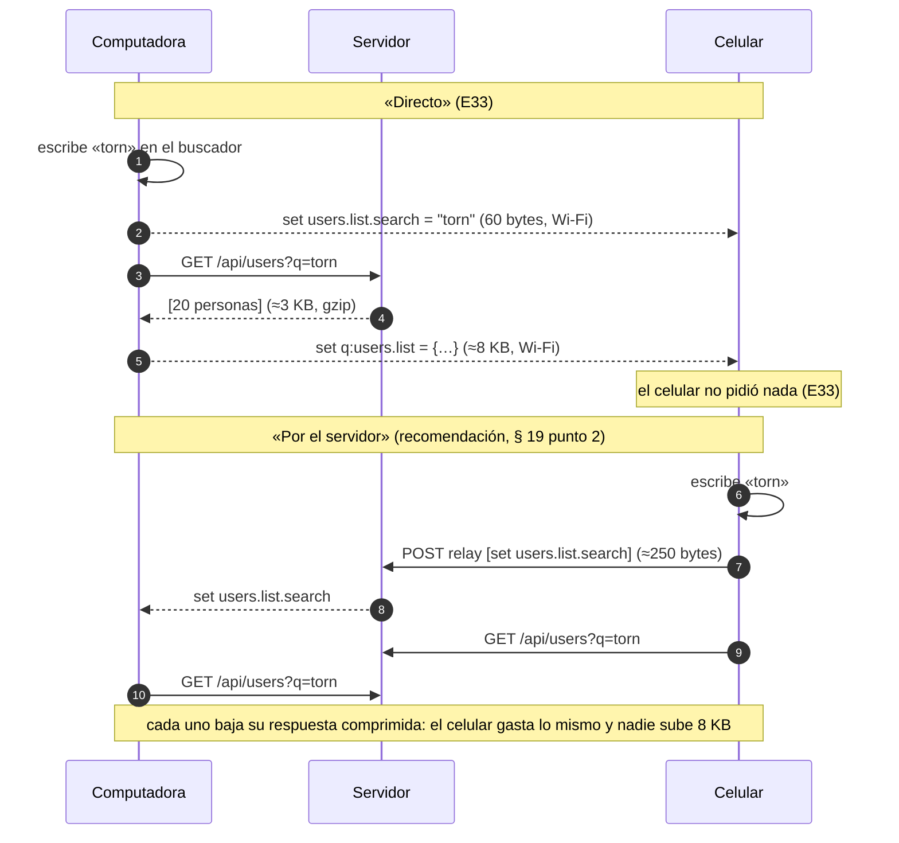

- **Directo:** pide **siempre la computadora** (`query.ts` elige a la que «manda», R6.3) y el celular
  recibe la respuesta por el Wi-Fi. Así el celular, que paga los datos, nunca pide lo que se muestra
  en el espejo. Si a los 3 s no llegó la respuesta de la computadora, el celular la pide él (queda en el
  diario como `query-timeout`): el espejo nunca deja una pantalla sin datos.
- **Por el servidor:** reenviar una respuesta hace que la suba quien la pidió y la baje el otro, sin
  comprimir (va dentro del tema), mientras que pedirla de nuevo la baja comprimida con gzip. Por eso el
  diseño recomienda que **por el servidor cada uno pida lo suyo** y que viajen solo los parches de lo
  que se ve. Es un cambio a la letra de R6.2: lo decide Carlos (§ 19, punto 2).
- **Lo que cambia algo** (un POST) lo hace solo el dispositivo donde se tocó, porque sale de un toque y
  no de un efecto. Con su respuesta, la pantalla llama a `update` del valor que cambió: por el directo
  viaja el valor nuevo; por el servidor viaja solo `{t:'stale', k}` y el otro lo vuelve a pedir.
- **Las búsquedas** siguen esperando 150 ms y dejando sin efecto la anterior (00 · R7.4) en quien pide;
  el otro solo recibe el resultado.

### 5.4. Un cambio espejado, de punta a punta

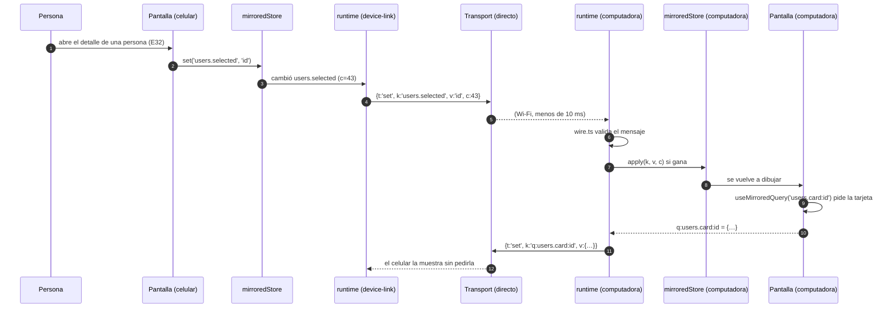

## 6. Varias pestañas en la computadora (R6.4)

- Cada pestaña de la computadora puede espejar, pero **solo una lo hace**: la última que se usó.
  `tabs.ts` usa un candado del navegador (`navigator.locks.request('ferrebress.mirror', {steal:true})`)
  que toma la pestaña donde la persona toca o aprieta una tecla, si está a la vista. La que lo pierde
  manda `bye {why:'handover'}` y cierra su transporte; la que lo toma se presenta de nuevo.
- Cambiar de pestaña **necesita internet**, porque hay que presentarse otra vez (unos 300 ms a 1 s).
  Sin internet, la pestaña que espejaba sigue espejando aunque se use otra; vuelve a valer la regla
  apenas vuelve internet. Es el mismo borde que R3.4.
- El servidor, si dos pestañas del mismo dispositivo escuchan el tema del vínculo, presenta solo a la
  última que se suscribió; a la anterior le manda `{superseded:true}` y deja de mandarle.

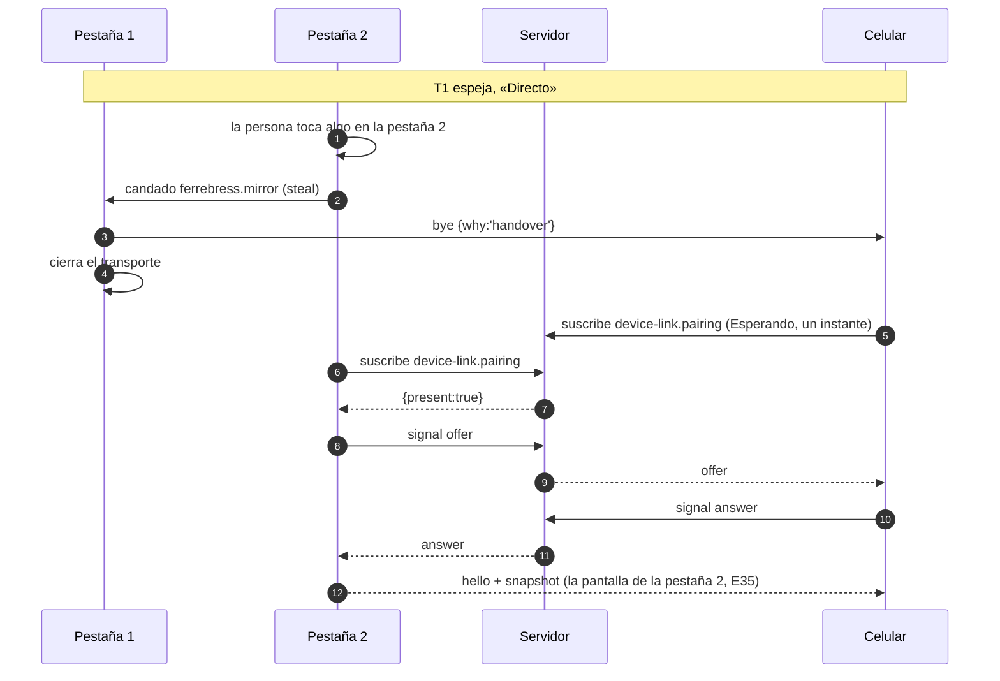

## 7. La máquina de estados del vínculo

En la aplicación, por dispositivo y por persona con sesión. Es una función pura en
`modules/device-link/state.ts`: `step(estado, evento) → { estado, efectos }`. Los efectos son comandos
(`subscribe`, `openTransport`, `sendSnapshot`, `closeTransport`, `post`…) que ejecuta `runtime.ts`;
lo que pasa afuera vuelve como evento. Sin sesión, el módulo no corre: el vínculo está dormido (R2.1).

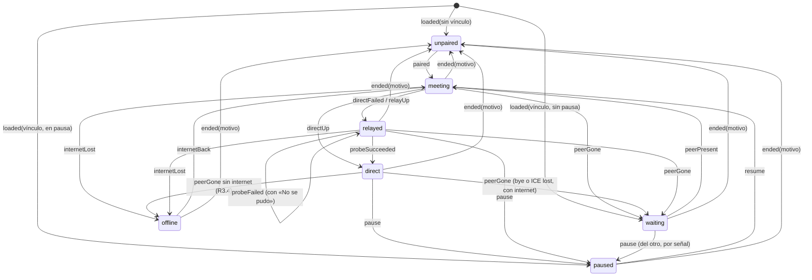

**Los estados son tipos que no admiten combinaciones imposibles:**

```ts
type LinkState =
  | { kind: 'unpaired' }
  | { kind: 'waiting'; pairing: Pairing }
  | { kind: 'meeting'; pairing: Pairing; attempt: AttemptId; probing?: true }
  | { kind: 'direct'; pairing: Pairing; transport: Transport & { kind: 'direct' } }
  | { kind: 'relayed'; pairing: Pairing; transport: Transport & { kind: 'relayed' }; probe?: 'failed' }
  | { kind: 'paused'; pairing: Pairing; keep?: Transport & { kind: 'direct' } }
  | { kind: 'offline'; pairing: Pairing };
```

No se puede escribir «directo sin transporte», «por el servidor con un transporte directo» ni
«vinculado sin vínculo». `step` es un `switch` sobre `estado.kind` y `evento.type` que termina en
`assertNever`: sumar un estado o un evento sin decir qué pasa en cada caso no compila. Un evento que no
corresponde al estado (un `directUp` tardío de un intento viejo, con otro `attempt`) **no cambia nada**
y queda en el diario como `ignored`.

| Estado | Indicador (R4.1) | Canal con el servidor | Transporte |
|---|---|---|---|
| `unpaired` | Sin vincular | ninguno (salvo el del código, con el código a la vista) | ninguno |
| `waiting` | Esperando al celular / a la computadora | según § 19 punto 1 | ninguno |
| `meeting` | Esperando… (dura menos de 5 s) | `device-link.pairing` | armándose |
| `direct` | Directo | **ninguno** (E24) | directo |
| `relayed` | Por el servidor | `device-link.pairing` | por el servidor |
| `paused` | Desconectado | ninguno | el directo se conserva si lo había, sin espejar (§ 7.2) |
| `offline` | Sin internet | ninguno (no hay red) | ninguno |

### 7.1. Las transiciones, con lo que hace cada una

| De | Evento | A | Efectos |
|---|---|---|---|
| — | `loaded(pairing)` (de `/api/start` o de la señal) | `waiting` / `paused` / `unpaired` | Si `waiting` y a la vista: `subscribe(pairing)` |
| `unpaired` | `paired(pairing)` (leyó el código, o entró con el celular) | `meeting` | `subscribe(pairing)` |
| `waiting` | `peerPresent(attempt)` | `meeting` | computadora: `openTransport(direct)`; celular: espera la oferta |
| `meeting` | `directUp` | `direct` | `unsubscribe`; computadora: `sendSnapshot`; `strip.mark('direct')` |
| `meeting` | `directFailed(diag)` | `relayed` | `report(diag)`; `openTransport(relayed)`; computadora: `sendSnapshot` |
| `direct` | `peerGone('hidden'│'signout'│'lost')` con internet | `waiting` | `closeTransport`; según § 19 punto 1, `subscribe` |
| `direct` | `peerGone('lost')` sin internet | `offline` | `closeTransport`; espera `online` |
| `offline` | `internetBack` | `meeting` | `subscribe(pairing)` |
| cualquiera con vínculo | `pause(origen)` | `paused` | si es de acá: `POST /pause` y `send(pause)`; deja de espejar |
| `paused` | `resume(origen)` | `meeting` | si es de acá: `POST /resume` y `send(resume)`; computadora: `sendSnapshot` al estar |
| `relayed` | `probe` (botón) | `meeting` con `probing` | `send(probe)`; computadora ofrece, el respaldo sigue |
| `meeting` con `probing` | `directUp` / `directFailed` | `direct` / `relayed` con `probe:'failed'` | cierra el que sobra |
| cualquiera | `ended(motivo)` | `unpaired` | `closeTransport`, `unsubscribe`, borra la tira (R2.4) |
| cualquiera | `hidden` (esta pestaña) | el mismo | `send(bye hidden)`, `closeTransport`, `unsubscribe` |
| cualquiera | `visible` | el mismo o `meeting` | como `loaded` |

### 7.2. Desconectar, reconectar y desvincular

- **Desconectar** (R5.1) guarda la pausa en el servidor (`paused_at`), así salir y volver a entrar no
  la saca (E28), y le avisa al otro: por el transporte, si hay uno, y por la señal del buzón. Si eran
  «Directo», **el canal de datos se conserva** sin espejar: no gasta internet, y «Reconectar» llega al
  otro en el acto y sin servidor. Si eran «Por el servidor», se cierra todo.
- **Reconectar** (R5.2) saca la pausa en el servidor y avisa igual. Si el canal de datos seguía, la
  computadora manda la foto en el acto (E29). Si no, se presentan de nuevo.
- **Desvincular** (R5.3) es `POST /api/device-link/unpair`: el servidor borra la fila, anota en la
  auditoría desde cuál, y avisa al otro por el tema o por el buzón; antes, el que desvincula manda
  `bye {why:'unpair'}` por el transporte, así el otro pasa a «Sin vincular» al instante.

## 8. Entidades

Un esquema, `device_link`, con una sola tabla. El estado del espejo no se guarda en ningún lado.

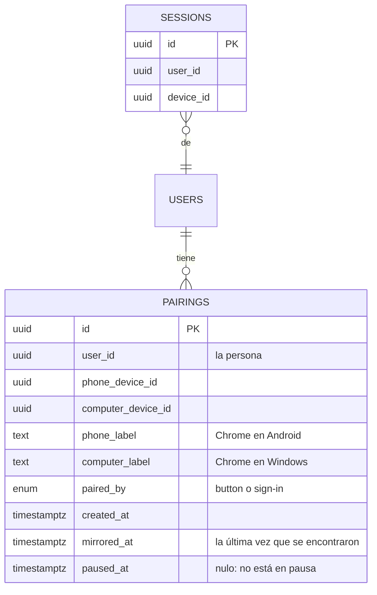

| Columna | Para qué |
|---|---|
| `id` | UUID v7 |
| `user_id`, `phone_device_id`, `computer_device_id` | De quién y qué dispositivos. El vínculo es de la persona y los dos dispositivos, no de las sesiones (R2.1): no tiene clave hacia `sign_in.sessions`, y otra persona en el mismo dispositivo no lo ve (E11) |
| `phone_label`, `computer_label` | El nombre de cada uno, el de su sesión al vincular («Chrome en Windows», de la lista cerrada del servidor) |
| `paired_by` | `button` o `sign-in`, para la auditoría (R8.1) |
| `created_at` | «Desde cuándo» (R4.2) |
| `mirrored_at` | La última vez que el servidor los presentó o reenvió algo entre los dos: vence a los 30 días de esto (R2.2). Una sesión dura como mucho 8 horas, así que un espejo continuo se vuelve a presentar al menos una vez por sesión y la fecha nunca queda vieja. Se escribe por tandas una vez por minuto, como el último uso de las sesiones |
| `paused_at` | «Desconectado» (R5.1); nulo, conectados |

**Índices:**

- Único sobre `(user_id, phone_device_id)` y único sobre `(user_id, computer_device_id)`: el uno con
  uno de R1.1, para cada persona, y la búsqueda «el vínculo de esta persona en este dispositivo», que
  hace cada `/api/start` la primera vez (después, de la memoria).
- Sobre `mirrored_at`: el trabajo diario que termina los vencidos (E12) los busca por ahí.

Lo que dura segundos vive en memoria: los códigos de vincular (60 s, un uso), los boletos de reemplazar
(2 minutos, un uso), quién escucha cada tema y las señales del buzón.

## 9. API

Todo con sesión, con los contratos de `src/shared/contracts/device-link.ts` y los pasos comunes de
`platform/guards.ts` (`readBody`, `limit`, `record`). Todos los `POST` llevan `Origin` y JSON como
cualquier otro (diseño de 01, § 4).

### 9.1. Lo que suma a `/api/start`

Con sesión y vínculo, `/api/start` trae `pairing` (unos 180 bytes): `{ id, side, other: { label },
since, lastMirrored, paused }`. Sin vínculo, nada. Así el indicador sabe su estado al abrir sin un
pedido más. `sign-in` no conoce a `device-link`: arma su respuesta con lo que le dan los módulos
registrados en `platform/start.ts` (§ 13.1).

### 9.2. Las rutas

| Ruta | Qué hace | Recibe | Devuelve | Errores |
|---|---|---|---|---|
| `GET /api/device-link` | El vínculo de ahora, después de una señal; lleva `seen` (la versión de la señal), que la borra del buzón | `?seen=3` | `{ pairing? }` | — |
| `POST /api/device-link/codes/read` | El celular leyó un código de vincular | `{ code }` (22 caracteres) | `{ ticket, replaces?: { phone?: label, computer?: true } }` o, si no hay nada que reemplazar, el vínculo ya hecho `{ pairing }` | `code-expired`, `code-used`, `other-account` (E37), `not-a-phone`, `not-a-computer` |
| `POST /api/device-link/codes/accept` | El celular aceptó reemplazar (R1.4) | `{ ticket }` | `{ pairing }` | `code-expired` (el boleto venció) |
| `POST /api/device-link/unpair` | Desvincular (R5.3) | `{}` | `{ ok }` | `not-paired` |
| `POST /api/device-link/pause` · `/resume` | Desconectar y reconectar (R5.1, R5.2) | `{}` | `{ ok }` | `not-paired` |
| `POST /api/device-link/signal` | Pasarle al otro la oferta o la respuesta | `{ attempt, kind: 'offer'│'answer', sdp }` (≤ 8 KB) | `{ ok }` | `not-paired` (E38), `peer-absent` |
| `POST /api/device-link/relay` | Pasarle al otro mensajes del espejo | `{ messages: WireMessage[] }` (≤ 64 KB) | `{ ok }` | `not-paired`, `peer-absent`, `too-many-attempts` |
| `POST /api/device-link/report` | Contar por qué no se logró la conexión directa (§ 14) | `{ attempt, outcome, ice }` (≤ 1 KB) | `{ ok }` | — |

- **«Ser del vínculo»** (E38, E39) se mira en cada `signal`, `relay`, `pause`, `resume` y `unpair`
  con `members.ts`: un mapa en memoria `(persona, dispositivo) → vínculo`, cargado de la base la
  primera vez (una consulta por índice) y puesto al día por cada alta y baja **después de confirmar** la
  transacción (`createGuardedMemory`, como las personas). Un vínculo terminado deja de valer en el
  próximo pedido.
- **Los límites**, por dispositivo y por dirección: leer un código, 10 por minuto (como el de entrada);
  `signal`, 30 por minuto; `relay`, 600 mensajes y 1 MB por minuto (una persona tocando sin parar no
  llega a 100); `report`, 10 por hora.

### 9.3. Vincular con el botón (R1.3, R1.4)

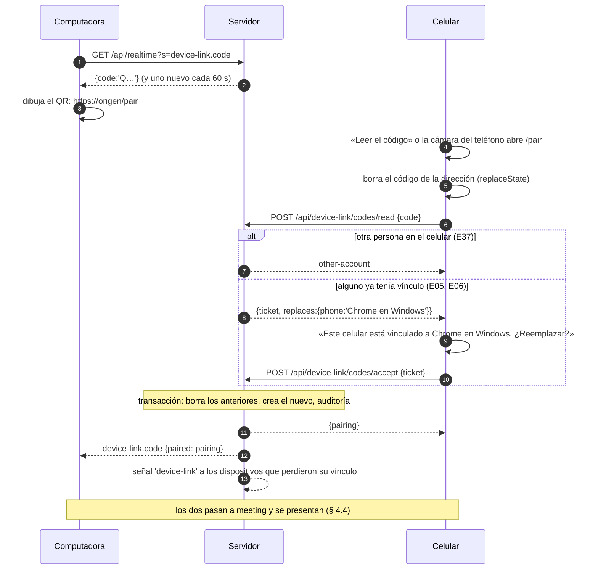

- El código es de la sesión de la computadora (no de la pantalla): leerlo exige que el celular tenga
  sesión de **la misma persona** (E37) y sea un celular (por el dispositivo de su sesión). Sin sesión,
  la aplicación lleva a la entrada y no vincula (E40). Un celular que entró sin conexión y todavía no
  se confirmó no tiene sesión en el servidor: la aplicación primero manda lo pendiente (`sendPending`)
  y recién después lee el código; si la confirmación no sale, no vincula (E36).
- **La dirección es `/pair#<código>`**, distinta de la de entrar (`/link#…`). Lo que va después del `#`
  no llega a los registros de Caddy, como en la entrada.
- Leer el código lo usa (E04): un código leído no vuelve a servir, aunque se cancele el reemplazo. El
  boleto de reemplazar dura 2 minutos y sirve una vez; cancelar no cambia nada (E05).
- `rotating-codes.ts` es la misma pieza que da los códigos de la entrada: la computadora recibe uno
  nuevo cada 60 s mientras el QR está a la vista (E03), y el canal se cierra al cerrar el código.

### 9.4. Vincular al entrar con el celular (R1.5)

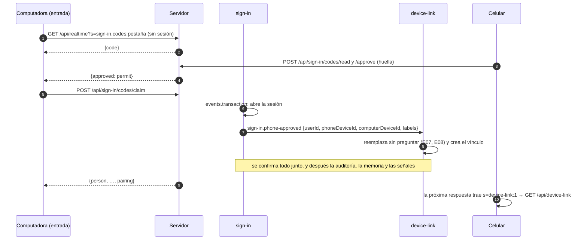

## 10. Eventos y auditoría

### 10.1. Lo que escucha (sin que los otros módulos conozcan a `device-link`)

| Evento | De | Qué hace device-link | Motivo en la auditoría |
|---|---|---|---|
| `sign-in.phone-approved` (nuevo) | sign-in, al cambiar el permiso por la sesión de la computadora, dentro de su transacción | Crea el vínculo, reemplazando los anteriores (R1.5) | — (`device-link.paired` con `how: 'sign-in'`) |
| `sessions.revoked` (nuevo) | sign-in, al cerrar desde Usuarios una o todas las sesiones, dentro de su transacción (hoy no la abre: pasa a `events.transaction`) | Termina los vínculos de esa persona en esos dispositivos (R2.3, E14) | `session-revoked` |
| `passkey.removed` (nuevo) | sign-in, al quitar la huella o cortar el celular | Termina los vínculos de esa persona en ese celular (E15) | `passkey-removed` o `phone-cut` |
| `user.deactivated` (ya existe) | users | Termina todos sus vínculos (E16) | `deactivated` |

Salir, o que la sesión venza (`sign-out`, `idle`, `max-age`), **no** termina el vínculo: queda dormido
(R2.1, E17). Por eso `device-link` no escucha el fin de cualquier sesión, solo esos eventos.

Los fines están en una tabla, `rules/ends.ts`, que dice para cada evento qué vínculos toca y con qué
motivo. Sumar un motivo es una fila más (§ 13).

### 10.2. Lo que anota (R8)

En `src/shared/audit-log/device-link.ts`, con el grupo, el color y el texto de cada uno, como los otros
módulos. Quién: la persona; a qué: los dos dispositivos, en códigos (navegador y sistema), nunca un
texto que elija el dispositivo.

| Evento | Cuándo | Lleva |
|---|---|---|
| `device-link.paired` | Se vincularon | `how: 'button'│'sign-in'`, los dos dispositivos |
| `device-link.replaced` | Un vínculo nuevo terminó otro | Los dispositivos del que terminó |
| `device-link.unpaired` | Se desvinculó | Desde cuál (`from: 'phone'│'computer'`) |
| `device-link.ended` | Terminó solo | `reason: 'expired'│'session-revoked'│'passkey-removed'│'phone-cut'│'deactivated'` |
| `device-link.rejected` | Un código de otra cuenta, o un pedido de quien no es del vínculo | El motivo; una fila por ventana y por clave (`recordOnce`) |

No se anotan el espejo, la pausa, reconectar ni los cambios entre directo y por el servidor (R8.2,
E42). Lo que hace falta para diagnosticar eso va por otro lado (§ 14), sin pasar por la auditoría.

## 11. Conexiones

Las cuatro formas del ADR-003, con lo que este módulo agrega a cada una:

| Forma | Qué usa device-link | Cuándo |
|---|---|---|
| `request` | Las rutas de § 9 | Al tocar algo |
| `piggyback` | La señal `device-link` en `X-Ferrebress` y `pairing` en `/api/start` | Al abrir y en cada respuesta |
| `temporary` | Los temas `device-link.code` y `device-link.pairing` | Con el código a la vista, al presentarse, por el servidor y (§ 19, punto 1) esperando al otro |
| `peer` | `platform/peer`, directo y por el servidor | Vinculados, conectados y los dos a la vista |

**Sin conexión** (capítulo 15): el vínculo no se guarda para trabajar sin conexión. El espejo directo
sigue sin internet (R3.4, E20) porque no pasa por el servidor; vincular, desvincular, pausar y
presentarse necesitan internet ([qué necesita internet](../../chapters/what-needs-internet.md) ya lo
dice).

## 12. Pantallas

Desde la maqueta aprobada, `docs/design/mockups/device-link-indicator/final/` (`changes.md` dice cada
pieza). Las clases de la maqueta pasan al CSS con el nombre de la pieza; los tokens, de `styles/`.

| Pieza | Dónde | Qué hace |
|---|---|---|
| `screens/Indicator/` | El lateral de la computadora y, en el celular, a la derecha del título | El punto y el texto de `LinkState` (§ 7); Alt L abre el detalle. Viene en el arranque (unos 2 KB): lo demás se baja recién con vínculo o al abrir el detalle |
| `screens/Detail/` | Flota al lado del lateral; en el celular es una hoja | La frase del estado (o «No se pudo»), la ruta con la latencia, la tira, los datos del vínculo y los botones de R4.2 con sus teclas (Alt D, R, P, V, X, C) |
| `screens/Code/` | Solo la computadora | El QR de `/pair#…`; Alt O vuelve. Usa `qr-draw.ts` de `sign-in` (por su fachada), que se baja al abrirlo |
| `screens/Replace/` | Solo el celular | «Este celular está vinculado a Chrome en Windows. ¿Reemplazar?» (R1.4) |
| `screens/Confirm/` | Diálogo en la computadora, hoja en el celular | La confirmación de desvincular (Alt C, Alt X) |
| `screens/Notices/` | Solo el celular | «Este código es de otra cuenta», «Este código venció» (maqueta, «Los mensajes al leer el código») |
| `strip.ts` | — | La tira (R4.4): tramos `[desde, hasta, grupo]` en `localStorage` (`device-link.strip`, menos de 1 KB), del día del negocio según la hora del servidor (00 · R8.4); al cambiar de día empieza de cero. Los totales se calculan de los tramos, como en la maqueta |

El indicador se enchufa en el marco por `App.tsx`, como las otras piezas que el marco muestra sin
conocer: quitarlo es quitar esa línea. Los textos, largos y cortos, en `device-link/texts.ts`.

**Las pantallas que existen** pasan su estado visible a valores con nombre (§ 5.1): `frame` (lo abierto
encima, Más en el celular), `users`, `audit-log` y `manual`. Es la tarea 7 (§ 18), con sus pruebas: el
comportamiento sin vínculo no cambia.

## 13. Cómo se suma algo nuevo sin tocar lo que existe, y qué lo hace robusto

Carlos pidió código que soporte los cambios sin romperse y que siga el principio abierto/cerrado:
cada punto de extensión se suma **agregando** una pieza, sin modificar las que ya están.

### 13.1. Los puntos de extensión

| Qué se suma | Cómo | Qué no se toca |
|---|---|---|
| **Un tema del canal** (T118, la foto del celular de la etapa b) | En el módulo: `realtime.topic({ name, param, authorize, onSubscribe })` en el servidor, `publish(clave, datos)` cuando pasa algo, y `useTopic(name, param, alRecibir)` en la pantalla. Su contrato va en `src/shared/contracts/<módulo>.ts` | El hub, el canal de la aplicación, los demás temas |
| **Algo que puede esperar** | `mailbox.signal(persona, dispositivo, 'tema')` y `onSignal('tema', …)` | La cabecera y su lectura |
| **Una forma de transporte** | Una `TransportFactory` más en la lista de `peer/transport.ts`, con su fila en la tabla de qué dice el indicador | La máquina de estados (pide «un transporte»), el espejo |
| **Lo que se espeja de una pantalla nueva** | Usar `useMirrored` y `useMirroredQuery` en vez de `useState` y pedir a mano | El espejo y `device-link`: no saben qué pantallas hay |
| **Un motivo de fin del vínculo** | El módulo que lo causa publica su evento; `device-link` suma una fila en `rules/ends.ts` (evento → vínculos → motivo) y el texto en el catálogo de la auditoría | El resto de los fines, el módulo que publica (no conoce a `device-link`) |
| **Un mensaje del protocolo entre los dos** | Su forma en la unión `WireMessage` del contrato y su manejador en el mapa `handlers` de `runtime.ts` | El despachador; un dispositivo con la versión anterior lo ignora (abajo) |
| **Lo que va en `/api/start`** | `start.contribute(nombre, (sesión) => datos)` | `sign-in` |

Ejemplo, T118 entero del lado del canal:

```ts
// server: modules/audit-log/realtime.ts
realtime.topic({
  name: 'audit-log.new',
  param: z.string().check(z.maxLength(40)),             // el último id que vio la pantalla
  authorize: async (c) => (await can(c, 'audit.view')) ? { key: 'all' } : { refused: 'forbidden' },
  onSubscribe: async (key, send, lastId) => send({ count: await countSince(lastId) }),
});
// al escribir una tanda en la auditoría: realtime.publish('audit-log.new:all', { count: n })
// app: modules/audit-log/state.ts
useTopic('audit-log.new', page.latestId, ({ count }) => setNew(count));
```

### 13.2. Qué lo hace robusto

- **Contratos con versión.** Todo lo que cruza un borde tiene su forma en `src/shared/contracts/`,
  validada con `zod/mini`: los pedidos, los eventos de cada tema y los mensajes entre los dos. El
  protocolo entre los dos lleva `v` (hoy 1) en el `hello`: los mensajes nuevos se **suman** a la unión
  sin subir `v`, y quien no conoce un tipo lo ignora y lo anota (`unknown-message`); `v` sube solo si un
  cambio deja de ser compatible, y con `v` distintas no espejan. La API sigue con `X-App-Version`
  (ADR-016, el bloqueo de 00 · R5.5).
- **Validar en los bordes, una sola vez.** `wire.ts` valida cada mensaje que llega por el canal de
  datos o por el servidor, y `sse.ts` cada evento: adentro todo está tipado y no se vuelve a mirar.
  Lo que no valida se descarta y se anota, nunca tira una excepción hacia la pantalla.
- **Estados imposibles que el tipo no deja escribir** (§ 7) y `switch` exhaustivos con `assertNever`.
- **Idempotencia en todo lo que se puede repetir:** cada tema manda su estado al suscribirse (§ 3.4);
  los parches con reloj de Lamport dan lo mismo repetidos o desordenados (§ 5.2); `close()` de un
  transporte y `unsubscribe` se pueden llamar dos veces; terminar un vínculo que ya no existe no es un
  error; los códigos y los boletos sirven una vez; un evento de un intento viejo (`attempt` distinto) se
  ignora.
- **Un solo dueño para cada cosa:** la máquina de estados decide, `runtime.ts` ejecuta; el servidor
  decide si hay vínculo, el dispositivo cómo se hablan. Nada se decide en dos lugares.
- **Los tiempos, con nombre y en un solo lugar** (`settings.ts` de cada lado): 40 s de latido, 55 s
  para dar por cortado, 5 s para el directo, 3 s de espera de una respuesta del otro, 50 ms de juntar
  mensajes por el servidor, 60 s de código, 2 minutos de boleto, 30 días de vencimiento.
- **Pruebas que lo cubren** (§ 17): la máquina de estados entera con una tabla de casos; una
  simulación de los dos dispositivos con una red de mentira que pierde, repite, demora y desordena
  mensajes según una semilla, que comprueba que siempre terminan en el mismo estado y mostrando lo
  mismo; y el contrato con mensajes mal formados.

### 13.3. Los patrones, y por qué

| Patrón | Dónde | Por qué (y no por adornar) |
|---|---|---|
| **Fachada** | `device-link/index.ts` en los dos lados; `realtime` y `mirror` exponen tres funciones cada uno | Lo único que ven los demás; quitar el módulo es quitar su registro |
| **Estrategia** | `Transport` (directo, por el servidor); `QueryRunner` (pide acá / espera la del otro) | Son variantes de lo mismo que se eligen en marcha; sin esto, cada pantalla tendría un `if` por transporte |
| **Máquina de estados** | `device-link/state.ts` | El vínculo es un proceso con pasos; los errores difíciles de reproducir salen de transiciones no pensadas, y una función pura con tabla las hace visibles y probables |
| **Comando** | Los efectos de la máquina (`subscribe`, `openTransport`, `sendSnapshot`…) | Separan decidir de ejecutar: la máquina se prueba sin navegador y el diario guarda qué se mandó hacer |
| **Eventos dentro del proceso** | `sign-in` y `users` publican; `device-link` escucha | El vínculo termina o nace sin que esos módulos lo conozcan (ADR-003) |
| **Registro de temas** (fuera de la lista, en ADR-017) | `realtime.topic()` | Abierto/cerrado: sumar un tema no toca el hub |
| **Registro LWW** (fuera de la lista, en ADR-017) | Cada valor con nombre | Dos dispositivos que escriben a la vez terminan iguales sin coordinarse |

## 14. Diagnosticar un error que no se puede reproducir

Los errores de esta parte dependen de la red del local, del navegador, del celular dormido y del
orden en que llegan las cosas. Se diseña para que, cuando pase, quede lo necesario para entenderlo sin
volver a verlo.

### 14.1. El diario de la conexión, en cada dispositivo

- **Qué anota:** cada evento que recibe la máquina de estados (§ 7), con el estado al que pasó y los
  comandos que mandó; cada mensaje descartado (`unknown-message`, `invalid`, `too-large`, `ignored`) y
  cada espera vencida (`query-timeout`, `ice-timeout`). Una entrada:
  `{ t: 51234, e: 'peerGone', w: 'lost', s: 'waiting', k: 'direct', a: 'a1b2c3d4', ice: 'disconnected' }`.
- **Sin datos personales ni del negocio:** ni nombres, ni correos, ni identificadores de personas o
  vínculos, ni valores espejados: de un parche, solo la clave (`users.selected`), que es código. `t`
  es tiempo de cronómetro, no la hora del dispositivo.
- **Cuánto ocupa:** las últimas 300 entradas, unos 40 bytes cada una: **unos 12 KB** en `localStorage`
  (`device-link.journal`). Sobrevive a recargar, que es justo lo que se hace cuando algo se trabó.
- **Se puede volver a correr:** como guarda los eventos que entraron a una función pura, `tools/`
  tiene un comando que pasa un diario por `step` y muestra cada estado: el error se reproduce en la
  computadora de quien lo arregla, con el diario de los dos dispositivos lado a lado por su `attempt`.

### 14.2. Cómo llega a quien lo arregla

- **Con «Algo salió mal»** (00 · R9): el aviso suma el diario de ese dispositivo, como suma los
  últimos pasos. Hoy queda guardado hasta que exista Mejoras y errores (00 · R9.2).
- **Del servidor**, una línea en el registro del contenedor por cada presentación y cada directo que
  falló (`POST /api/device-link/report`):
  `{"t":"device-link","attempt":"a1b2c3d4","outcome":"direct-failed","ms":5000,"ice":{"host":2,"mdns":2,"pairs":0,"state":"failed"},"ua":["chrome/android","chrome/windows"]}`,
  unos 200 bytes, sin personas ni direcciones; con unas 20 por día, 4 KB por día, dentro de los
  registros que ya rotan (3 × 10 MB). Responde «¿por qué en el local nunca anda el directo?» sin ir al
  local.
- **Lo que no se hace:** no se manda el diario solo, ni se anota en la auditoría (R8.2).

## 15. Seguridad

- **Datos que toca:** qué persona vinculó qué dispositivos (sus nombres de navegador y sistema), desde
  cuándo y cuándo se usaron juntos. Por la conexión directa pasa lo que está en pantalla, cifrado por
  WebRTC (DTLS) entre los dos y sin pasar por el servidor. Por el servidor pasan los mismos parches,
  cifrados por HTTPS: el servidor los reenvía en memoria, **no los guarda ni los anota**, y son datos que
  esa persona ya puede pedirle.
- **Quién puede hacer cada cosa:** vincular, solo la misma persona en un celular y una computadora
  (R1.1, E37); vincular no pide permiso (R1.2). Presentar, reenviar, pausar, reconectar y desvincular,
  solo los dos del vínculo, mientras exista (E38, E39), mirado en cada pedido con `members.ts`. Escuchar
  el tema del vínculo, igual. Escuchar el código de vincular, solo la computadora de esa sesión.
- **Qué entra de afuera y cómo se valida:**
  - El código: 128 bits al azar, un uso, 60 s, solo la misma persona, con límite por dirección y por
    dispositivo. Va después del `#`, fuera de los registros. Quien lo vea por arriba del hombro con otra
    cuenta no vincula (E37); con la misma cuenta es la misma persona.
  - La oferta y la respuesta de WebRTC: tamaño y forma (solo un canal de datos), y solo entre los dos
    del vínculo. Llevan la huella del certificado DTLS de cada uno y viajan por HTTPS con sesión: otro
    equipo del Wi-Fi no puede meterse en el medio, porque su certificado no coincide.
  - Cada mensaje entre los dos: su contrato, 256 KB como mucho, y un valor que no valida se descarta.
    Un dispositivo vinculado y modificado podría mandar cualquier valor válido: es la misma persona, y
    lo peor que logra es mostrarse algo a sí misma; un valor espejado nunca se usa como HTML (Preact lo
    escapa, y `pnpm check` prohíbe `dangerouslySetInnerHTML`).
  - Las suscripciones al canal: cada tema dice quién puede (`authorize`), y el identificador del canal
    solo sirve con la misma sesión o la misma cookie de pantalla.
- **Cuando termina un vínculo, el directo se corta del lado honesto.** El servidor no puede cortar una
  conexión entre dos navegadores. Si se corta un celular perdido, la computadora se entera por su
  canal o por la señal del buzón en su **próximo pedido**, y corta. Como todo lo que el celular ve del
  servidor lo pide la computadora (§ 5.3), el celular perdido no recibe nada nuevo sin que la
  computadora haga un pedido, y ese pedido trae la señal: lo más que se lleva es lo que ya estaba en
  pantalla.
- **WebRTC no expone direcciones:** sin STUN, no hay dirección pública; la local va escondida con
  mDNS.
- **Abuso:** los topes del canal y del reenvío (§ 3.3, § 9.2) limitan cuánto puede ocupar alguien con
  sesión; el reenvío no guarda nada, así que no se puede usar para llenar el disco.
- **Secretos:** ninguno nuevo. No hay llaves de servicios externos.
- **Auditoría:** § 10.2.

## 16. Metas de performance

### 16.1. Bytes

Medidos dentro de la conexión; con TCP y TLS cada paquete suma unos 60 a 90 bytes, que se cuentan
aparte donde pesan (el latido).

| Qué | Por mensaje | Por hora | Quién lo paga |
|---|---|---|---|
| «Directo», espejando | 60 a 120 bytes por parche; la respuesta de una pantalla, lo que pese sin comprimir (una lista de 20 personas, unos 8 KB) | **0 bytes de internet** | Solo el Wi-Fi |
| «Directo», sin tocar nada | ICE, unos 100 bytes cada pocos segundos | **0 bytes de internet** (E24) | Solo el Wi-Fi |
| Presentarse | Oferta y respuesta de unos 900 bytes cada una, más el canal y los pedidos: **unos 4 KB entre los dos**, una vez | — | Una vez por encuentro |
| Canal abierto (esperando, por el servidor, código a la vista) | Latido: 3 bytes de SSE, unos 90 en el cable | 90 latidos: **unos 8 KB por hora de bajada y 5 KB de subida** (los avisos de TCP) | Quien tiene el canal |
| «Por el servidor», cada cambio | De ida, unos 250 bytes (el POST con las cabeceras comprimidas de HTTP/2); de vuelta, unos 120 | Con una persona tocando cada 5 s, unos 270 KB por hora entre los dos, más el latido | Los dos |
| «Por el servidor», lo que trae el servidor | Con la recomendación (§ 19, punto 2), cada uno lo baja comprimido: lo mismo que sin espejo | — | Cada uno lo suyo |
| `/api/start` con vínculo | Unos 180 bytes más | — | Al abrir |
| Señal en la cabecera | Unos 20 bytes, solo con una señal sin leer | — | — |
| Código de vincular a la vista | Unos 60 bytes por código, 1 por minuto | 3,6 KB más el latido | Solo la computadora |
| El arranque de la aplicación | El indicador y el estado: **unos 2 KB** comprimidos, dentro del tope de 60 KB; el resto (WebRTC, espejo, detalle, unos 12 KB) se baja con vínculo o al abrir el detalle | — | Una vez por versión |

### 16.2. Tiempos

- **Lo que se toca en uno, visto en el otro por el directo (R6.5, E34): menos de 50 ms.** Presupuesto:
  armar y mandar el parche, 1 ms; el Wi-Fi, menos de 10 ms; validar y aplicar, menos de 5 ms; volver a
  dibujar en la notebook vieja, menos de 30 ms. La prueba de punta a punta lo mide.
- Presentarse por el Wi-Fi: menos de 1 s; si en 5 s no hay directo, por el servidor.
- Notar que el otro se fue: al instante si se ocultó (`bye`); en menos de 10 s si se apagó (ICE); un
  canal cortado, en menos de 55 s (R7.2).

### 16.3. Servidor

| Pedido | Consultas | Tiempo |
|---|---|---|
| `GET /api/realtime`, `POST /subscriptions` | 0 (la sesión y los vínculos en memoria) | menos de 5 ms |
| `publish` de un tema | 0 | menos de 1 ms por oyente |
| `signal`, `relay`, `pause`, `resume` | 0 (de `members.ts`); `pause` y `resume`, 1 escritura por índice | menos de 5 ms |
| `/api/start` con vínculo | 1 por índice la primera vez por dispositivo; después 0 | — |
| `codes/read` | 1: los vínculos de esa persona en los dos dispositivos, en una sola consulta por los dos índices únicos | menos de 10 ms |
| `codes/accept`, vincular al entrar | 3 en una transacción: borrar los anteriores devolviendo cuáles, crear el nuevo, y nada más | menos de 15 ms |
| `unpair` | 1 | menos de 10 ms |
| Un fin de vínculo por evento | 1 en la transacción de quien publica | — |
| Vencidos, una vez por día | 1 | — |
| `mirrored_at`, una vez por minuto | 1 en lote | — |

Las pruebas cuentan las consultas de cada uno.

## 17. Pruebas

| Escenarios | Prueba |
|---|---|
| E01, E02, E09, E22, E34, E35 | De punta a punta (`tests/e2e/device-link.spec.ts`), con dos contextos de Playwright (un celular y una computadora) y Caddy: vincular con el código (también abriendo `/pair#…` como lo haría la cámara del sistema), presentarse, el celular que se oculta y vuelve, lo que tarda un toque, dos pestañas. Para «Por el servidor», el celular arranca con `--force-webrtc-ip-handling-policy=disable_non_proxied_udp`, que no deja la conexión directa: el código es el mismo |
| E03, E04, E37, E40 | Unitarias de la ruta del servidor y del código rotativo, con el reloj falso |
| E05 a E08 | Unitarias del servidor (reemplazar, vincular al entrar con el evento de `sign-in`) y de la hoja de reemplazar |
| E10, E11, E17, E28 | Unitarias de `/api/start` con vínculo y de la máquina de estados al salir y entrar |
| E12, E13 | Unitarias de `rules/expire` y del trabajo diario, con fechas fijas |
| E14 a E16 | Unitarias del servidor: cerrar una sesión desde Usuarios, quitar la huella, cortar el celular y dar de baja terminan el vínculo; salir no |
| E18 a E21, E27, E29 | Unitarias de la máquina de estados (tabla de transiciones) y de la simulación (abajo) |
| E23, E24 | Unitarias que cuentan los pedidos y los canales con el reloj falso durante una hora |
| E25, E26, E26b, E30 | Unitarias de las pantallas y de `strip.ts`, y capturas del indicador y del detalle en cada estado (`tests/screens/`) |
| E31 a E33 | Unitarias del espejo con dos aplicaciones en el mismo proceso unidas por un transporte de mentira: abrir Auditoría, el detalle de una persona, escribir en un buscador (y que el celular no pida nada) |
| E36 | Unitaria de leer el código con una entrada sin confirmar |
| E38, E39 | Unitarias del servidor: `signal`, `relay`, `pause` y el tema de quien no es del vínculo o de un vínculo terminado |
| E41, E42 | Unitarias de la auditoría: qué se anota y qué no |

- **La simulación de los dos dispositivos:** dos máquinas de estados y dos espejos unidos por una red
  de mentira que, según una semilla, demora, repite, desordena, corta y pierde internet; corre 500
  semillas en menos de 2 s. Comprueba siempre lo mismo: al final de cada corrida los dos están en el
  mismo estado del vínculo y, si están conectados, con los mismos valores. Una semilla que falla se
  guarda como prueba fija.
- **El contrato:** mensajes mal formados, de más de 256 KB, de una versión mayor o de un tipo
  desconocido no cambian nada y quedan en el diario.
- **Fuera de la cobertura** (ADR-005, hablan solo con el navegador): `peer/direct.ts` y el candado de
  `tabs.ts`; se prueban de punta a punta.

## 18. Tareas

En orden; cada una empieza por sus pruebas. **[común]** toca el código común y se toma como su propia
tarea del plan (constitución, «Trabajo en paralelo»); **[otro módulo]** toca un módulo ya cerrado sin
cambiar sus reglas.

1. **La prueba de campo** (sin código de la aplicación): una página en `tests/` que se abre en la
   notebook y en el celular, se presentan por el servidor de pruebas y muestra si el canal de datos
   abrió, con qué candidatos y en cuánto. Carlos la abre en el Wi-Fi del local. Define § 19 punto 5.
2. **Las palabras nuevas en el glosario** (sección «Celular y computadora»): tema (`topic`), señal
   (`signal`), buzón (`mailbox`), presentarse (`meet`), transporte (`transport`), valor con nombre
   (`mirroredStore`), foto (`snapshot`), parche (`patch`), diario de la conexión (`linkJournal`), tira
   del día (`dayStrip`).
3. **[común]** El canal en el servidor: `platform/realtime/` (hub, temas, latido, topes, buzón y la
   señal en `X-Ferrebress`, `rotating-codes`), `platform/start.ts` y `sessions.onEnded`. Depende de 2.
4. **[común]** El canal en la aplicación: `platform/realtime/` (`channel`, `demand`, `useTopic`,
   `piggyback`, el lector de SSE que hoy está en `server/realtime.ts`). Depende de 3.
5. **[otro módulo] `sign-in`:** la espera del QR de entrada pasa al tema `sign-in.codes` sobre 3 y 4
   (sale el canal propio de `codes/computer/`), `/api/start` arma lo de `platform/start.ts`, y publica
   `sign-in.phone-approved`, `sessions.revoked` (cerrar desde Usuarios pasa a una transacción) y
   `passkey.removed`. Las pruebas de 01 siguen pasando sin cambios. Depende de 3 y 4.
6. **[común]** El espejo: `platform/mirror/` (valores con nombre, `useMirroredQuery`, foto, parches,
   bandeja) y la dirección de `router.ts` como valor con nombre, con el control de claves en
   `pnpm check`. Depende de 2.
7. **[otro módulo] Las pantallas que existen** (`frame`, `users`, `audit-log`, `manual`) pasan su estado
   visible a valores con nombre. Sin vínculo nada cambia: sus pruebas siguen pasando. Depende de 6.
8. **[común]** El transporte: `platform/peer/` (la interfaz, directo, por el servidor, `wire`). Depende de
   1, 4 y del contrato de 9.
9. **`device-link` del servidor:** la migración, reglas, datos, `members`, las rutas, los temas, lo que
   escucha, la auditoría, el trabajo diario y el aviso al registro. Depende de 3 y 5.
10. **`device-link` de la aplicación sin pantallas:** la máquina de estados, `runtime`, el diario, la
    tira, las pestañas, la simulación. Depende de 6, 8 y 9.
11. **Las pantallas** desde la maqueta: el indicador, el detalle, el código, reemplazar, desvincular y
    los avisos del celular; las capturas. Depende de 10.
12. **Las pruebas de punta a punta**, `mobile-data.md` con lo que aprobó Carlos (§ 19, punto 6) y el
    peso del arranque. Depende de 5, 7 y 11.
13. **Las revisiones del código y de seguridad** (paso 7). Depende de 12.

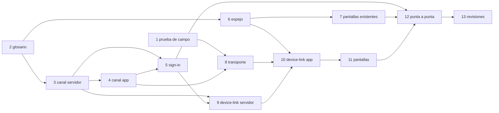

Se pueden hacer a la vez: 3 y 6; 7 y 8 y 9, cada una con su dueño.

## 19. Lo que tiene que decidir Carlos

1. **Enterarse de que el otro volvió (R3.5 y E22 contra R3.6 y E23).** Para que «al volver, se
   encuentran solos», alguien tiene que estar escuchando mientras el otro está cerrado; R3.6 dice que en
   ese caso no hay ningún canal abierto. Lo mismo con «Reconectar» por el servidor mientras el otro
   está «Desconectado».
   - **A. El que espera, a la vista, deja el canal abierto** solo con el tema del vínculo. Gasta unos
     13 KB por hora en el cable (unos 100 KB en un día de 8 horas) en el que espera. E22 y «Reconectar»
     andan solos. Cambia R3.6 y E23: «con el otro cerrado, el que está a la vista escucha; oculto, nada».
   - **B. Nadie escucha:** el que espera se entera en su próximo pedido al servidor (la señal en la
     cabecera), o al tocar el indicador. 0 bytes. E22 se cumple solo si se toca algo.
   - **C (recomendada). Escucha solo la computadora;** el celular se entera con la señal en su próximo
     pedido. El caso común (el celular apaga la pantalla, E22) anda solo y lo paga el Wi-Fi de la
     computadora; el celular no gasta datos por esperar. Cuando vuelve la computadora y el celular
     está en uso, el celular pide algo en segundos y se encuentran. Cambia R3.6 y E23 solo para la
     computadora.
   - Además, en cualquiera: **conservar el directo unos minutos con el celular oculto** (sin espejar,
     solo el Wi-Fi), así una pantalla apagada un momento vuelve al instante y sin internet. Android
     puede cortarlo antes; si lo corta, vale lo de arriba. 0 bytes de internet, algo de batería.
2. **Por el servidor, cada uno pide lo suyo (R6.2).** Reenviar por el servidor la respuesta del que
   pidió hace que el otro la baje **sin comprimir** (una lista que comprimida pesa 3 KB llega con 8 KB)
   y que el que pidió la suba entera. Que cada uno la pida le cuesta al celular lo mismo o menos que sin
   espejo, y al servidor una consulta más.
   - **Recomendado:** por el directo, se reenvía (0 bytes de internet); por el servidor, cada uno pide
     lo suyo y viaja solo lo que se ve. Cambia la letra de R6.2: «por la conexión directa, el otro no
     repite los pedidos».
   - **Alternativa:** reenviar siempre, como dice hoy: el celular paga unas 2 a 3 veces lo que pesa cada
     respuesta comprimida.
3. **Un canal por pestaña a la vista (R7.2 dice «por dispositivo»).** Una pestaña oculta cierra el suyo,
   así que en la práctica es uno por dispositivo. Con dos ventanas de Ferrebress a la vista a la vez,
   serían dos.
   - **Recomendado:** así, que es simple. Cambia la letra de R7.2: «cada pestaña a la vista tiene a lo
     sumo uno».
   - **Alternativa:** uno solo por dispositivo, con una pestaña que lo tiene y lo reparte a las demás
     (`BroadcastChannel` y un candado). Cumple la letra, con unas 150 líneas más y un caso nuevo que
     probar (la pestaña que lo tiene se oculta o se cierra). Ahorra un latido (unos 8 KB por hora) solo
     con dos ventanas a la vista.
4. **Versiones distintas en los dos.** Si uno se actualizó y el otro no, no pueden espejar con
   seguridad (las pantallas pueden ser distintas). No está en las reglas ni en la maqueta.
   - **Recomendado:** el de la versión vieja se actualiza solo si no tiene nada a medio hacer (como al
     entrar, 00 · R5.2), o muestra «Hay una versión nueva» (00 · R5.3); mientras tanto, los dos dicen
     «Esperando al celular» o «a la computadora». 0 bytes de más (la versión nueva se iba a bajar igual).
   - **Alternativa:** espejar igual si solo cambió el código y no `v`: más simple, con el riesgo de una
     pantalla que no existe en el otro (queda en la bandeja y se descarta a los 10 s).
5. **Sin servidores externos para la conexión directa (sin STUN ni TURN).** Recomendado: ninguno; el
   directo es solo por el Wi-Fi del local, que es lo que dice R3.1, y no hay servicio de afuera ni
   costo. Alternativa: el STUN gratis de Google, que ayuda en algunas redes raras donde mDNS no anda
   (un servicio externo más, que ve las direcciones del local; sigue sin servir para redes distintas).
   La tarea 1 lo mide en el local antes de decidir.
6. **Los pedidos automáticos nuevos** (constitución III), para anotarlos en
   [mobile-data.md](../mobile-data.md):
   - Al presentarse (al vincular, al volver a la vista el otro, al volver internet): unos 4 KB entre
     los dos, una vez por encuentro.
   - El canal abierto mientras «Por el servidor», con el código a la vista y, según el punto 1, mientras
     se espera: unos 13 KB por hora en el cable.
   - «Por el servidor»: unos 370 bytes por cambio entre los dos.
   - La señal del buzón: cuando trae algo, un `GET /api/device-link` de unos 300 bytes.
   - `/api/start` con vínculo: 180 bytes más.
   - El aviso de por qué falló el directo: unos 400 bytes, una vez por falla.
7. **El vínculo es de cada persona.** R1.1 dice uno con uno; el diseño lo cuenta por persona: la
   computadora de Ana vinculada a su celular puede estar vinculada también al celular de Beto para
   Beto (cada uno lo ve solo con su sesión, E11). Recomendado: así. Alternativa: uno por dispositivo
   aunque sean personas distintas, y vincular el de Beto reemplaza el de Ana.
8. **Un celular que entró sin conexión y lee el código** (E36): no está en la maqueta qué dice mientras
   se confirma su entrada. Recomendado: la espera común (00 · R7) mientras manda lo pendiente; si no se
   confirma, el aviso de la entrada que ya existe («No se pudo confirmar tu entrada sin conexión»).

**Lo que tiene que hacer Carlos antes de programar:** la tarea 1, abrir la página de prueba en la
notebook y en el celular, en el Wi-Fi del local, y decir qué muestra.
