# Diseño técnico · 03 · Celular y computadora (`device-link`), etapa a: vínculo y espejo

Implementa la etapa a del [capítulo 03](../../chapters/03-device-link/rules.md) y, con ella, **el
mecanismo único de lo que llega del servidor sin pedirlo** (R7), que después usan la espera del código
de entrada (01 · R2.5), la auditoría que se actualiza sola (roadmap T118) y lo que venga. El porqué de
las decisiones de fondo está en [ADR-017](../adr/ADR-017-realtime-channel-and-mirror.md); las cuatro
formas de conectarse, en [ADR-003](../adr/ADR-003-realtime-connections.md). Corregido con sus dos
revisiones ([diseño](device-link-design-review.md), [seguridad](device-link-security-review.md)).

**Estado:** aprobado por Carlos (paso 5).

**Cómo leerlo.** § 2 es el mapa: qué piezas hay, de qué depende cada una y qué datos pasan. § 3 a § 6
son las tres capas comunes, de abajo hacia arriba: el canal con el servidor, la conexión entre los dos
dispositivos y el espejo. § 7 es lo que hace seguro al directo aunque el servidor no lo vea. § 8 es la
máquina de estados del vínculo, que junta todo. § 9 a § 13 son lo de cada diseño (datos, API, eventos,
pantallas). § 14 dice cómo se suma algo nuevo sin tocar lo que existe y qué lo hace robusto; § 15, cómo
se diagnostica un error que no se puede reproducir.

## 1. Qué resuelve

- Las reglas R1 a R8 del capítulo 03 y sus escenarios E01 a E44 (con E17b, E22b, E23b, E26b, E33b, E33c y E39b).
- De 01: que la espera del código QR de entrada pase al mecanismo común (R7.1), sin cambiar lo que ve
  la persona.
- De 00 · R4.3 y de la constitución (III): nada corre de fondo, y cada pedido automático nuevo queda en
  [mobile-data.md](../mobile-data.md) (§ 18.2).
- Deja preparado, sin programarlo, el tema de la auditoría que se actualiza sola (T118, § 14.1).

**La idea técnica en tres capas comunes, que no conocen a `device-link`:**

1. **El canal** (`realtime`): por cada pestaña a la vista que lo necesita, **un solo** canal SSE con el
   servidor, que comparten todos los **temas** que esa pestaña escucha. Lo que no es urgente no abre
   nada: viaja como un **campo** en la cabecera de respuestas que ya existen (`piggyback`).
2. **La conexión entre los dos** (`peer`): un **transporte** que lleva mensajes que no conoce, con dos
   variantes que cumplen la misma interfaz: **directo** (WebRTC, un canal de datos por el Wi-Fi, sin
   servicios externos) y **por el servidor** (quien lo crea le da cómo mandar y cómo recibir).
3. **El espejo** (`mirror`): lo que se ve vive en **valores con nombre**, cada uno con su esquema. Cada
   cambio viaja como un parche de pocos bytes; quién manda y cómo se comparte lo que trae el servidor
   se lo dice quien lo usa.

`device-link` (el módulo) pone las reglas sobre esas capas: quién se vincula, cuánto dura, qué lo
termina, que manda la computadora (R6.3), la confirmación del vínculo (§ 7), la máquina de estados, el
indicador y la tira. Si se lo quita, el canal sigue sirviendo a los otros temas y los valores con nombre
se comportan como valores comunes.

**Lo que decidió Carlos para este diseño**, ya escrito en las reglas:

- Mientras espera al otro, solo **la computadora a la vista** escucha; el celular se entera de que la
  computadora volvió con su próximo pedido (R3.5, R3.6). Con la pantalla del celular apagada, la
  conexión directa se conserva unos minutos sin espejar (§ 8.3).
- **Por el servidor, cada uno pide lo suyo** y viaja solo lo que se ve; por el directo, el otro recibe
  lo que trajo el que pidió (R6.2).
- **Un canal por pestaña a la vista** (R7.2).
- **Con versiones distintas no espejan:** el de la versión vieja se actualiza (R6.7).
- **Sin STUN ni TURN:** el directo es solo por el Wi-Fi del local (§ 4.2).
- Los pedidos automáticos de § 18.2, para `mobile-data.md`.
- **El vínculo es de cada persona** (R1.1).
- E36 dice «Para vincular hace falta internet. Probá cuando vuelva la conexión».
- **El espejo cuenta como uso de las dos sesiones** (03 · R2.5, 01 · R3.3), con la confirmación cada 4
  minutos de uso (R2.6, § 7). Se acepta que una sesión desatendida siga viva mientras se use el otro.
- **Sin internet, el directo sigue con la última confirmación** hasta que vuelva (R3.4).
- **Para volver a encontrarse después de un corte de internet**, el reintento de `useReconnect` (R3.4,
  E21, § 8.5).
- **Lo que la pantalla elige sola por su forma no se espeja** (R6.2, E33c).
- **Después de reemplazar el vínculo al entrar con el celular**, el celular lo avisa una vez (R1.5).
- **La cuenta de datos por día** de § 18.1, en `mobile-data.md`.

## 2. El mapa de las piezas

### 2.1. El servidor

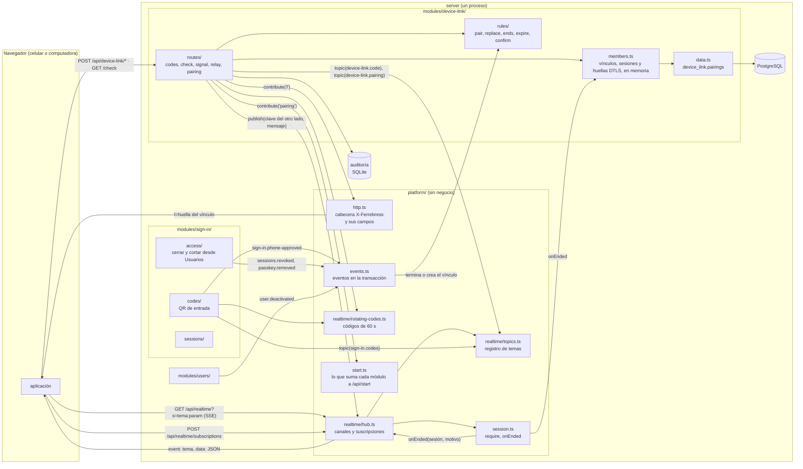

| Pieza | Responsabilidad, en una frase | Depende de | Recibe | Manda |
|---|---|---|---|---|
| `platform/realtime/hub.ts` | Tener abiertos los canales SSE, uno por pestaña, y entregarle a cada uno lo publicado en las claves que escucha | `topics`, `session`, `clock` | Abrir el canal, cambiar suscripciones, `publish(clave, datos)`, `drop(clave)` | `hello {channel}`, `{topic, data}` por tema, `refused {topic, code}`, latido cada 40 s, `closed {reason}` |
| `platform/realtime/topics.ts` | Saber qué temas existen, quién puede escuchar cada uno y qué hacer al empezar y al dejar de escuchar | — | `topic(definición)` de cada módulo | Para el hub: la clave o el rechazo |
| `platform/realtime/rotating-codes.ts` | Dar a quien escucha un código de 128 bits que se renueva cada 60 s, del que vale solo el último y que sirve una vez | `clock` | `start(dueño, enviar)`, `hold(dueño)`, `release(dueño)`, `take(código)`, `stop(dueño)` | El código nuevo, por el tema de quien lo pidió |
| `platform/http.ts` (cambia) | Además de la cabecera de hoy, sumar los campos que dan los módulos, sin conocerlos | — | `header.contribute(letra, (sesión) => texto)` | `X-Ferrebress: …; l=…` |
| `platform/start.ts` | Juntar lo que cada módulo suma a `/api/start`, con tipo | — | `contribute(nombre, (sesión) => datos)` y la interfaz `StartExtras`, que cada módulo amplía como `ServerEvents` | El objeto que `sign-in` agrega a su respuesta |
| `platform/session.ts` (cambia) | Además de resolver la sesión, avisar cuándo termina una, por cualquier motivo (también salir) | `sign-in` le da cómo | `onEnded(escucha)`, `isOpen(id, ahora)` | `(sesión, motivo)` |
| `modules/device-link/routes/` | La entrada HTTP del vínculo: valida, toma persona y dispositivo **de la sesión**, mira que sea del vínculo, llama a la regla y responde | `rules`, `members`, `hub` | § 10 | § 10 |
| `modules/device-link/rules/` | Qué se puede: vincular, reemplazar, terminar, vencer, confirmar; sin tecnología | — | Filas, sesiones y la hora | Decisiones |
| `modules/device-link/data.ts` | Leer y escribir `device_link.pairings`, en lote | Kysely | | |
| `modules/device-link/members.ts` | Contestar sin consultar la base: el vínculo de cada (persona, dispositivo), también «ninguno»; la sesión de cada lado; la huella DTLS que registró cada lado al presentarse | `data`, `session` | Altas, bajas, presentaciones, fines de sesión | Sí o no, y el vínculo |

### 2.2. La aplicación

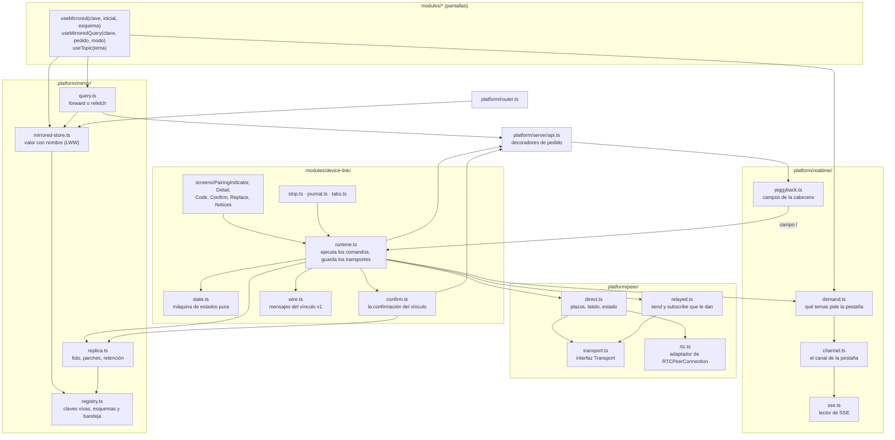

`state.ts` no depende de nada: `runtime.ts` le pasa el estado y el evento y recibe el estado nuevo y los
comandos. Las variantes del transporte dependen de la interfaz, no al revés.

| Pieza | Responsabilidad, en una frase | Depende de | Recibe | Manda |
|---|---|---|---|---|
| `platform/realtime/channel.ts` | Tener abierto a lo sumo un canal por pestaña, solo con temas pedidos, la pestaña a la vista y red | `sse`, `reach` | Los temas pedidos | `GET /api/realtime`, `POST /api/realtime/subscriptions`; reparte cada evento a su tema |
| `platform/realtime/demand.ts` | Contar quién pide cada tema (`useTopic`, o `want` desde código) y juntar los cambios de un mismo dibujo | — | Altas y bajas | Los temas al canal |
| `platform/realtime/piggyback.ts` | Leer los campos de la cabecera **antes** de que `api()` devuelva la respuesta, y avisar a quien los pidió | `api.ts` | `onField(letra, alCambiar)` | El valor nuevo |
| `platform/server/api.ts` (cambia) | Además de lo de hoy, dejar que alguien sume cabeceras a los pedidos | — | `decorate((pedido) => cabeceras)` | |
| `platform/peer/transport.ts` | La interfaz común de los transportes, con mensajes `Json` que no conoce | — | | `send`, `onMessage`, `onClose`, `kind`, `close` |
| `platform/peer/direct.ts` | La lógica del directo: oferta, respuesta, filtro de candidatos, plazos, cuándo se da por perdido, la latencia de `getStats()` | `rtc.ts` | La descripción del otro | La propia; mensajes |
| `platform/peer/rtc.ts` | Lo mínimo que habla con `RTCPeerConnection`; fuera de la cobertura (ADR-005) | El navegador | | |
| `platform/peer/relayed.ts` | Mandar y recibir por lo que le den (`send(lote)`, `subscribe(alRecibir)`), juntando los mensajes | — | Mensajes | Lotes |
| `platform/mirror/mirrored-store.ts` | Un valor con nombre y esquema que se comporta como `createStore` y avisa cada cambio hecho por la persona | `registry` | `set(valor)`, `set(valor, {auto: true})` | Parche |
| `platform/mirror/query.ts` | Pedir al servidor con el modo que dice la clave y guardar la respuesta en un valor con nombre | `api.ts`, `mirrored-store` | `useMirroredQuery(clave, pedido, {mode})` | El pedido, o la espera del valor del que manda |
| `platform/mirror/replica.ts` | Armar la foto, aplicar fotos y parches, retener lo que sale mientras alguien lo pida | `registry` | `attach({port, leader, over})`, `hold(promesa)` | Foto, parches, `stale` |
| `modules/device-link/state.ts` | La máquina de estados del vínculo, pura | — | Estado y evento (§ 8) | Estado y comandos |
| `modules/device-link/runtime.ts` | Ejecutar los comandos, guardar los transportes vivos y convertir lo que pasa en eventos, en una sola fila: un evento se procesa entero, con sus comandos, antes del siguiente. Sus partes, en `runtime/`: `live` (lo vivo y las dependencias), `commands` (uno por comando), `links` (abrir, cerrar, dormir y promover conexiones), `messages` (uno por mensaje del protocolo), `mirror-port` (espejo, saludo y foto) y `topic` (el tema del vínculo) | `peer`, `mirror`, `realtime`, `api`, `confirm`, `wire` | Comandos | Eventos |
| `modules/device-link/confirm.ts` | Que nada salga ni entre por el espejo sin una confirmación del servidor de hace menos de 4 minutos (§ 7) | `api.ts`, `mirror` | Pedidos de mandar o aplicar | Sí, no, o «esperá» |
| `modules/device-link/wire.ts` | El protocolo del vínculo (`hello`, `bye`, `pause`, `resume`, `probe`, `give-up`) y el sobre que lleva los del espejo, validados | contrato | Texto | Mensaje tipado o «desconocido» |
| `modules/device-link/journal.ts` | Anotar cada evento, sin datos personales (§ 15) | `device/storage` | Evento, estado | Las últimas 300 entradas |
| `modules/device-link/strip.ts` | La tira del día, por persona | `server/clock` | Cada cambio de estado | Tramos y totales (R4.4) |
| `modules/device-link/tabs.ts` | Elegir la pestaña que espeja con el candado del navegador (R6.4) | Web Locks | Toques y teclas | «Esta pestaña espeja» o «ya no» |

## 3. El canal con el servidor (`realtime`, código común)

### 3.1. Qué es un tema

Un **tema** es algo que una pantalla espera del servidor. Cada módulo declara los suyos al
registrarse; el hub no sabe qué significan:

```ts
// src/server/platform/realtime/topics.ts
export type TopicDefinition<P, E> = {
  name: string;                         // 'device-link.pairing', 'sign-in.codes', 'audit-log.new'
  param: Schema<P>;                     // qué parámetro lleva la suscripción (zod/mini)
  event: Schema<E>;                     // la forma de lo que manda; el hub la serializa con JSON.stringify
  // Quién puede escuchar y con qué clave: la clave separa a los oyentes (un lado de un vínculo, una pantalla).
  authorize(c: Context, param: P): Promise<{ key: string } | { refused: ErrorCode }>;
  // Al empezar a escuchar, el estado de ahora: así reconectarse nunca pierde nada (§ 3.4).
  onSubscribe?(key: string, send: (event: E) => void, param: P): void | Promise<void>;
  onUnsubscribe?(key: string): void;
  anonymous?: true;                     // se puede escuchar sin sesión (la entrada)
  // Cuándo dejar de valer: el hub vuelve a llamar a authorize con estos eventos (un permiso que cambió).
  recheckOn?: (keyof ServerEvents)[];
};
```

| Tema | Módulo | Parámetro | Clave | Quién | Al suscribirse manda |
|---|---|---|---|---|---|
| `sign-in.codes` | sign-in | la pestaña | la pantalla (cookie `__Host-sign-in-screen`) | sin sesión | el código vigente o la reserva |
| `device-link.code` | device-link | — | la sesión | con sesión, desde una computadora | el código vigente |
| `device-link.pairing` | device-link | el vínculo | el vínculo **y el lado**: `<id>:phone` o `<id>:computer` | con sesión, de **ese** vínculo (el `<id>` se compara con `members.ts`, E38) | si el otro lado escucha |
| `audit-log.new` (T118, no se programa) | audit-log | el último id visto | `all` | con `audit.view`; `recheckOn: ['users.permissions-changed']` | cuántas hay nuevas |

Con la clave por lado, `publish` de lo que manda la computadora va a `…:phone` y nunca vuelve a quien lo
mandó ni a una pestaña reemplazada.

### 3.2. El canal de la aplicación

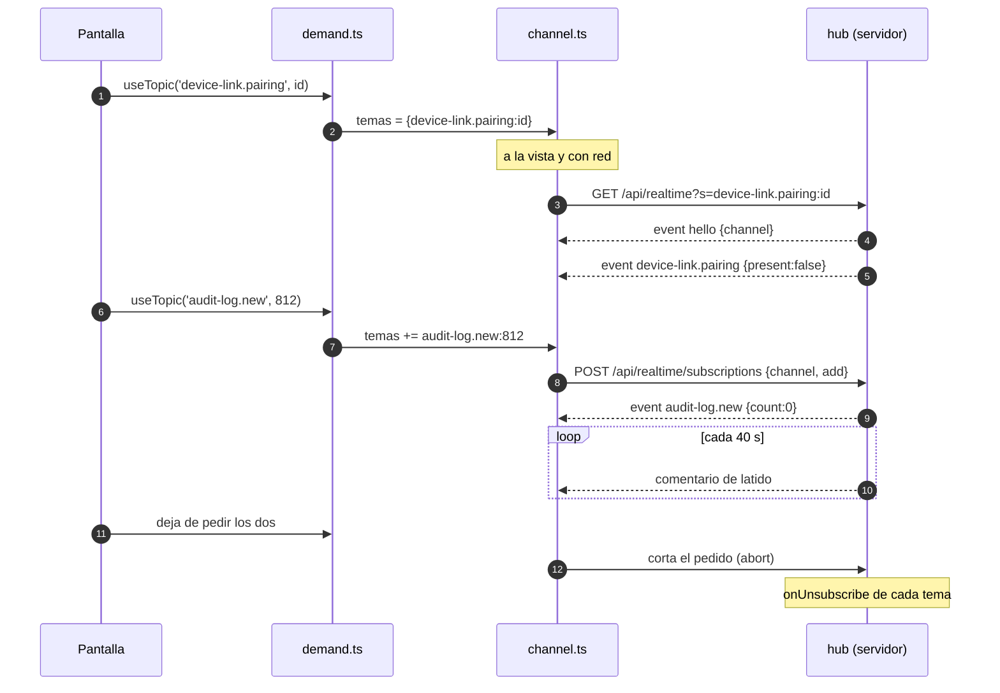

- **Uno por pestaña, nunca de fondo** (R7.2). Se abre cuando hay al menos un tema pedido, la pestaña
  está a la vista y el navegador dice que hay red; se cierra cuando falta cualquiera de las tres. Al
  ocultarse la pestaña se corta en el acto.
- **Sumar o sacar temas no rehace el canal:** `POST /api/realtime/subscriptions {channel, add, remove}`,
  con el identificador del canal (128 bits al azar, que llega en `hello`). `demand.ts` junta los cambios
  de un mismo dibujo en una microtarea.
- **El dueño del canal se fija al abrirlo:** una sesión o una cookie de pantalla. Un canal abierto sin
  sesión no puede sumar temas con sesión; al entrar, la pantalla cierra su canal anónimo (como hace
  hoy `claim` con la pantalla) y lo que necesite con sesión abre otro.
- **No usa `EventSource`**: es el lector con `fetch` de hoy (`server/realtime.ts`), que pasa a
  `realtime/sse.ts` con el mismo reintento (tres veces con espera creciente, y después espera a que
  vuelvan la red o la vista; con `429`, lo que dice el servidor). Cada evento se valida con el esquema
  de su tema; uno que no valida se descarta sin cortar la lectura.
- **Un corte se nota en menos de un minuto (R7.2):** el servidor manda un comentario (`:\n\n`) cada 40 s,
  con **un solo temporizador** para todos los canales; la aplicación da el canal por cortado si no llegó
  nada en 55 s.
- **Medido en el ambiente de pruebas** (con la entrada ya sobre el canal común): un canal quieto pasó
  100 s por el proxy de la máquina y el Caddy de Ferrebress sin cortarse, con el latido a los 37 y a
  los 77 s y el código nuevo a los 60 s, cada uno en el momento (sin juntarse).
- **HTTP/2:** el canal va por la misma conexión que los pedidos. Con cuatro pestañas y HTTP/1.1 ocuparía
  cuatro de las seis conexiones del navegador: la tarea 1 comprueba que el proxy de la máquina hable
  HTTP/2 y no junte ni corte el SSE antes de los 40 s.

### 3.3. El servidor: el hub

- **Abrir:** `GET /api/realtime?s=<tema>[:<param>]&s=…` (como mucho 16). Cada tema contesta `authorize`
  por su cuenta: **un tema rechazado no impide los otros**; el canal se abre con los que pasaron y manda
  `refused {topic, code}` por cada uno que no. Si no pasó ninguno, `403` con el primer motivo. Sin
  sesión, solo temas `anonymous`.
- **Quién lo tiene abierto:** `channels: Map<channelId, Channel>` y `byKey: Map<clave, Set<Channel>>`.
  `publish(clave, evento)` es una búsqueda y una escritura por oyente: sin consultas. El nombre del
  evento SSE es siempre el del tema registrado y los datos van siempre con `JSON.stringify`, nunca un
  texto que mandó un dispositivo (los saltos de línea no pueden inventar campos de SSE).
- **`drop(clave)`** suelta todas las suscripciones de una clave y les manda `closed`: `device-link` lo
  llama al terminar un vínculo, así nadie queda escuchando una clave muerta.
- **El oyente lento:** si lo que espera escribirse en un canal pasa de 256 KB (un celular con mala señal
  que no lee), el hub lo cierra con `closed {reason: 'slow'}`.
- **La sesión manda.** `sessions.onEnded` avisa el fin de una sesión por cualquier motivo (salir,
  cerrarla desde Usuarios, la baja, y el vencimiento cuando se lo descubre) y el hub cierra sus canales.
  En cada latido calcula además, en memoria, `closedReasonOf(sesión, ahora)` de la sesión de cada canal
  y cierra los vencidos: **tener el canal abierto no cuenta como uso** y no alarga ninguna sesión.
- **Los permisos:** los temas con `recheckOn` vuelven a pasar `authorize` cuando llega ese evento; el que
  ya no pasa recibe `refused`.

**Topes**, en la configuración:

| Qué | Con sesión | Sin sesión |
|---|---|---|
| Canales abiertos | 4 por sesión | 3 por dirección (IPv6 por su `/64`, con `networkOf`) |
| Aperturas | 10 por minuto **por sesión** | 10 por minuto por dirección |
| Total | 2.000 | 200, dentro de los 2.000: los anónimos nunca le sacan lugar a quien tiene sesión |
| Temas por canal | 16 | 16 |
| Cambios de suscripción | 60 por minuto por canal | ídem |

Así un cliente en el Wi-Fi del local, o un desconocido detrás del mismo NAT del operador, no deja sin
canal a las computadoras del local: con sesión se cuenta por sesión, como ya hace `requestSession`.

### 3.4. Reconectarse sin perder nada

Cada tema **manda su estado de ahora al suscribirse** (`onSubscribe`). Un corte, una pestaña que vuelve
a la vista o un servidor que se reinicia nunca dejan a una pantalla con algo viejo: el canal no guarda
lo que se perdió ni usa `Last-Event-ID`. Lo que se manda por un tema es **idempotente**: recibirlo dos
veces da lo mismo que una.

### 3.5. Lo que no es urgente: campos en la cabecera

`X-Ferrebress` suma los campos que contribuye cada módulo con `header.contribute(letra, (sesión) =>
texto | undefined)`. El de este módulo es **`l=`, la huella del vínculo**: 8 caracteres hexadecimales del
SHA-256 de `(id del vínculo, pausa, si el otro lado escucha)`, calculada de `members.ts`, sin consultas.
Solo con sesión y con vínculo; si no, no va.

- Cuesta unos 12 bytes en cada respuesta de un dispositivo vinculado y no guarda nada: sobrevive a un
  reinicio del servidor y no hay que borrarla.
- La aplicación (`platform/server/fields.ts`) la lee **antes** de devolver la respuesta a quien pidió. Si
  cambió, `device-link` da por vencida la última confirmación del directo (`confirm.stale()`, § 7) y pide
  `GET /api/device-link/check`: lo que la respuesta que trajo el cambio mueva en el espejo queda retenido
  hasta una confirmación nueva, y con el vínculo terminado se tira (revisión de seguridad, 1). No se frena
  la respuesta misma: si la trajo un pedido del propio vínculo, esperarla trabaría su fila.
- Así se entera sin canal de que lo terminaron desde Usuarios, de que lo reemplazaron, de que el otro
  tocó «Reconectar» y, con la decisión de R3.5, el celular de que la computadora volvió y escucha.
- Sumar otro campo es otra llamada a `contribute` en su módulo y otro `onField` en la aplicación; si un
  día hace falta un buzón con contenido (señales que se guardan hasta leerse), es una pieza más con la
  misma forma. Hoy ningún tema lo necesita.

## 4. La conexión entre los dos (`peer`, código común)

### 4.1. El transporte

```ts
// src/app/platform/peer/transport.ts
export type TransportKind = 'direct' | 'relayed';
export interface Transport {
  readonly kind: TransportKind;
  send(message: Json): void;               // nunca tira: cerrado, no hace nada; más de 64 KB, lo rechaza
  onMessage(listener: (message: Json) => void): () => void;   // sin validar: valida quien lo usa
  onClose(listener: (why: CloseReason) => void): () => void;
  close(why: CloseReason): void;           // idempotente
}
```

- El transporte **no conoce lo que lleva**: `device-link` le pone y le saca su sobre (`wire.ts`), y el
  espejo valida lo suyo. Un transporte de mentira con esta interfaz es lo que usan las pruebas.
- **No hay una lista de transportes intercambiables:** la regla es «directo, y si no se logra, por el
  servidor», y la decide la máquina de estados (§ 8), porque el indicador, la tira y las reglas nombran
  cada uno. Un tercer transporte sería un cambio de regla.
- **Un solo tope para los dos: 64 KB por mensaje**, el de un cuerpo en Caddy y en Hono. En un canal de
  datos ordenado, un mensaje grande frena a los que vienen detrás; con 64 KB, menos de 10 ms en el Wi-Fi.

### 4.2. Directo: WebRTC sin servicios externos

- **Solo un canal de datos**, sin audio ni video: `RTCPeerConnection({ iceServers: [] })` y
  `createDataChannel('mirror', { ordered: true })` (SCTP confiable y en orden).
- **Sin STUN ni TURN** (decidido): solo el Wi-Fi del local (R3.1); dos dispositivos en redes distintas
  van por el servidor (E09). Ningún servicio de afuera ve las direcciones del local.
- **Las direcciones:** sin permiso de cámara, Chrome esconde la dirección local con un nombre `.local`
  (mDNS). **Con permiso de cámara** (el celular lo tiene, para leer códigos), Chrome pone las direcciones
  reales de cada interfaz, también la IPv6 global de los datos móviles. Por eso `direct.ts` filtra los
  candidatos antes de mandar la descripción, y el servidor los vuelve a filtrar en `signal`: solo
  `typ host` en UDP con nombre `.local` o una dirección privada (10/8, 172.16/12, 192.168/16,
  fc00::/7, fe80::/10); el resto (TCP, IPv4 de 100.64/10, IPv6 global) se saca de la descripción. La descripción nunca se anota.
- **Roles fijos, sin choques:** la computadora siempre ofrece y el celular siempre responde.
- **Sin goteo de candidatos:** con candidatos locales, juntarlos tarda menos de 100 ms; la oferta va con
  todos en **un** mensaje, y la respuesta igual.
- **Un solo lado decide que falló:** la computadora. Si el canal de datos no abre en 5 s desde la oferta,
  manda `give-up` por el servidor y los dos pasan al respaldo; el celular no mide su propio plazo.
- **Seguir vivo:** ICE comprueba la conexión cada pocos segundos (paquetes STUN de unos 100 bytes por el
  Wi-Fi, no internet). Con `iceConnectionState` en `disconnected` más de 5 s, o `failed`, el transporte
  se cierra con `lost`.
- **El certificado DTLS** se crea una vez por pestaña (`RTCPeerConnection.generateCertificate`), así su
  huella (`a=fingerprint`) es la misma en cada presentación de esa pestaña: es lo que la confirmación del
  vínculo ata a la sesión (§ 7).
- **La latencia de la ruta** (la maqueta muestra «12 ms»): `getStats()`, el `currentRoundTripTime` del par
  de candidatos, leído cada 2 s solo con el detalle abierto. Es una lectura local: no manda nada.
- **Adaptador y lógica separados:** `rtc.ts` solo crea la conexión, la descripción y el canal (lo que
  habla con el navegador, fuera de la cobertura). Los plazos, el filtro, `lost` y la latencia están en
  `direct.ts`, con pruebas unitarias sobre un `rtc.ts` de mentira.

### 4.3. Por el servidor

- `relayed.ts` recibe al crearse cómo mandar (`send(lote)`) y cómo recibir (`subscribe(alRecibir)`).
  `device-link` le da `POST /api/device-link/relay` y el tema `device-link.pairing` de su lado: el código
  común no nombra ninguna ruta ni tema del módulo.
- **Juntar:** lo que sale en los mismos 50 ms va en un lote, y dos parches de la misma clave se quedan con
  el último. Lo escrito en un campo se junta durante 150 ms, la misma espera de la búsqueda (00 · R7.4):
  una persona escribe una letra cada 150 a 250 ms, así que «tornillo» sale en 2 o 3 pedidos, no en 8.
- **Cerrar manda lo pendiente:** el adiós o la pausa que salen justo antes de cerrar el respaldo van en un
  último lote, sin esperar respuesta.
- **Lo que llega antes de abrirlo espera** (hasta 20 lotes) y se entrega en orden apenas hay quien lo
  escuche. El `give-up` de la computadora llega así al celular, todavía presentándose: es lo que lo hace
  pasar al respaldo, y el lote que lo trae (`give-up`, `hello`, `snap`) se entrega entero después.
- El servidor reenvía al otro lado (clave `…:<lado del otro>`), sin guardar nada. Antes de cada lote
  mira en `members.ts` que el vínculo exista y que **la sesión del otro lado siga abierta**: por el
  servidor, la seguridad la pone el servidor en cada mensaje.
- La latencia: lo que tarda la respuesta del último `relay`, por dos. No hay `ping`.

### 4.4. Presentarse

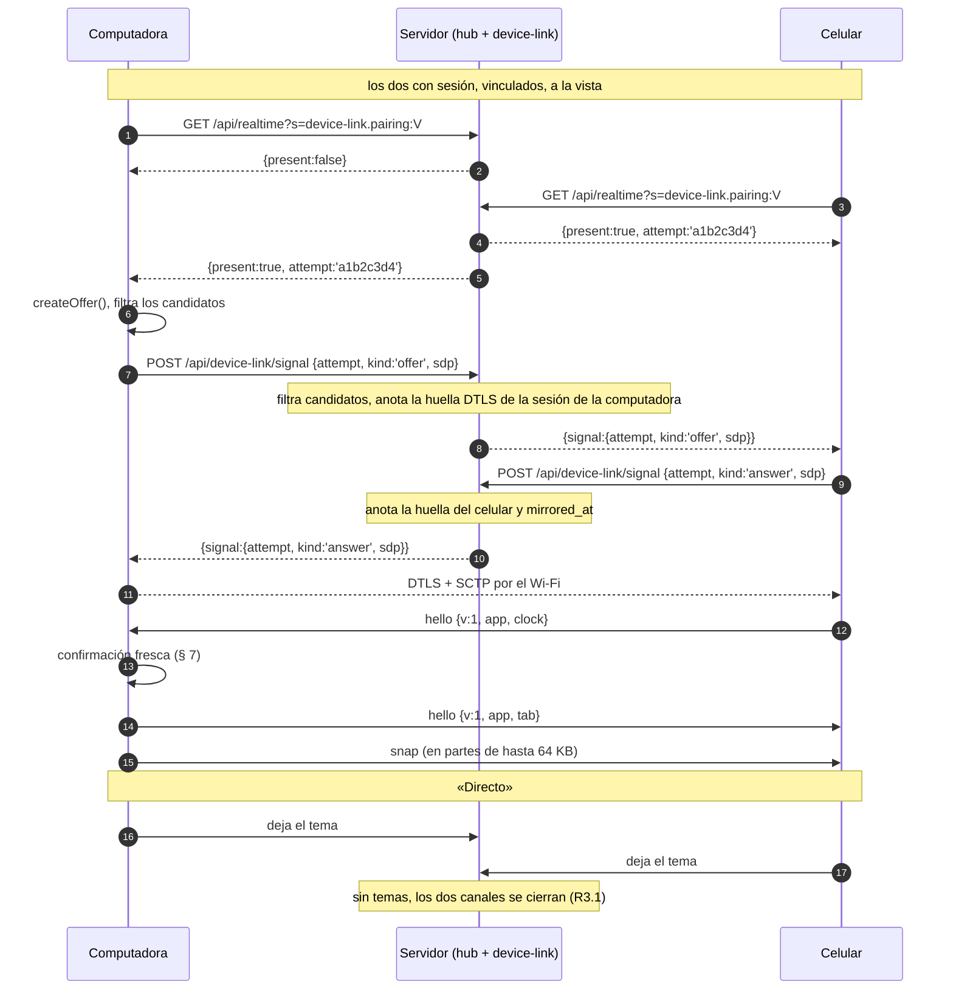

- `attempt` lo da el servidor al presentarlos y es el mismo en los dos y en el registro (§ 15).
- El servidor reenvía la señal solo entre los dos lados del vínculo, solo si los dos escuchan y solo si
  el vínculo existe (E38, E39). Valida el tamaño (8 KB), un solo `m=application` y los candidatos.
- **El `hello`** dice la versión del protocolo (`v`), la del código (`app`) y, el del celular, su reloj
  más alto (§ 5.2). Con otra `app`, no espejan (R6.7, § 8.4).

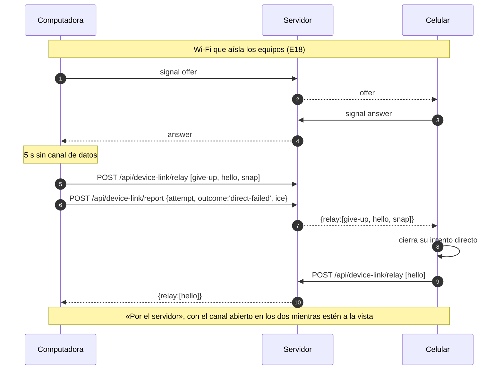

- **El respaldo no reintenta el directo por su cuenta (R3.3).** «Probar conexión directa» manda `probe`
  por el servidor y la computadora ofrece de nuevo **mientras sigue el respaldo** (`relayed` con
  `probe: 'trying'`): si el canal de datos abre, se cambia sin cortar; si no, «No se pudo» (E19).

## 5. El espejo (`mirror`, código común)

### 5.1. Qué se espeja: valores con nombre y esquema

Las pantallas guardan lo abierto, lo escrito y lo elegido en estado local de Preact (`useState`, unos
33 en `src/app/modules/`): no hay un punto único por donde pasen las acciones. Repetir acciones en los
dos obligaría a que cada una diera lo mismo en los dos (no lo da si pide al servidor) y no alcanza para
lo escrito letra por letra. El espejo replica **el estado a la vista** (R6.2):

```ts
// src/app/platform/mirror/mirrored-store.ts
export function mirroredStore<T extends Json>(key: MirrorKey, initial: T, schema: Schema<T>): Store<T>;
// Como useState, para el estado de una pantalla.
export function useMirrored<T extends Json>(key: MirrorKey, initial: T, schema: Schema<T>):
  [T, (next: T, options?: { auto?: true }) => void];

// src/app/platform/mirror/query.ts
export type QueryMode =
  | 'forward'   // el pedido es el mismo en los dos: por el directo lo pide el que manda y el otro recibe
  | 'refetch';  // el pedido depende del dispositivo o del permiso: cada uno pide el suyo
export function useMirroredQuery<T extends Json>(
  key: MirrorKey, request: () => Promise<ApiResult<T>>, deps: unknown[],
  options: { mode: QueryMode; schema: Schema<T> },
): { data?: T; failed: boolean; update(change: (now: T) => T): void; invalidate(): void };
```

- **Cada valor tiene su esquema** (`zod/mini`): lo que llega y no valida se descarta y queda en el diario
  (revisión de seguridad, 8). Un control de `pnpm check` exige el esquema.
- **Lo que la pantalla pone sola no viaja:** `set(valor, { auto: true })` cambia el valor solo en este
  dispositivo. Es para lo que cada forma elige por su cuenta, como la primera persona que Usuarios abre
  sola en la computadora: viaja lo que elige la persona, no lo que la pantalla elige por su ancho.
- **`refetch`** es para lo que se pide distinto en cada uno: Quién hizo qué pide de a 20 en la
  computadora y de a 10 en lo angosto (05 · R4.3), así que viajan el filtro y la página, y cada uno pide
  con su tamaño, su sesión y su permiso, como ya decía el diseño de 05.
- **Qué no es un valor con nombre:** lo que es solo del dispositivo: el menú minimizado (00 · R1.6), Alt
  apretado, el foco, cuánto se bajó en una lista, la cámara abierta, la entrada y todo lo de `sign-in`, la
  sesión, la llave de prueba y los avisos del marco. En las pantallas **no hay `useState` sin un
  comentario `// local:`** que diga por qué; lo controla `pnpm check`, que es más simple y confiable que
  adivinar por el nombre.
- **Las claves** son `<módulo>.<pantalla>.<cosa>` (`users.list.selected`, `audit-log.list.filters`); las de
  lo que trae el servidor, `q:<módulo>.<pantalla>.<cosa>` más su parámetro (`q:users.card.person:<id>`). No
  puede haber dos iguales.
- **Sin espejo, son valores comunes:** sin vínculo, o sin `device-link`, `useMirrored` es un `useState`
  con nombre y `useMirroredQuery` es pedir y guardar. Ningún módulo sabe del vínculo.
- **La tarea 8 dice pantalla por pantalla qué se espeja y cómo:**

| Pantalla | Qué se espeja | Cómo | Qué queda local |
|---|---|---|---|
| Marco | La dirección, lo abierto encima, Más en el celular | valores | El menú minimizado, los avisos |
| Usuarios | La búsqueda, la persona elegida por la persona, lo abierto encima, la tarjeta y la lista | valores; `q:` en `forward` | La primera persona que abre sola la computadora (`auto`) |
| Roles | El rol elegido, lo abierto encima, los permisos tildados sin guardar | valores; `q:` en `forward` | |
| Quién hizo qué | Los filtros, la página, la acción elegida, la cinta abierta | valores; la página en `refetch` | El tamaño de la página, el cabezal de la cinta |
| Manual | La tarea y el paso | valores | El contenido por dispositivo (el manual es distinto en cada forma) |

Cómo quedó: Usuarios espeja la búsqueda, los filtros, la persona elegida (la que la computadora abre
sola no viaja), lo abierto encima, lo escrito al autorizar, los roles tildados de una persona, la
búsqueda de roles, el rol a medio armar y elegir a quién darle un rol. Quién hizo qué espeja lo pedido
(filtros, página y «Actualizar»), la acción elegida y la cinta abierta; cada uno pide con su tamaño.
Lo que trae el servidor lo sigue pidiendo cada dispositivo (T123). Lo que se abre del marco queda en
cada uno: cambia de forma entre la computadora y el celular, y lo que cambia la pantalla es la
dirección, que viaja. El manual, en T122. `pnpm check` (`tools/checks/local-state.ts`) exige que cada
`useState` de los módulos diga `// local:` y por qué; la entrada no se mira.

### 5.2. Cómo viaja un cambio

- **Parche:** `{t:'set', k:'users.list.search', v:'torn', c:42}`. `c` es un reloj de Lamport por
  dispositivo. Quien recibe aplica si `(c, lado)` es mayor que lo que tiene, con la computadora ganando
  el empate: **gana el último que escribe**, y repetir o desordenar parches no cambia el resultado
  (registro LWW por clave, ADR-017).
- **La foto es un parche más (R6.3).** El `hello` del celular lleva su reloj más alto; la computadora
  sube el suyo por encima de ese y marca cada valor de la foto con ese reloj. Un parche que el celular
  mandó antes de recibir la foto pierde en los dos lados: la regla es una sola y quedan iguales.
- **La foto** lleva todo lo vivo: `{t:'snap', part, of, values:[[clave, valor, c]…]}`, partida en
  mensajes de hasta 64 KB. El celular vuelve al valor inicial lo que la computadora no tiene y va a su
  dirección. Por el servidor, la foto no lleva los `q:`: cada uno los pide (R6.2).
- **Lo que trae el servidor solo va del que manda al otro:** un `q:` que llega del celular se descarta.
  Si el celular tuvo que pedir él (abajo), el resultado queda en el celular y no viaja.
- **Llega antes que su pantalla:** un valor de una clave que todavía no existe queda en una bandeja
  hasta que la pantalla la registra, como mucho 10 s, 64 claves y 1 MB.
- **Tope:** un valor de más de 64 KB no se espeja (queda en el diario como `too-large`): una lista así se
  pide en páginas.

### 5.3. Quién le pide al servidor

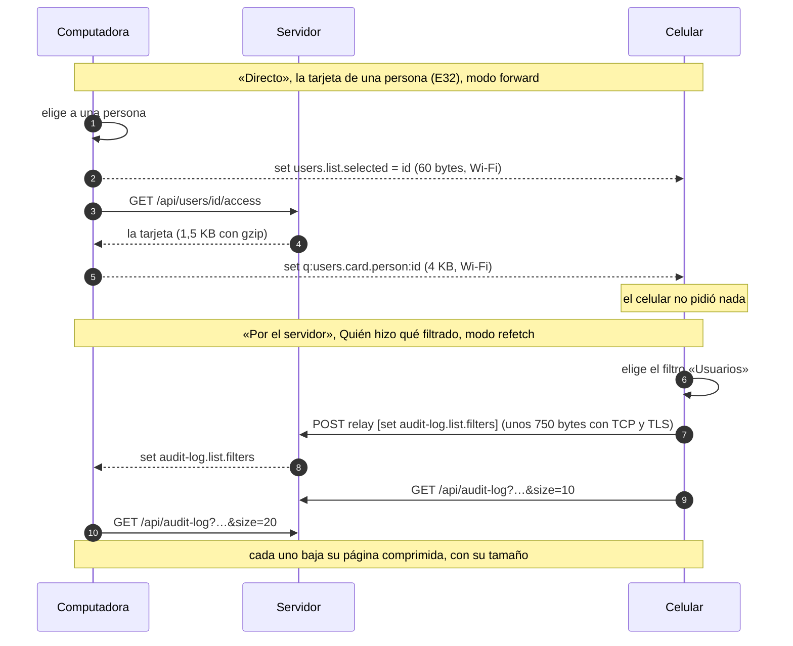

- **Quién manda** se lo dice `device-link` al espejo al conectarlo (`attach({ port, leader, over })`): la
  computadora (R6.3). El espejo no lo decide.
- **`forward` por el directo:** pide el que manda y el otro recibe la respuesta por el Wi-Fi: el celular,
  que paga los datos, no pide lo que se muestra. Si a los 3 s no llegó, el celular pide él (diario:
  `query-timeout`) y el resultado no viaja.
- **Por el servidor, todo es `refetch`:** cada uno pide lo suyo y viajan solo los parches de lo que se ve
  (R6.2). Reenviar una respuesta por el servidor la sube entera y la baja sin comprimir.
- **Lo que cambia algo** (un POST) lo hace solo el dispositivo donde se tocó: sale de un toque o una
  tecla, nunca de un efecto que mira un valor. Mientras el espejo aplica algo del otro, `api.ts` no deja
  salir un POST (falla en desarrollo), así un cambio que llega del otro nunca escribe. Con la respuesta,
  la pantalla llama a `update`: por el directo viaja el valor nuevo; por el servidor viaja el valor nuevo
  si pesa menos de 4 KB (una persona de la lista) y, si no, `{t:'stale', k}` y el otro lo vuelve a pedir.
- **Las búsquedas** siguen esperando 150 ms y dejando sin efecto la anterior (00 · R7.4) en quien pide.

### 5.4. La dirección

`router.route` es un valor con nombre, pero no un valor común: lleva el historial y la guarda de lo sin
guardar. Lo que viaja es solo `{ path, search }`, validado contra las direcciones del menú:

- **Lo que va después del `#` no viaja nunca** (ahí van los códigos) ni `history.state`.
- **La dirección que llega del otro entra al historial** (`pushState`): «Atrás» funciona en cada uno y,
  al usarlo, la dirección nueva viaja como cualquier otro cambio. Aplicar una dirección del otro no la
  vuelve a mandar.
- **La guarda la pregunta quien navega:** si hay algo sin guardar, se pregunta en el dispositivo donde se
  tocó; el otro tiene lo mismo escrito (está espejado) y aplica la dirección sin preguntar (`force`),
  porque la persona ya decidió.

### 5.5. Un cambio espejado, de punta a punta

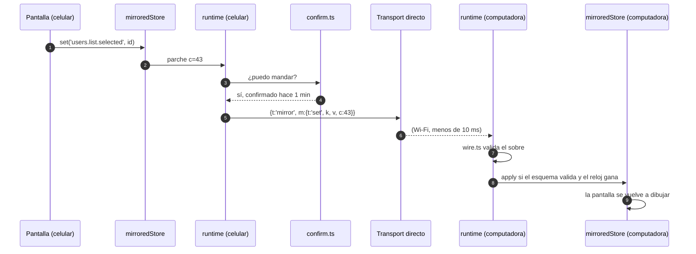

## 6. Varias pestañas en la computadora (R6.4)

- Solo una pestaña espeja: la última que se usó. `tabs.ts` toma el candado del navegador
  (`navigator.locks.request('ferrebress.mirror', { steal: true })`) en la pestaña donde la persona toca o
  aprieta una tecla, si está a la vista. **Solo la que tiene el candado se suscribe** al tema del vínculo:
  decide un solo lugar. La que lo pierde se entera porque el navegador le corta su candado: manda
  `bye {why:'handover'}` y cierra su transporte.
- Cambiar de pestaña necesita internet, porque hay que presentarse otra vez (de 300 ms a 1 s). Sin
  internet, la pestaña que espejaba sigue hasta que vuelve (el mismo borde de R3.4).

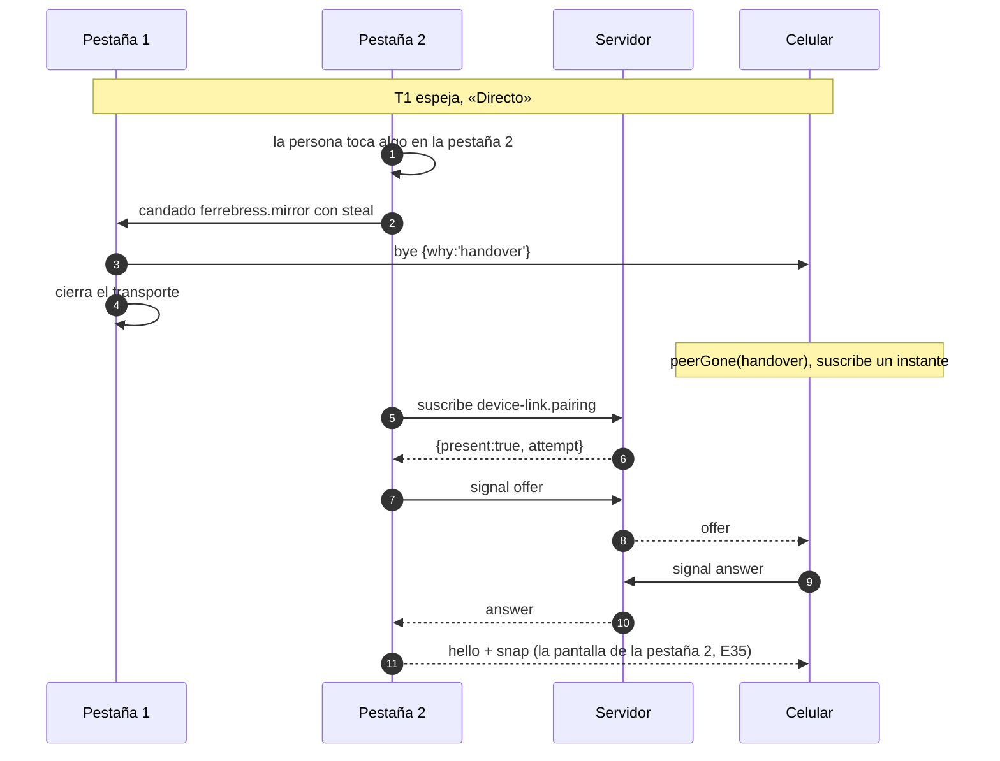

## 7. La confirmación del vínculo: el directo seguro sin el servidor en el medio

El servidor no ve la conexión directa y no puede cortarla. Si terminan el vínculo, cortan el celular o
cierran una sesión, **ningún dispositivo puede seguir espejando más de 4 minutos de uso**, aunque el otro
esté en manos de alguien que modificó la aplicación. No depende de que el que sigue en regla se entere
por casualidad: cada uno **exige** una confirmación reciente antes de mandar o aplicar cualquier cosa.

### 7.1. La regla

- **Confirmar** es `GET /api/device-link/check?fp=<huella DTLS del otro>`. El servidor contesta, desde
  `members.ts` y sin consultas, si: el vínculo de esta sesión existe; la huella `fp` es la que registró
  **en la presentación de esta conexión** la sesión del otro lado (§ 4.4); y esa sesión sigue abierta
  (`closedReasonOf` con la hora de ahora, ADR-015). Responde `{ pairing, peer: 'ok' | 'gone' }`.
- **Antes de mandar** un parche, una foto o un `q:`, y **antes de aplicar** uno que llegó, `confirm.ts`
  mira que la última confirmación con `peer: 'ok'` tenga menos de 4 minutos y que no haya cambiado `l=`
  después. Si no, retiene lo que sale y lo que entra, en orden, y confirma. Con `gone` o sin vínculo, la máquina recibe
  `peerGone('signed-out')` o `serverSaid(none)` y no sale ni entra nada más.
- **Un `hello` o un `resume` del otro** exige una confirmación de menos de 30 s antes de mandar la foto:
  reconectar por un canal de datos conservado ya no manda nada sin preguntarle al servidor.
- **Solo confirma quien está en uso:** la confirmación sale cuando hay algo que mandar o aplicar y la
  anterior venció. Sin que nadie toque nada, no sale ninguna (E23, E24). No hay temporizador.
- **Por el servidor** no hace falta: el servidor mira el vínculo y la sesión del otro en cada `relay`.
- **Sin internet** (R3.4): si confirmar falla porque no hay conexión, se sigue con la última
  confirmación buena mientras este dispositivo no llegue al servidor. Al volver internet, lo primero es
  confirmar. Hasta 30 minutos (`deviceLinkSettings.confirm.offlineMs`, en el `settings.ts` del módulo): después la máquina recibe `peerGone('lost')`,
  deja de espejar y queda «Sin internet» hasta llegar al servidor. El tope es porque el otro sí puede
  hacer que le falte internet: en el mismo Wi-Fi, cortándole el camino al servidor sin cortar el Wi-Fi
  (revisión de seguridad del código, 7).

### 7.2. Qué más cierra

- **La sesión del celular no vence en medio del espejo** (revisión de diseño 1.1, de seguridad 2): las
  confirmaciones son pedidos de su sesión, así que cuentan como uso (ADR-015) mientras se use; sin uso,
  vence a los 60 minutos como siempre. Traen además la huella de los permisos (`p=`, R6.6) y el campo
  `l=`. Así el espejo cuenta como uso de las dos sesiones (R2.5).
- **Las escrituras dicen con qué vínculo se hicieron:** mientras espeja, `device-link` suma a cada `POST`
  la cabecera `X-Pairing: <id>` (con `api.decorate`), y un paso que registra en el servidor contesta
  `409 pairing-ended` si ese vínculo ya no existe o la sesión del otro lado se cerró: nada que haya
  escrito un par cortado sale con la sesión del otro. Anota `device-link.rejected` una vez por ventana.
  No son escrituras del espejo, y no llevan la cabecera ni pasan por el paso, entrar y salir, el canal
  y las rutas del vínculo (`isMirroredWrite`, en `shared/contracts/pairing.ts`): salir, desvincular y
  desconectar andan aunque el vínculo ya haya terminado (revisión de seguridad del código, 1).
- **La sesión propia cerrada o vencida suelta el vínculo en el momento:** con la entrada encima de lo
  que había, para el vínculo ya no hay nadie (`sessionLost`), sin esperar a la próxima confirmación.
- **La respuesta que trae el aviso no viaja** (§ 3.5).

### 7.3. Lo que queda

Un dispositivo cortado ve, como mucho, lo que ya estaba en pantalla y lo que el otro muestre durante los
4 minutos de uso desde la última confirmación del otro; y, sin internet en el otro, hasta que vuelva.
Lo aceptó Carlos (R2.6, R3.4) y está en § 16.

## 8. La máquina de estados del vínculo

En la aplicación, por pestaña y por persona con sesión. Es una función pura en
`modules/device-link/state.ts`: `step(estado, evento) → { estado, comandos }`. Los estados guardan solo
datos (el vínculo, el `attempt`, el tipo de transporte): **los transportes vivos los guarda
`runtime.ts`**, así un estado se puede guardar en el diario y volver a correr.

### 8.1. Estados, eventos y lo que muestra el indicador

```ts
type PairingState =
  | { kind: 'asleep' }                                         // sin sesión (R2.1)
  | { kind: 'unpaired' }
  | { kind: 'waiting'; pairing: Pairing; dormant?: AttemptId; why?: 'version' }
  | { kind: 'meeting'; pairing: Pairing; attempt: AttemptId }
  | { kind: 'direct'; pairing: Pairing; attempt: AttemptId }
  | { kind: 'relayed'; pairing: Pairing; attempt: AttemptId; probe?: 'trying' | 'failed' }
  | { kind: 'paused'; pairing: Pairing; kept?: AttemptId }
  | { kind: 'offline'; pairing: Pairing }
  | { kind: 'away'; pairing: Pairing; dormant?: AttemptId };   // esta pestaña oculta o sin el candado

type PairingEvent =
  | { type: 'serverSaid'; pairing: Pairing | null }            // /api/start, check, l= cambiado, 403 not-paired, codes
  | { type: 'sessionLost'; samePerson: boolean }              // salir, sesión cerrada o vencida, otra persona
  | { type: 'peerPresent'; attempt: AttemptId }
  | { type: 'peerBack'; attempt: AttemptId }                  // hello por el directo dormido o conservado
  | { type: 'peerGone'; why: 'hidden' | 'signout' | 'signed-out' | 'lost' | 'handover' | 'replaced' | 'unpair' | 'version' }
  | { type: 'directUp' | 'directFailed' | 'relayUp'; attempt: AttemptId }
  | { type: 'internetLost' } | { type: 'internetBack' }
  | { type: 'pause' | 'resume'; from: 'here' | 'peer' }
  | { type: 'probe' } | { type: 'probeResult'; attempt: AttemptId; ok: boolean }
  | { type: 'tabAway'; why: 'hidden' | 'handover' } | { type: 'tabBack' }
  | { type: 'dormantLost' };                                   // el directo dormido se cerró o venció
```

Entrar con sesión es el `serverSaid` del vínculo que contesta `check` al abrir: no hace falta otro evento.

No se puede escribir «directo sin vínculo» ni «probando sin estar por el servidor». `step` es un `switch`
sobre `estado.kind` y `evento.type` que termina en `assertNever`: sumar un estado o un evento sin decir qué
pasa en cada caso no compila. Un evento de un `attempt` que no es el del estado (un `directUp` tardío) no
cambia nada y queda en el diario como `ignored`.

| Estado | Indicador (R4.1) | Canal con el servidor | Transporte |
|---|---|---|---|
| `asleep` | (no se muestra: no hay sesión) | ninguno | ninguno |
| `unpaired` | Sin vincular | ninguno (salvo el del código, con el código a la vista) | ninguno |
| `waiting` | Esperando al celular / a la computadora | la computadora: el tema del vínculo; el celular: ninguno (se fija una vez al entrar, § 8.3) | el directo dormido, si el celular se ocultó hace menos de 5 minutos |
| `meeting` | Esperando… (menos de 5 s) | el tema del vínculo | armándose |
| `direct` | Directo | **ninguno** (E24) | directo |
| `relayed` | Por el servidor; con `probe:'trying'`, la espera en «Probar» a los 300 ms; con `'failed'`, «No se pudo» | el tema del vínculo | por el servidor (y un directo a prueba) |
| `paused` | Desconectado | la computadora a la vista, el tema del vínculo, si no conservó el directo | el directo conservado sin espejar, si lo había |
| `offline` | Sin internet | ninguno | ninguno |
| `away` | (oculta) | ninguno | el directo dormido, si estaba en directo al ocultarse |

### 8.2. El gráfico

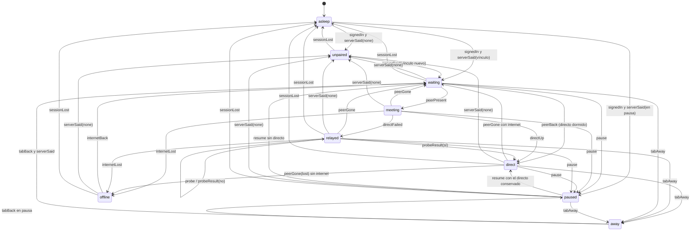

`serverSaid` con **otro** vínculo (un reemplazo, E05, E06, E08) es «vínculo nuevo»: desde cualquier
estado con vínculo, cierra el transporte con `bye {why:'replaced'}` y va a `waiting` con el nuevo. Para
que el gráfico se lea, esas flechas no se dibujan: están en la tabla.

### 8.3. Las transiciones, con sus comandos

| De | Evento | A | Comandos |
|---|---|---|---|
| `asleep` | `signedIn` y `serverSaid(p)` (el `pairing` de `/api/start`) | `unpaired`, `waiting` o `paused` | como `serverSaid` abajo |
| con vínculo | `serverSaid(none)` | `unpaired` | `send(bye unpair)`, `closeTransport`, `unsubscribe`, `strip.clear` (R2.4) |
| con vínculo | `serverSaid(otro)` | `waiting` (nuevo) | `send(bye replaced)`, `closeTransport`, como `waiting` |
| `unpaired` | `serverSaid(p)` | `waiting` | como `waiting` |
| cualquiera | `sessionLost` | `asleep` | **antes que todo:** `send(bye signout)`, `closeTransport`, `unsubscribe`, `mirror.detach`; si entra **otra** persona, el espejo vuelve al valor inicial lo recibido del otro (con el descarte de lo que había a medio hacer); la misma persona lo conserva (01 · R3.4) |
| entrar a `waiting` | — | — | computadora: `subscribe`; celular: `subscribe` una vez para ver si está el otro y, si no, `unsubscribe` |
| `waiting` | `peerPresent(a)` | `meeting` | computadora: `openDirect(a)`; celular: espera la oferta |
| `meeting` con otro intento | `peerPresent(b)` | `meeting` con `b` | cierra lo que abría y empieza de nuevo: el servidor los presentó otra vez (el otro volvió a escuchar) |
| `waiting` con `dormant` | `peerBack` (llegó `hello` por el directo dormido) | `direct` | computadora: `sendSnapshot`, que confirma (30 s) antes |
| `meeting` | `directUp(a)` | `direct` | `unsubscribe`; computadora: `sendSnapshot`, que confirma (30 s) antes; `strip.mark` |
| `meeting` | `directFailed(a)` (de la computadora, o `give-up`) | `relayed` | `report`; `openRelayed(a)`; computadora: `sendSnapshot` sin `q:` |
| `direct` | `peerGone('hidden')` | `waiting` con `dormant` | conserva el directo sin espejar hasta 5 minutos; computadora: `subscribe` |
| `direct`, `relayed` | `peerGone(otro motivo)` con internet | `waiting` | `closeTransport`; como `waiting` |
| `direct` | `peerGone('lost')` | `offline` si `check` falla sin conexión, `waiting` si contesta | `closeTransport`, `check` |
| `offline` | `internetBack` (del reintento, § 8.5) | `waiting` | como `waiting` |
| con vínculo | `pause('here')` | `paused` | `POST /pause`, `send(pause)`, `mirror.detach`; conserva el directo si lo había |
| con vínculo | `pause('peer')` (por el transporte o por `l=`) | `paused` | `mirror.detach` |
| `paused` con `kept` | `resume` | `direct` | `POST /resume` si es de acá, `send(resume)`; computadora: `sendSnapshot`, que confirma (30 s) antes (E29) |
| `paused` sin `kept` | `resume` | `waiting` | `POST /resume` si es de acá; la computadora deja el tema y lo vuelve a escuchar, así el servidor los presenta de nuevo aunque el otro haya llegado mientras tanto; el otro se entera por el tema o por `l=` |
| `paused` con `kept` | `peerGone` del directo conservado | `paused` sin `kept` | `closeTransport`; la computadora escucha el tema (lo encontró la simulación: reconectar iba a un directo muerto) |
| `relayed` | `probe` | `relayed` con `probe:'trying'` | `send(probe)`; computadora: `openDirect` con un `attempt` nuevo |
| `relayed` con `trying` | `probeResult(sí)` | `direct` | cierra el respaldo; `unsubscribe` |
| `relayed` con `trying` | `probeResult(no)` | `relayed` con `probe:'failed'` | cierra el intento |
| cualquiera | `tabAway` (oculta, o perdió el candado) | `away` | `send(bye hidden)` o `send(bye handover)`, `unsubscribe`; el celular conserva el directo dormido 5 minutos |
| `away` | `tabBack` | `waiting` | con el directo dormido, `waiting` con `dormant` y `send(hello)` por él: el otro contesta por el mismo directo y los dos pasan a `direct` sin presentarse (E22); con el vínculo en pausa, vuelve a `paused` (la computadora escucha el tema) y `check`: volver no reconecta (R5.1); si no, `check` y como `waiting` |
| `waiting` o `away` con `dormant` | `dormantLost` (el otro lo cerró, o pasaron los 5 minutos) | `waiting` (o `away`) sin `dormant` | en `waiting`, `check` y como `waiting` |
| `waiting`, `meeting`, `direct`, `relayed` | `peerGone('version')` (el `hello` del otro trae otra `app`) | `waiting` con `why:'version'` | suelta todo **sin volver a escuchar** y pregunta (`check`): la cabecera dice cuál es la vieja (R6.7). La que está al día vuelve a escuchar; la vieja no, hasta actualizarse. Si escucharan las dos, se presentarían una y otra vez |

- **Lo que el servidor dice por la huella `l=`** (`pairingChanged`): esperando sin escuchar (el celular,
  que solo se fijó una vez; el celular después de una pausa), el otro pudo haber llegado, y se mira el tema
  (el celular con `peek`, la computadora escuchando); con otra versión, solo la que está al día. En
  cualquier otro estado, se pregunta (`check`). Así, después de reconectar desde un lado, el otro se
  entera en su próximo pedido.

### 8.4. Versiones distintas (R6.7)

El `hello` trae la versión del código del otro. Si no es la misma, no espejan: cada uno cierra el
transporte y queda «Esperando…». El que tiene la versión vieja se entera de que hay una nueva por la
cabecera de su próximo pedido (00 · R5.1) y se actualiza solo si no tiene nada a medio hacer, o muestra
«Hay una versión nueva» (00 · R5.2, R5.3). Al volver, se presentan de nuevo.

### 8.5. «Sin internet»: cómo se sabe y cómo se vuelven a encontrar

- **Qué es «hay internet»:** el resultado del último intento de llegar al servidor (`online` de
  `api.ts`), no `navigator.onLine`, que con el Wi-Fi andando y sin internet sigue diciendo que hay red.
- **Al perder el directo** se confirma (`check`): si falla sin conexión, `offline`; si contesta, `waiting`.
- **Para volver a encontrarse**, con `offline` y la pantalla a la vista, se reusa `useReconnect` (2, 4, 8,
  16 y 32 s, y después cada minuto): cada intento es la confirmación, y el primero que llega da
  `internetBack`. Es el mismo reintento de la entrada (R3.4, E21).

## 9. Entidades

Un esquema, `device_link`, con una sola tabla. El estado del espejo no se guarda en ningún lado.

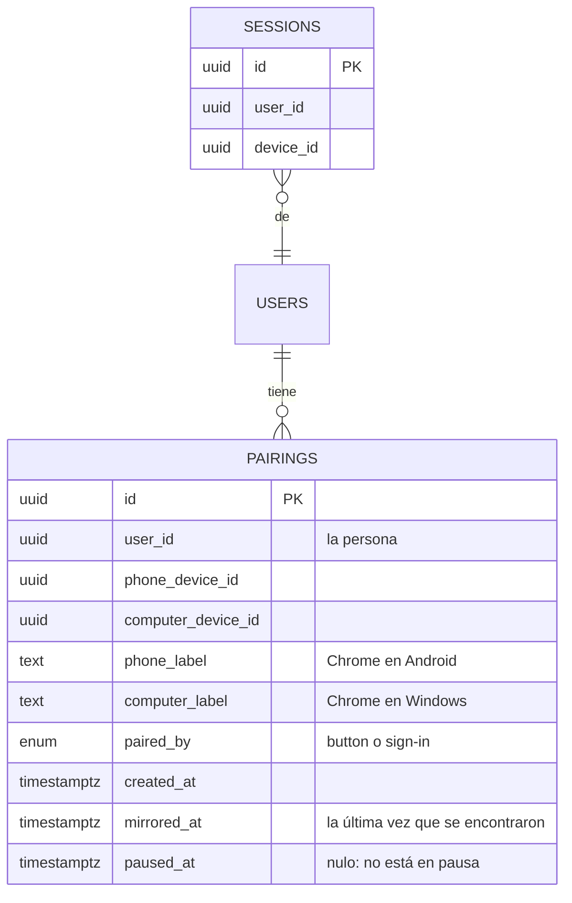

| Columna | Para qué |
|---|---|
| `id` | UUID v7 |
| `user_id`, `phone_device_id`, `computer_device_id` | De quién y qué dispositivos, los de **sus sesiones**. El vínculo es de la persona y los dos dispositivos, no de las sesiones (R2.1): otra persona en el mismo dispositivo no lo ve (E11) |
| `phone_label`, `computer_label` | El nombre de cada uno, el de su sesión al vincular (lista cerrada del servidor) |
| `paired_by` | `button` o `sign-in`, para la auditoría (R8.1) |
| `created_at` | «Desde cuándo» (R4.2) |
| `mirrored_at` | La última vez que el servidor los presentó o les reenvió algo: vence a los 30 días (R2.2). Una sesión dura como mucho 8 horas, así que un espejo continuo se vuelve a presentar al menos una vez por sesión. Se escribe por tandas una vez por minuto |
| `paused_at` | «Desconectado» (R5.1) |

**Índices:** único sobre `(user_id, phone_device_id)` y único sobre `(user_id, computer_device_id)`: el
uno con uno de R1.1 por persona, y la búsqueda del vínculo de una sesión. **Sin índice sobre
`mirrored_at`:** lo lee una vez por día un trabajo sobre una tabla de, a lo sumo, unos cientos de filas.

**En memoria** (`members.ts`, con `createGuardedMemory`): el vínculo de cada (persona, dispositivo),
**también «ninguno»**, para que `/api/start` de un dispositivo sin vínculo no consulte la base; la
sesión abierta de cada lado (la pone al día `sessions.onEnded`); la huella DTLS que registró cada lado
en la última presentación. Además, en memoria y de corta vida: los códigos de vincular (60 s, un uso)
y los boletos de reemplazar (2 minutos, un uso).

## 10. API

Todo con sesión, con los contratos de `src/shared/contracts/device-link.ts` y los pasos comunes de
`platform/guards.ts`. **La persona y el dispositivo salen siempre de la sesión** (`session.userId`,
`session.deviceId`; celular o computadora, de la sesión), nunca de `X-Device-Id`: el vínculo, `members`,
las claves de los límites y `recordOnce` (revisión de seguridad, 4).

### 10.1. Lo que suma a `/api/start` y a la cabecera

- `/api/start`, con sesión y vínculo: `pairing` (unos 180 bytes), `{ id, side, other: { label }, since,
  lastMirrored, paused }` en `parts.pairing`, por `start.contribute`; sin vínculo, `null`. Sin sesión,
  nunca. `start` es código común (`platform/start-parts.ts`): cada módulo suma su parte con un nombre
  y `/api/start` no conoce a ninguno. En la aplicación, `platform/server/start-parts.ts` guarda las
  partes del último `/api/start`, y el vínculo toma de ahí su estado al abrir, sin un pedido más;
  después de entrar, o al volver la pestaña, pregunta con `check`.
- Cada respuesta con sesión y vínculo: `l=` en `X-Ferrebress` (§ 3.5).

### 10.2. Las rutas

| Ruta | Qué hace | Recibe | Devuelve | Errores |
|---|---|---|---|---|
| `GET /api/device-link/check` | El vínculo de ahora y si el otro lado de esta conexión sigue en regla (§ 7) | `?fp=` (opcional) | `{ pairing?, peer?: 'ok'│'gone' }` | — |
| `POST /api/device-link/codes/read` | El celular leyó un código de vincular | `{ code }` | `{ ticket, replaces?: { phone?: label, computer?: true } }` o `{ pairing }` | `code-expired`, `code-used`, `other-account` (E37), `not-a-phone` |
| `POST /api/device-link/codes/accept` | El celular aceptó reemplazar (R1.4) | `{ ticket }` | `{ pairing }` | `code-expired` |
| `POST /api/device-link/unpair` | Desvincular (R5.3) | `{}` | `{ ok }` | `not-paired` |
| `POST /api/device-link/pause` · `/resume` | Desconectar y reconectar (R5.1, R5.2) | `{}` | `{ ok }` | `not-paired` |
| `POST /api/device-link/signal` | Pasarle al otro la oferta o la respuesta | `{ attempt, kind: 'offer'│'answer', sdp }` (≤ 8 KB) | `{ ok }` | `not-paired` (E38), `peer-absent` |
| `POST /api/device-link/relay` | Pasarle al otro mensajes | `{ messages: Json[] }` (≤ 64 KB) | `{ ok }` | `not-paired`, `peer-gone`, `too-many-attempts` |
| `POST /api/device-link/report` | Por qué no se logró el directo (§ 15) | `{ attempt, outcome, ice }`, cerrado | `{ ok }` | `bad-request` |

- **«Ser del vínculo»** (E38, E39) se mira en cada ruta con `members.ts`, y el tema compara el `<id>` del
  parámetro con el de la sesión: tener otro vínculo no alcanza.
- **`report`**, con un contrato cerrado: `attempt` de 8 hexadecimales; `outcome` de una lista
  (`direct-failed`, `probe-failed`, `lost`); `ice` con `host`, `mdns` y `pairs` enteros de 0 a 50 y `state`
  de la lista de estados de ICE. Lo que no cumple da 400 y no escribe. El navegador y el sistema de cada
  uno los pone el servidor con `deviceCodes` de las dos sesiones. Solo desde un vínculo.
- **Los límites**, por sesión: leer un código, 10 por minuto; `signal`, 30 por minuto; `relay`, 600
  mensajes y 1 MB por minuto; `check`, 60 por minuto; `report`, 10 por hora.
- **Un reenvío que falla no vuelca el cuerpo** al registro: el `onError` de `http.ts` anota el error sin
  el cuerpo (una prueba lo comprueba).

### 10.3. Vincular con el botón (R1.3, R1.4)

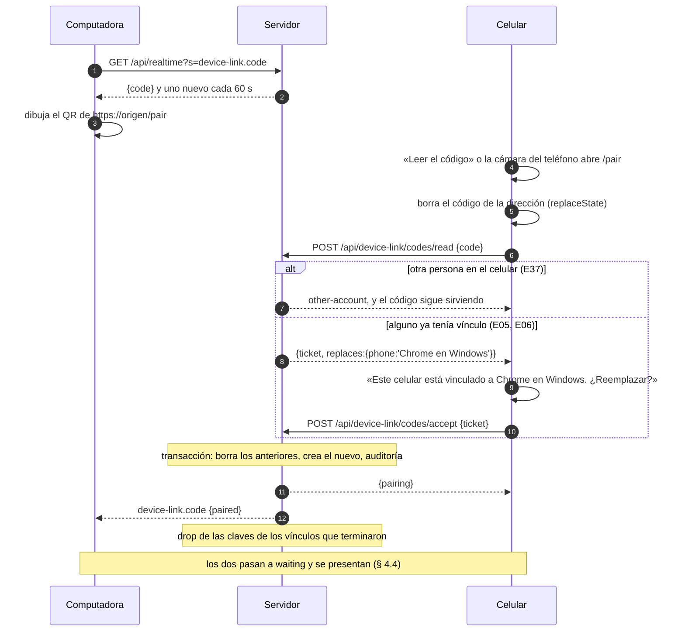

- **Antes de gastar el código** se miran la persona y el tipo de dispositivo: `other-account` y
  `not-a-phone` no lo gastan, así nadie bloquea a otro apuntándole con su celular (revisión de seguridad,
  5). `other-account` queda en la auditoría con la persona dueña del código («Beto leyó el código de la
  computadora de Ana»). Se vuelve a mirar que la sesión dueña del código siga abierta.
- **Leer lo gasta** cuando sí es de la misma persona (E04), aunque se cancele el reemplazo.
- **El boleto de reemplazar** guarda la sesión del celular, la de la computadora y los vínculos que iba a
  reemplazar; `accept` lo cambia solo con esa sesión del celular, con las dos sesiones abiertas y los
  mismos vínculos. Dura 2 minutos y sirve una vez; cancelar no cambia nada (E05).
- **Sin sesión**, la aplicación lleva a la entrada y no vincula (E40). **Con una entrada sin conexión que
  el servidor todavía no confirmó** (E36), dice «Para vincular hace falta internet. Probá cuando vuelva
  la conexión.» y no lee el código.
- **La dirección es `/pair#<código>`**, distinta de la de entrar (`/link#…`); `App.tsx` atiende las dos.
  Si «Leer el código» del indicador lee un `/link#`, o «Escanear» de la entrada lee un `/pair#`, cada uno
  dice que no es su código («Este no es un código para vincular» / el aviso de código vencido de la
  entrada) y no hace nada.
- **Los códigos:** `rotating-codes` hace lo común (128 bits, renovar cada 60 s mientras alguien escucha,
  vale solo el último, un uso, `hold` para no renovar mientras está reservado y `release` para volver).
  La reserva de la entrada (su secreto, el desafío de la huella, «No soy yo») sigue en `sign-in`.

### 10.4. Vincular al entrar con el celular (R1.5)

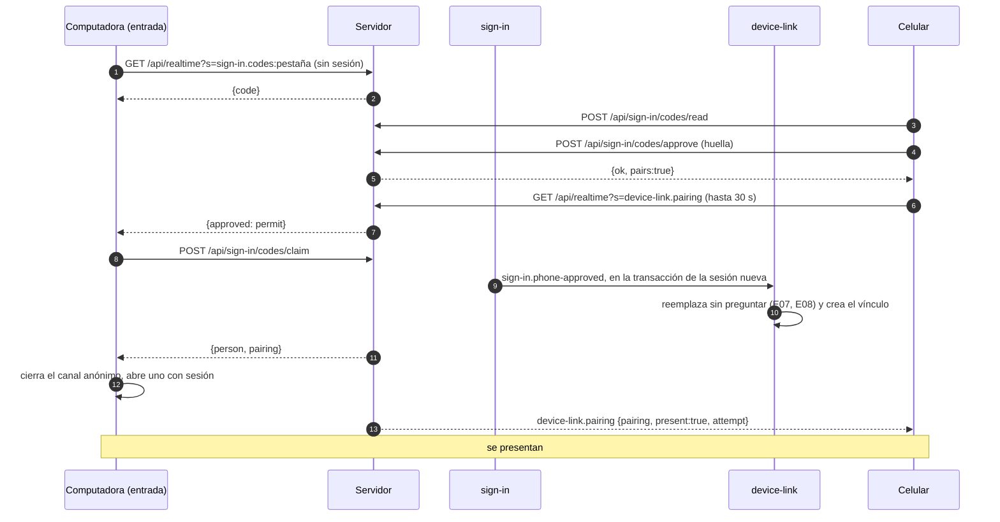

- La respuesta de `approve` dice `pairs: true` y el celular escucha el tema del vínculo hasta que la
  computadora entra o pasan los 30 s del permiso. Si no llega, `l=` en su próximo pedido hace lo mismo.
- Tras un reemplazo al entrar, el celular muestra una vez «Ahora este celular está vinculado a Chrome en
  Windows», con «Desvincular» (R1.5).

## 11. Eventos y auditoría

### 11.1. Lo que escucha (sin que los otros módulos conozcan a `device-link`)

| Evento | De | Lleva | Qué hace device-link | Motivo |
|---|---|---|---|---|
| `sign-in.phone-approved` (nuevo) | sign-in (`codes/`), al cambiar el permiso por la sesión, en su transacción | persona, celular, computadora, sus nombres | Crea el vínculo, reemplazando sin preguntar (R1.5) | — (`paired` con `how:'sign-in'`) |
| `sessions.revoked` (nuevo) | sign-in (`access/`), al cerrar desde Usuarios una o todas; cerrar pasa a `events.transaction` | persona y **los dispositivos** de las sesiones cerradas (`closeSessions` los devuelve) | Termina los vínculos de esa persona en esos dispositivos (E14) | `session-revoked` |
| `passkey.removed` (nuevo) | sign-in (`access/`), al quitar la huella o cortar | persona, celular, `cause: 'removed'│'cut'` | Termina los vínculos de esa persona en ese celular (E15) | `passkey-removed` o `phone-cut` |
| `user.deactivated` (existe) | users | persona | Termina todos sus vínculos (E16) | `deactivated` |
| `sessions.onEnded` (plataforma) | sign-in | sesión, motivo | Pone al día `members.ts` (qué sesión tiene cada lado); no termina el vínculo | — |

Salir o que la sesión venza no terminan el vínculo: queda dormido (R2.1, E17). Los fines están en una
tabla, `rules/ends.ts`, con una fila por evento: qué vínculos toca y con qué motivo. Después de
confirmar, `device-link` llama a `hub.drop` de las claves de esos vínculos y pone al día `members.ts`;
la huella `l=` cambia en la próxima respuesta de cada dispositivo.

### 11.2. Lo que anota (R8)

En `src/shared/audit-log/device-link.ts`. Quién: la persona; a qué: los dos dispositivos, en códigos.

| Evento | Cuándo | Lleva |
|---|---|---|
| `device-link.paired` | Se vincularon | `how: 'button'│'sign-in'`, los dos dispositivos |
| `device-link.replaced` | Un vínculo nuevo terminó otro | Los dispositivos del que terminó; con `how:'sign-in'`, la dirección de las dos computadoras |
| `device-link.unpaired` | Se desvinculó | Desde cuál |
| `device-link.ended` | Terminó solo | `reason: 'expired'│'session-revoked'│'passkey-removed'│'phone-cut'│'deactivated'` |
| `device-link.rejected` | Un código de otra cuenta (con la dueña del código como «a quién»), un pedido de quien no es del vínculo, una escritura con un vínculo terminado (`pairing-ended`) | El motivo; una fila por ventana y por sesión |

No se anotan el espejo, la pausa, reconectar ni los cambios entre directo y por el servidor (R8.2, E42).

## 12. Conexiones

| Forma | Qué usa device-link | Cuándo |
|---|---|---|
| `request` | Las rutas de § 10, y `check` | Al tocar algo; `check`, con uso y la confirmación vencida |
| `piggyback` | `l=` en `X-Ferrebress` y `pairing` en `/api/start` | Al abrir y en cada respuesta |
| `temporary` | `device-link.code` y `device-link.pairing` | Con el código a la vista, al presentarse, por el servidor, y en la computadora a la vista mientras espera |
| `peer` | `platform/peer`, directo y por el servidor | Vinculados, conectados y los dos a la vista |

**Sin conexión** (capítulo 15): el vínculo no se guarda para trabajar sin conexión. El espejo directo
sigue sin internet (R3.4, E20) con la última confirmación (§ 7.1).

## 13. Pantallas

Desde la maqueta aprobada, `docs/design/mockups/device-link-indicator/final/` (`changes.md` dice cada
pieza). Las clases pasan al CSS con el nombre de la pieza; los tokens, de `styles/`.

| Pieza | Dónde | Qué hace |
|---|---|---|
| `screens/PairingIndicator/` | El lateral de la computadora; en el celular, debajo del título, en el lugar de la luz | El punto y el texto del estado (§ 8.1); Alt L abre el detalle. Viene en el arranque (unos 2 KB) |
| `screens/Detail/` | Flota al lado del lateral; en el celular, una hoja | La frase del estado (o «No se pudo»), la ruta con la latencia, la tira, los datos y los botones de R4.2 (Alt D, R, P, V, X, C) |
| `screens/Code/` | Solo la computadora | El QR de `/pair#…`; Alt O vuelve. Dibuja con `platform/camera/qr-draw.ts` |
| `screens/Replace/` | Solo el celular | «Este celular está vinculado a Chrome en Windows. ¿Reemplazar?» (R1.4) |
| `screens/Confirm/` | Diálogo en la computadora, hoja en el celular | Desvincular (Alt C, Alt X) |
| `screens/Notices/` | Solo el celular | «Este código es de otra cuenta», «Este código venció», «Para vincular hace falta internet…» (E36) y las tostadas de la maqueta («Vinculados: fuiste a la pantalla de la compu», «Desconectados…», «Ahora van directo por el Wi-Fi») |
| La cámara | Solo el celular | Común: el lector y el dibujo del QR en `platform/camera/` y la pantalla en `ui/camera/Camera.tsx`; la entrada y el vínculo le pasan sus textos y qué código les sirve |

- El indicador se enchufa en el marco por `App.tsx`; quitarlo es quitar esa línea. Los textos, largos y
  cortos, en `device-link/texts.ts`.
- **La tira** (R4.4): tramos `[desde, hasta, grupo]` en `localStorage`, con la clave
  `device-link.strip.<hash corto de la persona>`, así otra persona en la misma computadora no ve ni suma
  los tramos de la anterior. Menos de 1 KB, del día del negocio según la hora del servidor (00 · R8.4).
  Al ocultarse la pestaña, al salir o al entrar otra persona, el último tramo termina («Separados»):
  con la pantalla apagada no sigue contando «Directo». El resumen es un FNV-1a de 32 bits del
  identificador: separa a las personas sin nombrarlas, no es secreto.
- **El celular que se fija** y no encuentra al otro sigue escuchando 30 s antes de dejar el tema: al
  vincular o reconectar los dos se enteran casi a la vez, y sin esa espera no se encontrarían hasta
  el próximo pedido de alguno (lo encontró la prueba de punta a punta).
- **El canal común** cuenta un tema sumado como escuchado desde que lo pide: el primer evento del tema
  (el estado de ahora, por ejemplo «el otro está») llega por el canal y puede ganarle a la respuesta del
  pedido que lo sumó.
- **La prueba de punta a punta** (`tests/e2e/device-link.spec.ts`, aprobada por Carlos): vincular con
  el código, conectarse, ver la pantalla de la computadora en el celular y desvincular, con dos
  navegadores. Exige «Directo» si la máquina tiene una dirección privada; si no (un contenedor), el
  filtro las saca todas y exige «Por el servidor».
- **El QR de vincular** lleva `/pair#<código>`. La cámara del teléfono abre esa dirección: con sesión, el
  celular lee el código (E02); sin sesión, queda la entrada y no vincula (E40).
- Lo que se baja aparte (WebRTC, espejo y detalle): todo junto, enseguida después del arranque, en la
  misma pieza que el vínculo (`start.ts`). Un detalle bajado aparte desde el marco partía el arranque
  en tres archivos y costaba 2,6 KB más comprimido (gzip comprime peor cada pedazo).
- **El marco no conoce el vínculo:** recibe `link` con sus tres piezas (el indicador del lateral, el del
  título del celular y lo que abren) y las pone en su lugar. En el celular, `PhoneLight`, debajo del
  título de cada pantalla, le pasa al indicador la luz de conexión: el indicador la pone a su lado sin
  conexión, o en su lugar si no tiene nada que mostrar (00 · R4.1). Mientras el vínculo se baja, el
  indicador muestra lo que dijo `/api/start`, así no aparece de golpe.
- **Un componente o una función no va suelto en un store:** `useStore` lo pasa a `useState`, que lo toma
  por el inicializador. `linkOver` y `linkStrip` lo llevan adentro de un objeto.

## 14. Cómo se suma algo nuevo sin tocar lo que existe, y qué lo hace robusto

### 14.1. Los puntos de extensión

| Qué se suma | Cómo | Qué no se toca |
|---|---|---|
| **Un tema del canal** (T118, la foto del celular de la etapa b) | `realtime.topic({ name, param, event, authorize, onSubscribe })`, `publish(clave, datos)` y `useTopic` en la pantalla; el contrato, en `src/shared/contracts/<módulo>.ts` | El hub, el canal, los otros temas |
| **Un campo en la cabecera** | `header.contribute(letra, …)` en el servidor y `onField(letra, …)` en la aplicación | `http.ts`, `api.ts` |
| **Lo que se espeja de una pantalla nueva** | `useMirrored(clave, inicial, esquema)` y `useMirroredQuery(…, { mode })` | El espejo y `device-link` |
| **Un motivo de fin del vínculo** | El módulo que lo causa publica su evento; `device-link` suma una fila en `rules/ends.ts` y el texto en el catálogo | Los otros fines, el módulo que publica |
| **Un mensaje del protocolo del vínculo** | Su forma en la unión del contrato y su manejador en el mapa `handlers` de `runtime.ts` | El despachador; un dispositivo con la versión anterior lo ignora |
| **Lo que va en `/api/start`** | `start.contribute(nombre, …)` y la interfaz `StartExtras` | `sign-in` |
| **Una forma de transporte** | No es un punto de extensión: sería una regla nueva (R4.1 nombra cada uno). La interfaz `Transport` sirve para probar con uno de mentira | — |

Ejemplo, T118 entero del lado del canal:

```ts
// server: modules/audit-log/realtime.ts
realtime.topic({
  name: 'audit-log.new',
  param: z.string().check(z.maxLength(40)),
  event: z.object({ count: z.number() }),
  authorize: async (c) => (await can(c, 'audit.view')) ? { key: 'all' } : { refused: 'forbidden' },
  onSubscribe: async (_key, send, lastId) => send({ count: await countSince(lastId) }),
  recheckOn: ['users.permissions-changed'],
});
// al escribir una tanda en la auditoría: realtime.publish('audit-log.new:all', { count: n })
// app: modules/audit-log/state.ts
useTopic('audit-log.new', page.latestId, ({ count }) => setNew(count));
```

### 14.2. Qué lo hace robusto

- **Contratos con versión.** Todo lo que cruza un borde tiene su forma en `src/shared/contracts/` (lo que
  ve el servidor) o en su módulo de la aplicación (lo que solo ven los dos dispositivos), validada con
  `zod/mini`. El protocolo del vínculo lleva `v` (hoy 1): los mensajes nuevos se suman sin subirla y quien
  no conoce un tipo lo ignora (`unknown-message`); con `v` o `app` distintas, no espejan.
- **Validar en los bordes, una sola vez:** cada evento SSE con el esquema de su tema, cada mensaje del
  vínculo con `wire.ts`, cada valor espejado con el esquema de su clave, la dirección contra las del menú.
  Lo que no valida se descarta y se anota, nunca tira hacia la pantalla.
- **Estados imposibles que el tipo no deja escribir** (§ 8.1) y `switch` exhaustivos con `assertNever`.
- **Idempotencia:** cada tema manda su estado al suscribirse; los parches con reloj de Lamport dan lo
  mismo repetidos o desordenados, y la foto es un parche más; `close()`, `unsubscribe` y `drop` se pueden
  repetir; terminar un vínculo que no existe no es un error; códigos y boletos sirven una vez; un evento de
  otro `attempt` se ignora.
- **Un solo lugar decide cada cosa:** la máquina decide, `runtime.ts` ejecuta; el servidor decide si hay
  vínculo y si el otro sigue en regla; la computadora decide que el directo falló; la pestaña con el
  candado es la única que se suscribe; `device-link` decide quién manda en el espejo.
- **Los tiempos, con nombre en `settings.ts`:** 40 s de latido, 55 s para dar por cortado, 5 s para el
  directo, 3 s de espera de una respuesta, 4 minutos de confirmación (30 s antes de una foto), 5 minutos
  de directo dormido, 50 y 150 ms de juntar, 60 s de código, 2 minutos de boleto, 30 días de vencimiento.
- **Pruebas** (§ 20): la máquina entera con una tabla; la simulación de los dos con una red que pierde,
  repite, demora y desordena; el contrato con mensajes mal formados; una prueba por cada riesgo de la
  revisión de seguridad.

### 14.3. Los patrones, y por qué

| Patrón | Dónde | Por qué |
|---|---|---|
| **Fachada** | `device-link/index.ts`; `realtime`, `peer` y `mirror` exponen pocas funciones | Lo único que ven los demás; quitar el módulo es quitar su registro |
| **Estrategia** | `Transport` (directo, por el servidor); `QueryMode` (`forward`, `refetch`) | Variantes de lo mismo que se eligen en marcha; sin esto, cada pantalla tendría un `if` por transporte |
| **Máquina de estados** | `device-link/state.ts` | El vínculo es un proceso con pasos; los errores difíciles salen de transiciones no pensadas, y una función pura con tabla las hace visibles y probables |
| **Comando** | Los comandos de la máquina | Separan decidir de ejecutar: la máquina se prueba sin navegador y el diario guarda qué se mandó hacer |
| **Eventos dentro del proceso** | `sign-in` y `users` publican; `device-link` escucha | El vínculo termina o nace sin que esos módulos lo conozcan (ADR-003) |
| **Registro de temas** (ADR-017) | `realtime.topic()`, `header.contribute`, `start.contribute` | Abierto/cerrado: sumar un tema o un campo no toca el hub ni la cabecera |
| **Registro LWW** (ADR-017) | Cada valor con nombre | Dos dispositivos que escriben a la vez terminan iguales sin coordinarse |

## 15. Diagnosticar un error que no se puede reproducir

### 15.1. El diario de la conexión, en cada dispositivo

- **Qué anota:** cada evento que entra a la máquina, con sus datos, el estado al que pasó y los comandos;
  cada mensaje descartado (`unknown-message`, `invalid`, `too-large`, `ignored`) y cada espera vencida
  (`query-timeout`, `ice-timeout`, `confirm-timeout`). Una entrada:
  `{ t: 51234, e: 'peerGone', w: 'lost', s: 'waiting', k: 'direct', a: 'a1b2c3d4', ice: 'disconnected' }`.
- **Sin datos personales ni del negocio:** ni nombres, ni correos, ni identificadores de personas o de
  vínculos (el vínculo va como «el actual» o «otro»), ni valores. De una clave se guarda hasta el primer
  `:` (`q:users.card.person`, nunca el id de la persona). `t` es tiempo de cronómetro.
- **Cuánto ocupa:** las últimas 300 entradas, unos 100 bytes cada una: **unos 30 KB** en `localStorage`
  (`device-link.journal`). Se junta en memoria y se escribe al ocultarse la pestaña y cada 10 s si cambió,
  así escribir no compite con los 50 ms de R6.5. Sobrevive a recargar.
- **Se puede volver a correr:** como guarda los eventos con sus datos y los estados no tienen objetos
  vivos, `tools/device-link/replay.ts` pasa un diario por `step` y muestra cada estado; con los diarios de
  los dos lado a lado por su `attempt`, el error se ve en la computadora de quien lo arregla.

### 15.2. Cómo llega a quien lo arregla

- **Con «Algo salió mal»** (00 · R9): el aviso suma el diario de ese dispositivo, como suma los últimos
  pasos (tarea de `frame`, § 21).
- **Del servidor**, una línea en el registro del contenedor por cada `report`:
  `{"t":"device-link","attempt":"a1b2c3d4","outcome":"direct-failed","ice":{"host":2,"mdns":2,"pairs":0,"state":"failed"},"ua":["chrome/android","chrome/windows"]}`,
  unos 200 bytes, con lo que puso el servidor (`ua`) y números de una lista; sin personas, direcciones ni
  descripciones. Unas 20 por día, dentro de los registros que ya rotan (3 × 10 MB).
- No se manda el diario solo ni va a la auditoría (R8.2).

## 16. Seguridad

- **Datos que toca:** qué persona vinculó qué dispositivos, desde cuándo y cuándo se usaron juntos. Por el
  directo pasa lo que está en pantalla, cifrado con DTLS entre los dos. Por el servidor pasan los parches,
  cifrados con HTTPS, que el servidor reenvía en memoria sin guardarlos ni anotarlos.
- **Quién puede hacer cada cosa:** vincular, solo la misma persona en un celular y una computadora (R1.1,
  E37), sin permiso (R1.2). Presentar, reenviar, pausar, reconectar, desvincular y escuchar el tema, solo
  los dos lados de **ese** vínculo mientras exista (E38, E39), con persona y dispositivo de la sesión.
  Escuchar el código, solo la computadora de esa sesión.
- **El directo, aunque el servidor no lo vea** (§ 7): nada se manda ni se aplica sin una confirmación del
  servidor de hace menos de 4 minutos, atada a la huella DTLS que registró la sesión del otro al
  presentarse; antes de una foto, de menos de 30 s. Las escrituras llevan su vínculo y el servidor las
  rechaza si terminó (`409 pairing-ended`). Lo que pidió el celular no viaja a la computadora. El cierre
  de la sesión propia corta todo antes que nada (`sessionLost`), y otra persona en la misma pestaña no
  recibe nada de la anterior ni le manda nada a su celular (E11).
- **Qué entra de afuera y cómo se valida:**
  - El código: 128 bits, un uso, 60 s, solo la misma persona, con límite por sesión; después del `#`.
    Una lectura de otra cuenta no lo gasta.
  - El boleto de reemplazar, atado a las dos sesiones y a los vínculos que reemplaza.
  - La descripción de WebRTC: tamaño, un solo canal de datos, candidatos solo locales (§ 4.2). Lleva la
    huella DTLS y viaja por HTTPS con sesión: otro equipo del Wi-Fi no puede meterse en el medio.
  - Cada mensaje entre los dos: el sobre de `wire.ts`, 64 KB como mucho, y cada valor con el esquema de su
    clave; la dirección, contra las del menú; la bandeja, con tope. Un valor nunca se usa como HTML
    (Preact escapa todo y `pnpm check` prohíbe `dangerouslySetInnerHTML`), y la política de contenido
    (`script-src 'self'`) frena un `javascript:`.
  - Lo que manda `report`: contrato cerrado (§ 10.2).
  - El canal: cada tema dice quién puede, el dueño se fija al abrir, el identificador del canal sirve
    solo con ese dueño.
- **El diario y la tira** no guardan identificadores de personas, y la tira es de cada persona (§ 13,
  § 15).
- **Abuso:** topes del canal por sesión, anónimos con tope aparte, IPv6 por `/64` (§ 3.3); el oyente
  lento se cierra; el reenvío no guarda nada.
- **Secretos:** ninguno nuevo. Ningún servicio externo: sin STUN ni TURN, ninguna dirección sale a nadie.
- **Auditoría:** § 11.2.
- **Lo que se acepta** (lo decidió Carlos): un dispositivo cortado puede ver hasta 4 minutos de
  uso, y sin internet en el otro, hasta que vuelva; el espejo mantiene viva la sesión de los dos mientras
  se use, así que una computadora desatendida no vence mientras se use el celular (y viceversa); el
  reemplazo al entrar con el celular (R1.5) agranda un engaño en la entrada, que el aviso de § 10.4 hace
  visible.
- **Con varias copias del servidor:** el hub, `members.ts`, los códigos, los boletos y `mirrored_at` en
  memoria pasan a PostgreSQL (`LISTEN/NOTIFY` y una tabla chica). Un aviso de `NOTIFY` lleva como mucho
  8.000 bytes: el reenvío de hasta 64 KB necesita que los dos lados de un vínculo caigan en la misma copia
  o una tabla de paso. Hoy no hace falta.

## 17. Lo que no se tomó de las revisiones, y por qué

- **Un buzón de señales general** (diseño 3.2): no hay hoy otro tema que lo necesite; la huella `l=`
  alcanza y sobrevive a un reinicio.
- **Una lista de transportes intercambiables** (diseño 3.1): se sacó; un transporte nuevo es una regla.
- **Que el servidor cuente los pedidos de la computadora como uso del celular** (diseño 1.1, opción a):
  la confirmación ya es un pedido del celular y no cambia ADR-015.
- **Un pedido mínimo del celular cada tanto** (diseño 1.1, opción b): la confirmación sale solo con uso;
  sin uso, que venza es lo correcto.
- **Un estado aparte «por confirmar»** (seguridad 1.1): la retención del espejo (`hold`) hace lo mismo sin
  sumar estados a la máquina.
- **Que el espejo no cuente como uso de la computadora** (seguridad 14): «son una sola aplicación en dos
  pantallas»; Carlos aceptó el riesgo (R2.5).

## 18. Metas de performance

### 18.1. Bytes

Medidos en el cable: con TCP y TLS cada paquete suma unos 60 a 90 bytes, y una conexión segura nueva
(después de unos 5 minutos sin pedidos) unos 4 a 5 KB.

| Qué | Por vez | Por hora | Quién lo paga |
|---|---|---|---|
| «Directo», espejando | 60 a 120 bytes por parche; una respuesta reenviada, lo que pese sin comprimir | **0 bytes de internet** | Solo el Wi-Fi |
| «Directo», sin tocar nada | ICE, unos 100 bytes cada pocos segundos | **0 bytes de internet** (E24) | Solo el Wi-Fi |
| La confirmación (§ 7) | Unos 700 bytes (pedido, respuesta con cabeceras, TCP y TLS); +4 a 5 KB si la conexión se había cerrado | Con uso continuo, 15: **unos 10 KB** | Cada uno, solo con uso |
| Presentarse | Unos 4 KB entre los dos; el celular que vuelve después de unos minutos suma su conexión segura: **unos 7 KB en el celular** | — | Una vez por encuentro |
| Volver con el directo dormido (menos de 5 minutos) | **0 bytes**: no se presentan | — | — |
| Canal abierto (esperando, por el servidor, código a la vista) | Latido, unos 90 bytes de bajada y su aviso de subida | **unos 8 KB de bajada y 5 KB de subida** | Quien tiene el canal; esperando, es costo puro |
| «Por el servidor», cada cambio | Unos 750 bytes entre los dos (POST, su respuesta, el evento de vuelta, TCP y TLS); lo escrito, junto cada 150 ms | Un toque cada 5 s: **unos 540 KB entre los dos**, más el latido | Los dos |
| «Por el servidor», lo que trae el servidor | Cada uno lo baja comprimido: lo mismo que sin espejo | — | Cada uno |
| `/api/start` con vínculo | 180 bytes más | — | Al abrir |
| `l=` en la cabecera | Unos 12 bytes por respuesta, con vínculo | — | — |
| `check` después de un `l=` nuevo | Unos 700 bytes | — | Cuando cambia el vínculo |
| Código de vincular a la vista | 60 bytes por código, 1 por minuto | 3,6 KB más el latido | La computadora |
| El arranque | El indicador y el estado: **unos 2 KB**, dentro del tope de 64 KB; el resto, unos 12 KB, con vínculo o al abrir el detalle | — | Una vez por versión |

**Un día típico en el celular** (supuestos: 8 horas abiertos, 6 de uso en espejo; el celular apaga la
pantalla 40 veces, 30 por menos de 5 minutos):

| Qué | Directo | Por el servidor |
|---|---|---|
| Presentarse: 10 veces × 7 KB (las 30 cortas, 0) | 70 KB | 70 KB |
| Confirmaciones: 6 h × 10 KB | 60 KB | — (las hace el servidor en cada reenvío) |
| Reenvío: 6 h × 270 KB (su mitad) | — | 1,6 MB |
| Latido: 6 h × 13 KB | — | 78 KB |
| `/api/start`, `l=`, avisos | menos de 5 KB | menos de 5 KB |
| **Total** | **unos 135 KB** | **unos 1,75 MB** |

La computadora suma, en el caso común, unos 13 KB por hora mientras espera al celular, por el Wi-Fi.

### 18.2. En `mobile-data.md` (aprobado por Carlos)

Presentarse; el canal y su latido mientras «Por el servidor», con el código a la vista y en la
computadora que espera; el reenvío; la confirmación con uso; el `check` después de un `l=` nuevo;
`/api/start` con vínculo; el aviso de una falla del directo (unos 400 bytes, una vez por falla); y el
reintento de § 8.5. Con los números de arriba, ya en `mobile-data.md`.

### 18.3. Tiempos

- **Lo que se toca en uno, visto en el otro por el directo (R6.5, E34): menos de 50 ms.** Presupuesto: armar
  y mandar el parche, 1 ms; el Wi-Fi, menos de 10 ms; validar y aplicar, menos de 5 ms; dibujar en la
  notebook vieja, menos de 30 ms. La confirmación no suma: se pide antes de que venza solo cuando hay uso,
  y mientras dura, los parches se retienen (lo que se ve es la espera común, 00 · R7, si pasa de 300 ms).
- Presentarse por el Wi-Fi: menos de 1 s; si en 5 s no hay directo, por el servidor.
- Notar que el otro se fue: al instante si se ocultó (`bye`); en menos de 10 s si se apagó (ICE); un canal
  cortado, en menos de 55 s (R7.2).

**Medido en el local** (la prueba de campo, `tests/field/peer/`, con la notebook en Chrome 156 sobre
Windows y el celular Android, los dos en el Wi-Fi del local):

- **El directo anda** en ese Wi-Fi: sin STUN ni TURN, con candidatos `host` mDNS (`.local`). La
  computadora dio dos (dos interfaces). El par elegido fue `host`/`prflx` (el otro aprendido por sus
  comprobaciones), como se espera con mDNS.
- **Juntar los candidatos:** el navegador avisó que terminó a los 146 ms. En Chromium sin pantalla, en
  cambio, no avisa nunca: `direct.ts` sigue también a los 300 ms sin candidatos nuevos, con un tope de 1 s.
- **Abrir:** ICE pasó a `connected` 40 ms después de aplicar la respuesta, y el canal abrió 50 ms después.
- **Ida y vuelta de un mensaje chico** (100 seguidos): p50 8,3 ms, p95 27,5 ms, máximo 101,8 ms. De ida
  sola, la mitad: unos 4 ms de mediana y 14 ms en el p95, dentro de los 10 ms del presupuesto de Wi-Fi en
  la mediana. El máximo (unos 50 ms de ida) es un salto del Wi-Fi: con dibujar, ese toque puede pasar los
  50 ms de R6.5 de vez en cuando, no de forma sostenida.
- **Con permiso de cámara, Chrome expone las direcciones reales** (comprobado en la segunda corrida, con
  la notebook que ya tenía el permiso dado para la página): la oferta pasó de 2 candidatos mDNS a 18, con
  IPv4 privadas, una IPv4 que no es privada (probablemente la de Tailscale, 100.64/10), una IPv6 privada y
  cuatro IPv6 globales, cada una en UDP y en TCP; el QR pasó de 440 a 2.245 caracteres. El directo abrió
  igual, por `host` UDP, con 8,1 ms de mediana. Confirma el filtro de este apartado, que además saca los
  candidatos TCP: en el Wi-Fi del local siempre gana UDP, y los TCP solo agrandan la oferta.
- **El celular, igual:** con el permiso de cámara dio 6 candidatos (una IPv4 privada y dos IPv6 globales, en
  UDP y TCP) en vez de mDNS. Después del filtro le queda la IPv4 privada en UDP, que es la que el Wi-Fi del
  local necesita.

### 18.4. Servidor

| Pedido | Consultas | Tiempo |
|---|---|---|
| `GET /api/realtime`, `POST /subscriptions`, `publish` | 0 | menos de 5 ms |
| `check`, `signal`, `relay` | 0 (`members.ts`) | menos de 5 ms |
| `pause`, `resume` | 1 escritura por índice | menos de 10 ms |
| `/api/start` con o sin vínculo | 1 por índice la primera vez por dispositivo; después 0 | — |
| `codes/read` sin nada que reemplazar | 2 en una transacción: los vínculos de esa persona en los dos dispositivos (una consulta por los dos índices) y crear | menos de 15 ms |
| `codes/read` con algo que reemplazar | 1, en la misma transacción que no escribe | menos de 10 ms |
| `codes/accept`, vincular al entrar | 3 en una transacción: los vínculos de los dos dispositivos, borrar los que reemplaza (si son los que se aceptaron) y crear | menos de 15 ms |
| `unpair` | 1 | menos de 10 ms |
| Un fin de vínculo por evento | 1 en la transacción de quien publica | — |
| Vencidos, una vez por día y al arrancar; `mirrored_at`, una vez por minuto | 1 cada uno, en lote (`DELETE … RETURNING`; `UPDATE … FROM (VALUES …)`) | — |

Leer y escribir van en la misma transacción (`pair` con `mayReplace`): lo que se preguntó al
reemplazar es lo que se borra, sin leer dos veces. `queries.test.ts` cuenta las consultas de cada uno,
con las de abrir y cerrar la transacción. Los trabajos periódicos corren también al poco de arrancar
el servidor: se reinicia con cada subida, y un trabajo diario no correría nunca.

## 19. Sin conexión, hora y escala

- **Sin conexión:** nada se guarda para trabajar sin conexión; el directo sigue (R3.4).
- **Hora:** fechas y vencimientos con el reloj del servidor; la tira con la hora del servidor; el diario,
  los plazos y el reloj de Lamport, con el cronómetro.
- **Escala:** § 16, último punto.

## 20. Pruebas

| Escenarios | Prueba |
|---|---|
| E01, E02, E09, E22, E34, E35 | De punta a punta (`tests/e2e/device-link.spec.ts`), con dos contextos de Playwright y Caddy. Antes de escribirlas se le justifica cada una a Carlos (CLAUDE.md). En Docker los nombres `.local` pueden no resolverse: Chromium arranca con `--disable-features=WebRtcHideLocalIpsWithMdns`; para «Por el servidor», con `--force-webrtc-ip-handling-policy=disable_non_proxied_udp`. E34 medido en la máquina de pruebas no dice nada de la notebook vieja: se mide además a mano en el local |
| E03, E04, E37, E40 | Unitarias de la ruta y de `rotating-codes`, con el reloj falso |
| E05 a E08, E44 | Unitarias del servidor (reemplazar, vincular al entrar, el vínculo de cada persona) y de la hoja de reemplazar |
| E10, E11, E17, E17b, E28 | Unitarias de `/api/start` y de la máquina al salir y entrar, también otra persona en la misma pestaña |
| E12, E13 | Unitarias de `rules/expire` y del trabajo diario, con fechas fijas |
| E14 a E16 | Unitarias del servidor: cerrar desde Usuarios, quitar la huella, cortar y la baja terminan el vínculo; salir no |
| E18 a E21, E22b, E23b, E27, E29, E43 | Unitarias de la máquina (tabla de transiciones) y de la simulación |
| E23, E24 | Unitarias que cuentan pedidos y canales con el reloj falso durante una hora |
| E25, E26, E26b, E30 | Unitarias de las pantallas y de `strip.ts`, y capturas del indicador y del detalle en cada estado |
| E31 a E33c | Unitarias del espejo con dos aplicaciones en el mismo proceso y un transporte de mentira, en `forward` y en `refetch` |
| E36 | Unitaria de leer el código con una entrada sin confirmar |
| E38, E39, E39b | Unitarias del servidor: cada ruta y el tema con quien no es del vínculo, con el id de otro vínculo y con un vínculo terminado |
| E41, E42 | Unitarias de la auditoría |
| Seguridad | Una por cada fila de «Una prueba por riesgo» de la revisión de seguridad |

- **La simulación de los dos dispositivos** (`simulation.test.ts`, con `testing/chaos.ts`): dos vínculos
  enteros (máquina, espejo y `confirm.ts` cada uno) sobre el Wi-Fi y el servidor de mentira, que según una
  semilla demoran y desordenan los pedidos (el canal de datos y el tema mantienen su orden), y 20 cosas al
  azar: cambiar valores, desconectar y reconectar, ocultar y volver, cortar el Wi-Fi, aislar los equipos y
  perder internet. Después todo se arregla y los dos tienen que quedar conectados de la misma forma, con
  los mismos valores en los dos sentidos. 500 semillas en menos de 2 s, con el reloj falso; una semilla
  que falla se guarda en `fixed`. Falta que cierre sesiones y que mire que nada salió sin confirmación.
- **Los avisos de una conexión llevan su intento:** `peerGone` de un transporte que se cerró, o de un
  `bye` o un `hello` que llegaron por él, dice de qué intento es; uno de una conexión anterior no cambia
  nada (lo encontró la simulación: un aviso viejo en la fila cortaba la presentación nueva).
- **El respaldo por el servidor** manda un lote por vez (el siguiente, cuando contestó el anterior: así
  el servidor no los entrega en otro orden), cada uno con hasta 100 mensajes y 60 KB; y el espejo junta
  lo que cambia durante 150 ms, de cada clave el último (`platform/mirror/coalesce.ts`). Lo que llega por
  el respaldo antes de abrir el propio se guarda solo mientras se presentan, y se vacía al cerrar
  (revisión del código, 4.4 y 4.5). Los tamaños se miden en bytes, no en caracteres.
- **Un error pasajero del servidor no corta el directo:** `gone` es solo lo que dice el servidor del
  otro; si el pedido falla (un 429, un 500), no se pudo confirmar y vale la última buena, con el tope
  de 30 minutos (revisión del código, 4.3).
- **Nada queda vivo de un intento que ya no está:** después de cada espera (crear la conexión, la
  oferta, la respuesta) se mira que el estado siga esperando ese directo; si no, se cierra lo que se
  abrió sin avisar a la máquina (revisión del código, 4.6). El reintento sin internet es uno solo,
  para al salir de «Sin internet» o al cerrar la pestaña, y oculta (`away`) no reintenta (4.7).
- **Probar el directo que no sale:** la computadora lo anota y le manda `give-up` al celular, que deja
  de esperarlo y dice «No se pudo» (E19; revisión del código, 1.7).
- **La foto no frena la fila:** espera el saludo del otro y la confirmación de menos de 30 s por su lado y
  sale solo si sigue la misma conexión con el espejo conectado (revisión del código, 4.1 y 4.2).
- **Fuera de la cobertura** (ADR-005): `peer/rtc.ts` y el candado de `tabs.ts`.

## 21. Tareas

En orden; cada una empieza por sus pruebas. **[común]** toca el código común o `src/shared/` y se toma
como su propia tarea del plan; **[otro módulo]** toca un módulo ya cerrado sin cambiar sus reglas.

1. **La prueba de campo:** una página aparte en `tests/` que se abre en la notebook y en el celular y se
   pasa la oferta y la respuesta **por un QR** entre los dos (sin servidor): muestra si el canal de datos
   abrió, con qué candidatos (también con el permiso de cámara dado) y en cuánto. Además, que el proxy de
   la máquina hable HTTP/2 y no corte el SSE antes de 40 s. Carlos la abre en el Wi-Fi del local.
2. **Hecha.** **Los documentos que este diseño deja viejos** (Documentos del proyecto y los de otros módulos):
   - el glosario («Celular y computadora»): tema (`topic`), campo de la cabecera (`headerField`),
     presentarse (`meet`), transporte (`transport`), confirmación del vínculo (`pairingCheck`), valor con
     nombre (`mirroredStore`), foto (`snapshot`), parche (`patch`), diario de la conexión
     (`linkJournal`), tira del día (`dayStrip`); y «Acción», que deja de ser lo que se espeja;
   - `audit-log.md`, «Las acciones con nombre»: pasa a «lo que se espeja» (valores con nombre; la página
     en `refetch`, como ya decía);
   - `sign-in.md`: el canal del código como tema `sign-in.codes`, `platform/realtime`, y el renglón de
     «las acciones con nombre llegan con el módulo 03».
3. **[común]** El canal en el servidor: `platform/realtime/` (hub, temas, topes, latido, `drop`,
   `rotating-codes`), los campos de la cabecera, `platform/start.ts` y `sessions.onEnded` con todos los
   motivos. Depende de 2.
4. **[común]** El canal en la aplicación: `platform/realtime/` (`channel`, `demand`, `useTopic`,
   `piggyback` antes de devolver, el lector de SSE que valida) y `api.decorate`. Depende de 3.
5. **[otro módulo] `sign-in`:** el código de entrada como tema `sign-in.codes` sobre 3 y 4 (sale el canal
   propio), `/api/start` con `platform/start.ts`, `onEnded` también al salir, `approve` con `pairs`, y los
   eventos `sign-in.phone-approved`, `sessions.revoked` (con los dispositivos, en una transacción) y
   `passkey.removed`; el QR y la cámara pasan a `platform/camera/` **[común]**. Las pruebas de 01 que usan
   `/api/realtime/sign-in-codes` cambian de ruta porque cambia el diseño, con los mismos escenarios.
   Depende de 3 y 4.
6. **[común]** El espejo: `platform/mirror/` (valores con esquema, `auto`, `forward` y `refetch`, foto con
   reloj, bandeja con tope, `hold`, el bloqueo de POST al aplicar) y la dirección de `router.ts` (§ 5.4),
   con el control de `// local:` y de esquemas en `pnpm check`. Depende de 2.
7. **[común]** El transporte: `platform/peer/` (la interfaz, `direct.ts` con su `rtc.ts`, `relayed.ts`).
   Depende de 1 y 4.
8. **[otro módulo] Las pantallas que existen** (`frame`, `users`, `audit-log`, `manual`) pasan su estado
   visible a valores con nombre según la tabla de § 5.1; `frame` suma el diario a «Algo salió mal» y
   `App.tsx` atiende `/pair`. Sin vínculo nada cambia. Depende de 6.
9. **[común]** Los contratos: `src/shared/contracts/device-link.ts` y `src/shared/audit-log/device-link.ts`.
   Depende de 2.
10. **`device-link` del servidor:** la migración, reglas, datos, `members.ts`, las rutas con `check`, los
    temas, el paso de `X-Pairing`, lo que escucha, la auditoría, el trabajo diario y `report`. Depende de
    3, 5 y 9.
11. **`device-link` de la aplicación sin pantallas:** la máquina, `runtime`, `confirm`, `wire`, el diario
    (y `tools/device-link/replay.ts`), la tira, las pestañas, la simulación. Depende de 6, 7, 9 y 10.
12. **Las pantallas** desde la maqueta, con las capturas. Depende de 11.
13. **Las de punta a punta** (justificadas antes), `mobile-data.md` con lo aprobado (§ 18.2) y el peso del
    arranque. Depende de 5, 8 y 12.
14. **Las revisiones del código y de seguridad** (paso 7). Depende de 13.

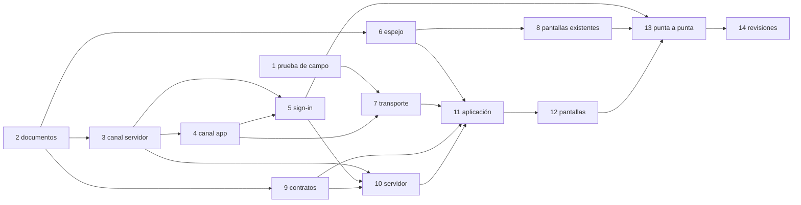

Se pueden hacer a la vez, cada una con su dueño: 3, 6 y 9; después 7, 8 y 10.

## 22. Lo que tiene que decidir Carlos

Nada: lo decidido está en § 1 y en las reglas.
